# Social Impact Platform - Architecture Diagrams & Flow Charts

This document maps the architectural boundaries, deployment topologies, and transactional flows of the Social Impact Platform using Mermaid diagrams.

---

## 1. Context Diagram (System Boundary)

The Context Diagram defines the user segments and third-party integrations interacting with the platform.

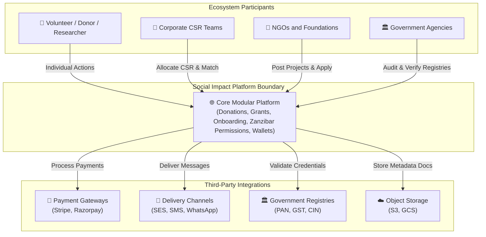

---

## 2. Container Diagram (High-Level Containers)

Details the software containers, caching layers, and database sharding boundaries.

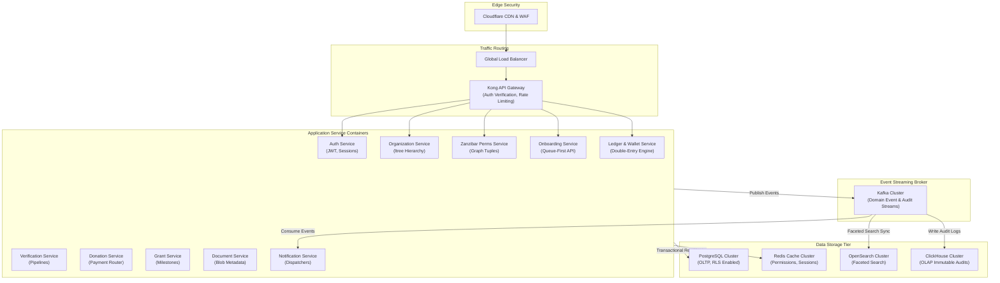

---

## 3. Component Diagram (Onboarding & Permissions Internals)

Illustrates the internal package dependencies of the Onboarding Service and its integration with the Zanzibar-inspired relation engine.

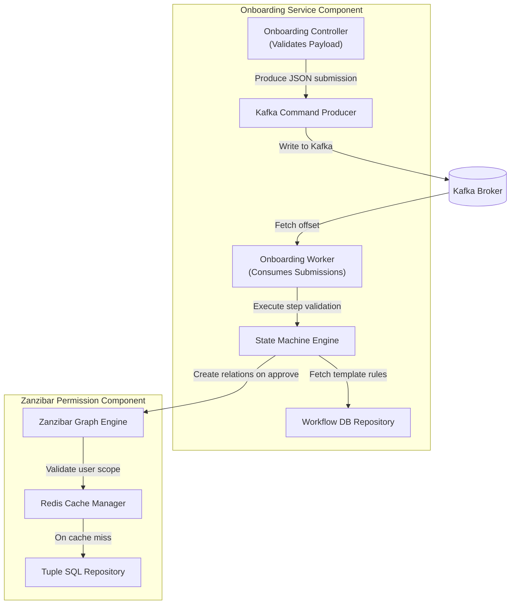

---

## 4. Deployment Diagram (Infrastructure Topology)

Visualizes physical deployment nodes distributed across Availability Zones.

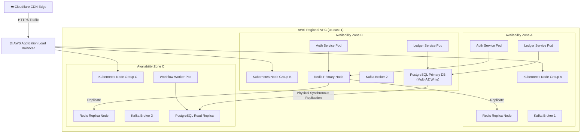

---

## 5. Tiered Data-Fetching Flow

Illustrates high-speed reads across container memory, Redis, RLS replicas, and OpenSearch.

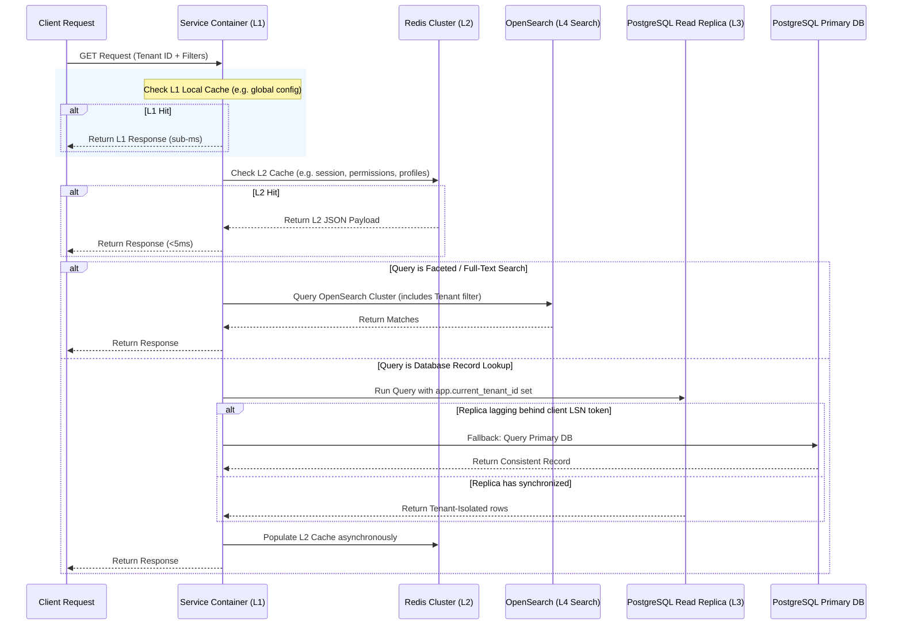

---

## 6. System Data Flow Diagram

Visualizes the lifecycle of a command execution vs. a read query evaluation.

```mermaid
graph TD
    User[👤 Client User] -->|1. HTTP Write Command| Gateway[API Gateway]
    Gateway -->|2. Put to Command Queue| Kafka[Apache Kafka]
    Kafka -->|3. Consume Async| Worker[Worker Service]
    Worker -->|4. Strict Write| PGWrite[(PostgreSQL Primary)]
    PGWrite -->|5. Trigger Emit| AuditStream[Kafka Audit Topic]
    AuditStream -->|6. Batch Ingest| ClickHouse[(ClickHouse OLAP)]

    User -->|1. HTTP Read Query| ReadGateway[API Gateway]
    ReadGateway -->|2. Check Cache| Redis[Redis Cache]
    Redis -- Cache Miss -->|3. Query Read Replica| PGRead[(PostgreSQL Replica)]
```

---

## 7. Request Lifecycle Flow

Traces how request traces are propagated through the system boundaries.

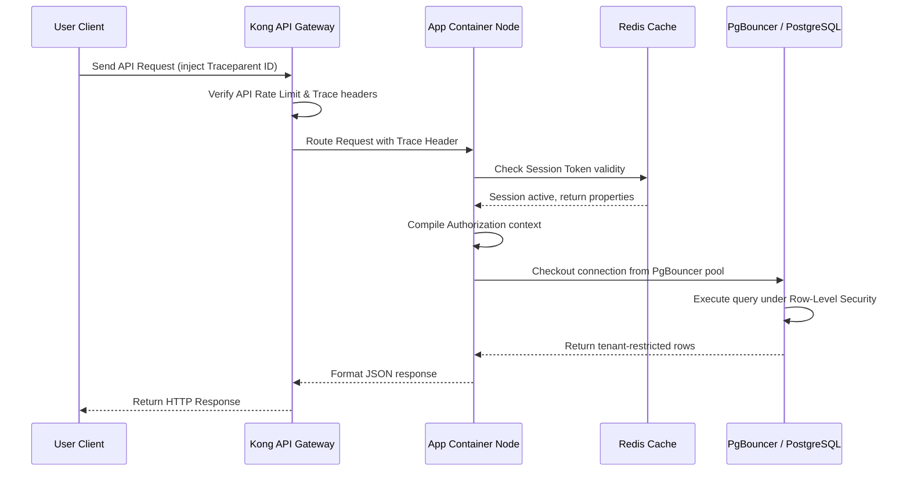

---

## 8. Authentication Flow

Details token lifecycle management.

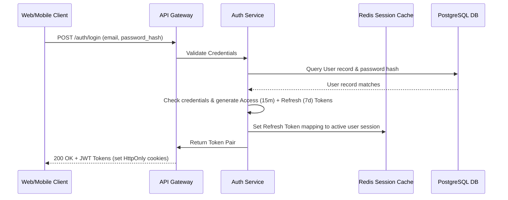

---

## 9. Onboarding Application Flow

Visualizes the queue-buffered onboarding pipeline.

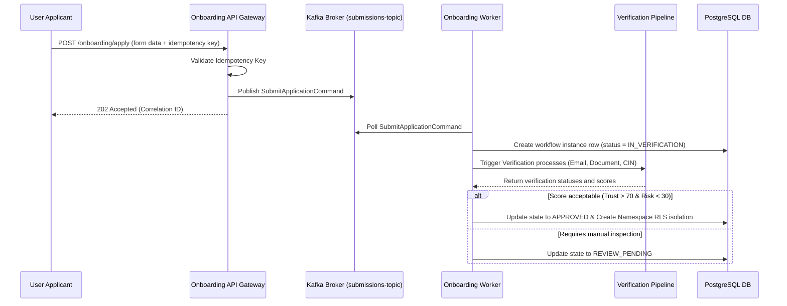

---

## 10. Double-Entry Donation Flow

Detailed accounting processing.

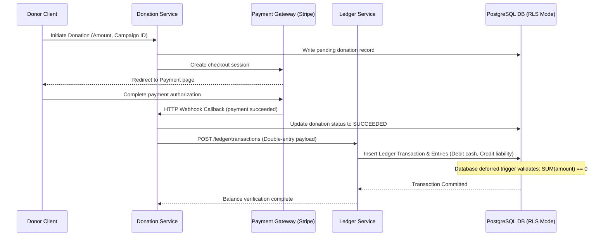

---

## 11. Grant Application & Dispersal Flow

Milestone-driven grant lifecycle.

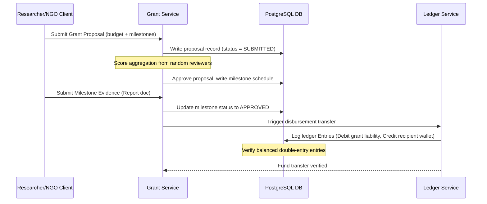

---

## 12. Hierarchy Organization Traversal Flow

Demonstrates organizational tree resolution.

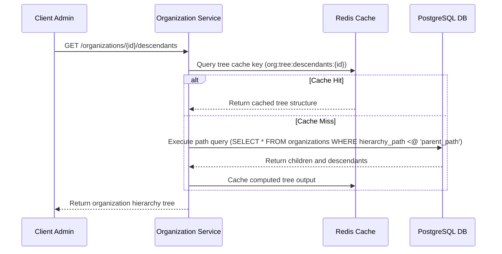

---

## 13. State Machine Workflow Execution Flow

Core steps executor.

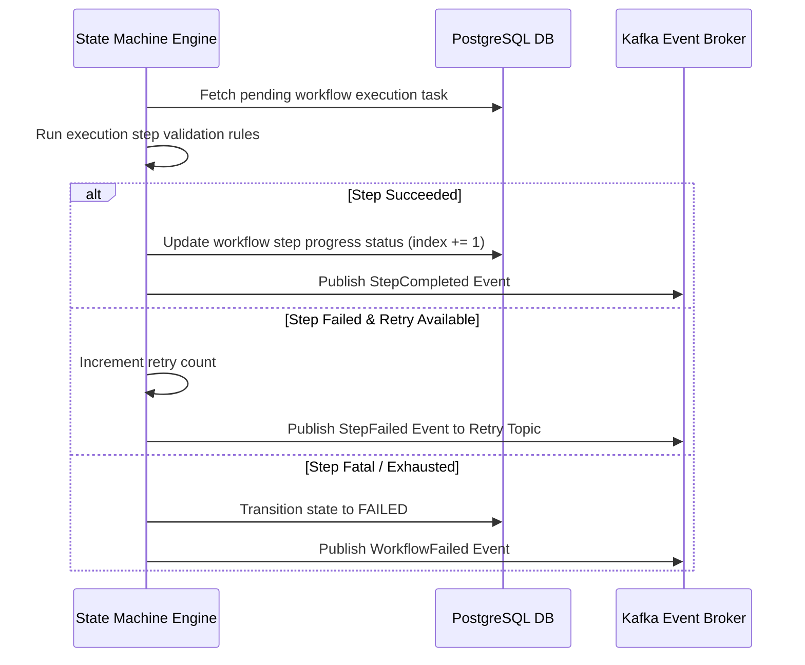
