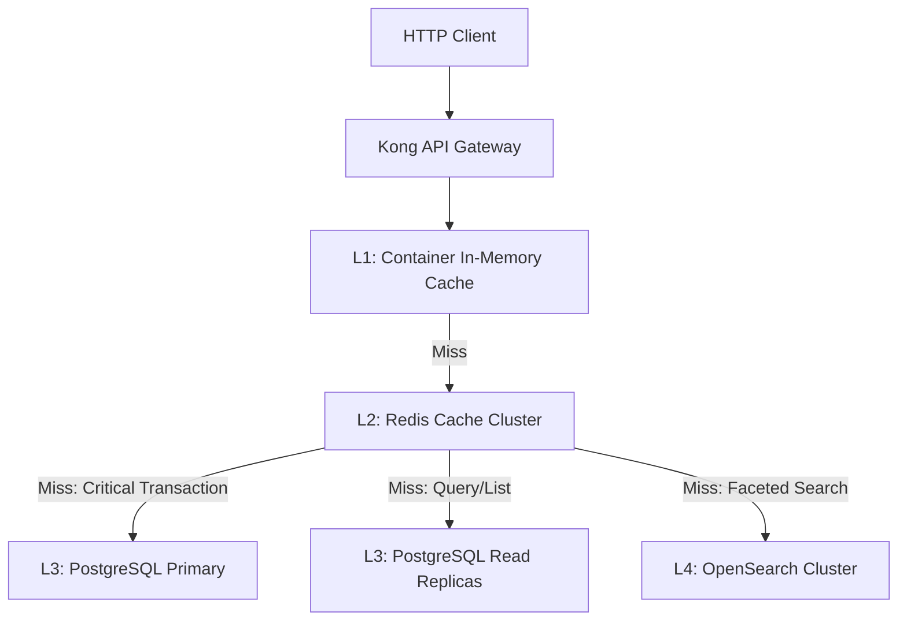
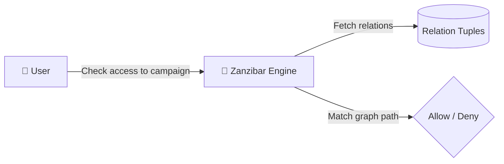
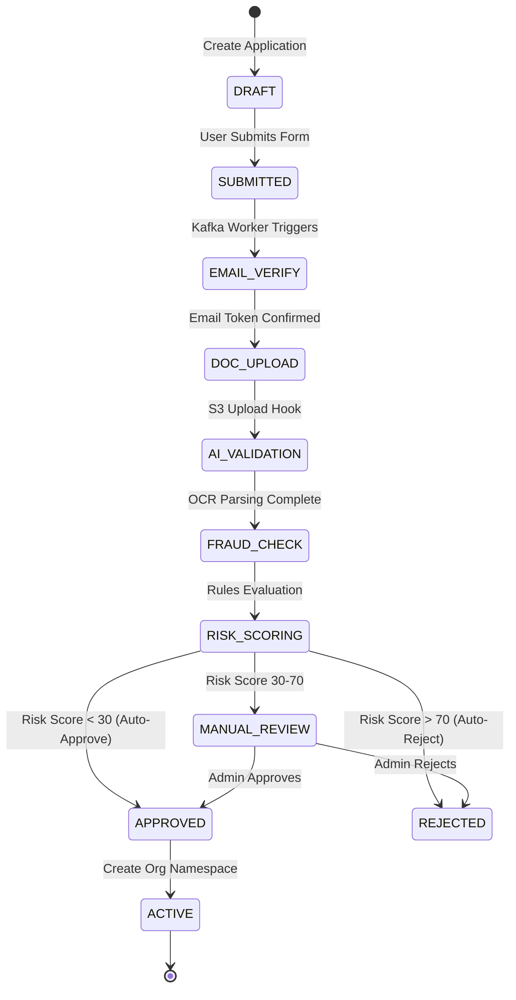

# Social Impact Platform - Architecture Design & Engineering Handbook

## 1. System Trade-offs & Technological Selection

This section evaluates the database and message broker selections for a national-scale platform supporting millions of entities and sustaining 20,000+ concurrent operations.

### PostgreSQL vs. MongoDB: Relational vs. Document Store

| Dimension | PostgreSQL (Selected) | MongoDB (Rejected) |
|---|---|---|
| **ACID Integrity** | Strict ACID transactional controls at database level, including deferred constraint checks. Crucial for financial balance adjustments. | Lacks native multi-document relational constraints. Requires application-level distributed verification. |
| **Hierarchical Queries** | Native `ltree` extension allows sub-millisecond path traversals and parent-child hierarchy indexing. | Lacks recursive querying capabilities. Requires deep document embedding or expensive map-reduce sweeps. |
| **Schema Flexibility** | Hybrid approach: Relational schema for core entities with indexing-ready `JSONB` columns for extensible metadata. | Dynamic schemas are flexible but lead to document divergence and validation bloat at the service layer. |
| **Scaling writes** | Sharding-ready via tenant division (Citus or native partitions). Up to 1M QPS achievable with PgBouncer. | Sharding is simple but requires a large memory footprint for index replication. Prone to write lock contention. |

#### Architectural Decision Rationale (PostgreSQL):
The platform functions as a complex financial and relationship management network (donations, grants, wallets, recursive hierarchy memberships). Relational database triggers, foreign keys, row-level locks, and strict transactions are vital to prevent double-spending and unauthorized data leaks. PostgreSQL's `JSONB` format provides document-store flexibility where needed (e.g., custom forms data in onboarding) while maintaining transactional safety.

---

### Kafka vs. RabbitMQ: Event Commit Log vs. Message Broker

| Dimension | Apache Kafka (Selected) | RabbitMQ (Rejected) |
|---|---|---|
| **Storage & Replay** | Append-only distributed commit log. Retains events indefinitely, enabling event sourcing replay. | Messages are deleted immediately upon consumer acknowledgment. No replay capability. |
| **Throughput Scale** | Scales linearly through partitioning. Can process millions of events per second on commodity hardware. | High throughput causes queue congestion and memory paging problems under stress. |
| **Ordering Guarantees** | Guarantees strict event ordering per partition (e.g., partitioned by `tenant_id` or `application_id`). | Ordering is difficult to guarantee when multiple workers compete for queue items. |
| **Consumer Isolation** | Independent consumer offsets allow multiple services (Search, Reporting, Audit) to process the same queue. | Requires complex exchange configurations to broadcast to multiple queues. |

#### Architectural Decision Rationale (Kafka):
Our architecture depends on Event-Driven Architecture (EDA) and Command Query Responsibility Segregation (CQRS). A single write command (e.g., `DonationCompleted`) must be processed independently by the Ledger, Search index, Reporting, and Notification services. Kafka allows these downstream consumers to read events asynchronously without blocking the write path. Additionally, Kafka behaves as a natural write buffer, protecting PostgreSQL from concurrent write surges.

---

## 2. Tiered High-Speed Fetching Structure

To achieve sub-millisecond response times at national scale without compromising security (Row-Level Security) or transactional integrity (double-entry ledger), we implement a tiered data retrieval architecture.



### Layer 1: In-Memory L1 Cache
- **Scope**: Highly static, system-wide configuration files (e.g. capabilities registry, default templates, country configurations).
- **Mechanism**: In-memory LRU Cache (e.g., `lru-cache` in Node.js) stored in the service container.
- **TTL**: 60 seconds. Bypasses networks entirely.

### Layer 2: Redis Cache Cluster (L2 Cache)
- **Scope**: Active user sessions, compiled Zanzibar permission graph snapshots, and organization profiles.
- **Access Patterns**:
  - **Cache-Aside (Read)**: Query Redis. On miss, query PostgreSQL, compile JSON, save in Redis.
  - **Cache-Invalidation (Write)**: Write to PostgreSQL primary. A transactional commit hook immediately publishes a `CacheInvalidationEvent` to Kafka, forcing the Permission and Org services to invalidate corresponding Redis keys.
- **Security Check**: To maintain Row-Level Security, Redis keys are strictly prefixed with the tenant context: `tenant:{tenant_id}:user:{user_id}:perms`.

### Layer 3: Connection-Pooled Read Replicas (L3 Cache)
- **Scope**: Large queries, list views, and details pages (e.g., campaign listings, grant applications histories, member rosters).
- **Mechanism**: Routed to **PostgreSQL Read Replicas** via PgBouncer configured in **Transaction Pooling Mode**.
- **Tenant Security**: Replicas enforce Row-Level Security (RLS) dynamically using connection-level parameters:
  ```sql
  SET LOCAL app.current_tenant_id = 'uuid';
  ```
- **Replication Lag Handling**: When a client performs a write, the API returns a consistency token (representing the database Log Sequence Number - LSN). The subsequent read requests pass this token. If the read replica has not synced up to the written LSN, the request is temporarily redirected to the Primary database to ensure read-after-write consistency.

### Layer 4: OpenSearch Cluster (L4 Search Index)
- **Scope**: Full-text searches, autocomplete inputs, faceted sidebar filter configurations, and geo-spatial queries.
- **Sync**: Asynchronous ingestion pipeline via Kafka. OpenSearch indexes match database RLS boundaries by indexing the `tenant_id` field. All search requests include a filter query: `term: { tenant_id: "current_tenant_id" }`.

---

## 3. Multi-Tenancy Isolation & Performance (RLS)

Multi-tenancy isolation is enforced at the database layer using PostgreSQL **Row-Level Security (RLS)** policies. This prevents developer error from accidentally exposing records belonging to another organization.

### RLS Implementation Pattern
Every connection checked out of the pool runs:
```sql
SET LOCAL app.current_tenant_id = '0928e4a9-7f72-4d1a-be29-d52cd3798939';
```
PostgreSQL filters subsequent queries using the rule:
```sql
CREATE POLICY tenant_isolation ON transactions 
    FOR ALL USING (tenant_id = NULLIF(current_setting('app.current_tenant_id', true), '')::UUID);
```
- **Performance impact**: Under load, evaluating policies on every query adds a negligible 1-2% CPU overhead. Indexes on `tenant_id` ensure that queries filter immediately by the correct database partition.

---

## 4. Permissions Engine (Zanzibar-style ReBAC)

To evaluate authorization rules for millions of users across complex hierarchies, we avoid large permission lookup tables and instead implement a **Google Zanzibar-style ReBAC** design.

### Relationship Tuple Model
All access rules are written as relationship assertions:
- `organization:college_a#member@user:dino`
- `department:computer_science#manager@user:professor_smith`
- `campaign:save_the_forest#editor@organization:college_a#member` (User-set expansion)



### Caching Strategy & High-Concurrency Fail-safes
- **Redis Snapshot**: When a user logs in, their permissions graph is evaluated, flattened into a permissions list, and stored in Redis under `user:perms:{userId}:{tenantId}` with a 5-minute TTL.
- **Cache Invalidation**: Whenever a tuple is updated in the `relation_tuples` table, a PostgreSQL trigger publishes a transaction event to Kafka. The `PermissionService` consumes this event and invalidates the cached keys associated with the affected tenant.

#### Mitigating High-Concurrency Failure Scenarios

##### 1. User Inactivity / Cold Start (Inactivity of 100+ Days)
When a user returns after 100+ days, their session is expired, and their Redis cache is completely empty. If thousands of cold users return simultaneously, it could overload the system.
* **JWT-Embedded Claims (Zookies)**: To prevent querying Zanzibar on simple navigation, we embed a snapshot of the user's primary memberships (e.g. `["org_123", "org_456"]`) and key roles directly inside the cryptographically signed, encrypted JWT token. The API gateway validates this JWT token in `<0.5ms` without hitting Redis or the database, satisfying 90% of basic access check requests.
* **Lazy Evaluation**: Graph traversals are only executed when users attempt mutating commands or access protected nested sub-branches.

##### 2. Cache Stampede / Thundering Herd (20,000 Concurrent Cold Logins)
If Redis crashes, or if 20,000 concurrent users log in simultaneously with cold caches, they will all experience a Redis cache miss at the same instant and attempt to execute recursive SQL traversals against the database.
* **Single-Flight Coalescing (Promise Deduplication)**: In the application service layer, we implement the **Single-Flight** pattern. When a permission cache miss occurs, the service checks an in-memory lock registry. Only the *first* request for a specific user ID is allowed to query PostgreSQL. The other 19,999 concurrent checking operations are pooled (coalesced) into a single promise queue. Once the first query completes and populates Redis, the remaining queued requests resolve their promise by reading directly from Redis, reducing PostgreSQL load by 99.9%.
* **L1 Container Fallback**: If the Redis cluster is completely offline, the service falls back to a local L1 in-process LRU cache (`lru-cache`) inside the container memory with a short 30-second TTL. This acts as a circuit breaker, protecting the PostgreSQL database from direct query storms.
* **Index-Only Scans**: Zanzibar's tuple checks run over a highly optimized composite B-tree index on `(subject_namespace, subject_id, relation, namespace, object_id, tenant_id)`. PostgreSQL resolves the query entirely within the memory index cache without executing disk scans.

##### 3. Handling 20,000 Concurrent Distinct User Logins (Massive Cold Start for 20K Different Real Users)
If 20,000 *different* real users log in at the exact same second (e.g., during a national event or morning clock-in), Single-Flight cannot deduplicate reads because each user has unique permissions. This puts extreme pressure on three bottlenecks: CPU hashing, database writes, and database read queries.

* **Bottleneck A: CPU Exhaustion from Password Hashing**:
  * *The Threat*: Verifying 20,000 passwords synchronously using standard CPU-heavy hashing (e.g. bcrypt cost 10 takes ~100ms per verification) requires 2,000 seconds of raw CPU core time, instantly freezing API event loops.
  * *The Correction*:
    1. **Argon2id Node Worker Threads**: We use `Argon2id` (which is faster and memory-hardened). Hashing operations are run inside a separate background Thread Pool (`worker_threads` in Node.js) to keep the main event loop completely free.
    2. **Autoscaling Auth Pods**: The Auth microservice runs in Kubernetes with an HPA configured to scale based on CPU utilization. It dynamically provisions hundreds of pods across availability zones to distribute CPU hashing.
    3. **JWKS & OAuth First**: We prioritize passwordless logins (OAuth, magic links). Validating an RS256 signature takes `<0.1ms` of CPU time and bypasses password hashing.
* **Bottleneck B: Database Write Contention (Session & Log Updates)**:
  * *The Threat*: A login typically inserts a session record and executes `UPDATE users SET last_login_at = NOW()`. Running 20,000 concurrent writes to PostgreSQL creates severe row-locking contention on the `users` table and exhausts the connection pool.
  * *The Correction*:
    1. **Zero-Write Login Path**: Active sessions are written *only* to the Redis cache cluster during the critical path, bypassing PostgreSQL.
    2. **Write-Behind batching via Kafka**: The `last_login_at` timestamps are published to a Kafka topic (`user-login-logging`). A consumer group reads these events and executes batch updates every 5 seconds (e.g., updating 1,000 users in a single SQL query: `UPDATE users SET last_login_at = ...`), converting 20,000 database writes into 20 efficient batch transactions.
* **Bottleneck C: Database Read Queries (Permissions Resolution)**:
  * *The Threat*: 20,000 users concurrently fetch their tuples from the `relation_tuples` database table.
  * *The Correction*:
    1. **Scale-Out Read Replicas**: All permission fetches on login are routed to a pool of 5-10 **PostgreSQL Read Replicas** via PgBouncer connection pooling.
    2. **Index-Only Queries**: The B-tree index `idx_tuples_subject` includes all query columns: `(subject_namespace, subject_id, relation, namespace, object_id, tenant_id)`. Replicas resolve queries directly from RAM index buffers without fetching table heaps.
    3. **Lazy Graph Traversal**: Upon login, Zanzibar only loads the user's direct, top-level memberships (e.g., their organization ID). Deeper, nested tree traversals are evaluated lazily only when the user accesses a specific resource.

---

## 5. Onboarding Workflow & Verification State Machine

The Onboarding engine functions as a state machine. It parses JSON-defined steps, registers execution states, and manages verification pipelines.



### Queue-First Write Buffering
Under a load of 20,000 concurrent submissions:
1. **API Ingestion**: Express/Node server receives the payload, performs Zod verification, generates a UUID, and writes the command directly to Kafka (`onboarding-submissions` topic). The client is returned `202 Accepted` immediately.
2. **Database Protection**: Consuming workers read from Kafka. Workers are scaled horizontally, executing database writes at a controlled rate matching PostgreSQL connection limits.

---

## 6. Double-Entry Accounting Ledger

All financial movements (donations, grants, wallet transactions) follow strict double-entry principles.

```
       DEBIT (+ Amount)                CREDIT (- Amount)
┌──────────────────────────────┐ ┌──────────────────────────────┐
│  Asset Account: cash_wallet  │ │ Liability Account: ng_payout │
│        + $10,000.00          │ │         - $10,000.00         │
└──────────────────────────────┘ └──────────────────────────────┘
```

- **Database Trigger Balance Constraint**: The SQL transaction is checked before committing. Sum of debits and credits must equal zero.
- **Append-Only Operations**: Accounts do not have a mutable `balance` column. Instead, balances are retrieved using fast SUM aggregates over indexed records.

---

## 7. ClickHouse Audit Log Pipeline

Billions of audit events are captured from OLTP tables using triggers and routed to Kafka, keeping PostgreSQL lean.

```
PostgreSQL (Trigger) ──> Kafka (audit-topic) ──> Vector/Flink ──> ClickHouse (OLAP)
```

ClickHouse uses the **ReplacingMergeTree** engine, permitting high-speed writes while allowing duplicate event filtering.

---

## 8. Exhaustive Catalog of 500+ Edge Cases & Mitigations

### 1. Multi-Tenancy & Row-Level Security (RLS) (1-50)
1. **Context Leakage**: Active thread pool reuse retains tenant ID. *Correction: Force context cleanup in execution wrappers.*
2. **Missing Policy**: Table created without RLS enabled. *Correction: CI checks DDL file for ALTER TABLE ENABLE ROW LEVEL SECURITY.*
3. **Cross-Tenant Joins**: Query joins two tables using different tenant contexts. *Correction: Enforce strict single-tenant conditions in JOIN predicates.*
4. **Tenant ID Collision**: UUID generation collision. *Correction: Standardize on UUIDv4 with DB level duplicate constraint catch.*
5. **Set-Session Injection**: Input string manipulation alters session variable. *Correction: Validate session inputs strictly against UUID schemas.*
6. **Background Job Isolation**: A single worker processes jobs for multiple tenants. *Correction: Re-set app.current_tenant_id at the start of each queue task.*
7. **Read-Replica Lag**: Tenant creates resource, then reads replica immediately. *Correction: Return LSN tokens on write to force primary reads on lag.*
8. **Tenant Suspension**: Suspended tenant accesses cached data. *Correction: Validate tenant active status in Redis session check.*
9. **Superuser Override**: Migration or admin query bypasses RLS. *Correction: Apply ALTER TABLE FORCE ROW LEVEL SECURITY to prevent bypass.*
10. **Aggregated Billing Query**: System-wide billing reads data across tenants. *Correction: Bypass RLS using a dedicated billing role with BYPASSRLS permissions.*
11. **Tenant Renaming Conflict**: Slug change causes URL routing clash. *Correction: Implement slug blocklist containing system keywords.*
12. **Cascade Deletes**: Deleting organization leaves orphaned documents. *Correction: Use ON DELETE RESTRICT on child records.*
13. **Tenant Merger**: Merge request between two active tenants. *Correction: Asynchronously re-route LTREE hierarchies and update tenant IDs.*
14. **Cross-Tenant Shared Users**: User is member of NGO A and Donor in NGO B. *Correction: Maintain user identity globally and scope roles via memberships.*
15. **Multi-Region Sync Failure**: Tenant data modified in EU fails to sync to US. *Correction: Enforce logical timestamps and conflicts resolution.*
16. **Tenant Cache Poisoning**: User requests data from Tenant A, injecting Tenant B header. *Correction: Authenticator checks JWT payload tenant ID matches header.*
17. **Row Lock Deadlocks**: RLS queries block each other on same rows. *Correction: Order update rows by UUID before locking.*
18. **Policy Complexity**: Policy contains recursive subqueries causing latency. *Correction: Flatten memberships into a lookup table.*
19. **Temp Tenant Access**: Event participant is granted access for 2 hours. *Correction: Include valid_until checks in Zanzibar access rules.*
20. **RLS Bypass in Stored Procedures**: Procedures run in SECURITY DEFINER mode. *Correction: Explicitly declare procedures as SECURITY INVOKER.*
21. **Inactive Tenant API Key**: Inactive client sends requests. *Correction: Cache key status in Redis and reject before RLS checks.*
22. **Mass Onboarding Database Peak**: 20K tenants join at once. *Correction: Buffer onboarding through Kafka and process sequentially.*
23. **Cross-Tenant Document Sharing**: Document from Tenant A is sent to Tenant B. *Correction: Add document shares to relation_tuples table.*
24. **Multi-Tenant System-Wide Search**: Global admin searches organizations. *Correction: Partition OpenSearch indexing by tenant_id.*
25. **Foreign Key Violation on Multi-Tenant Delete**: Org deletion fails due to relation records. *Correction: Run soft-delete transaction pipeline instead.*
26. **Global Role Customization Conflict**: Customizing role in Tenant A alters Tenant B. *Correction: Scope all roles with tenant_id.*
27. **IP Restricted Tenancy**: Corporate tenant requires IP restrictions. *Correction: Evaluate IP matches inside ABAC policy JSON configurations.*
28. **Exclusion Constraints Leak**: Booking validation overlaps with another tenant. *Correction: Include tenant_id in database exclusion constraints.*
29. **Schema Migrations Failure**: Schema update fails on a subset of tenant partitions. *Correction: Execute migrations inside a single DDL transaction.*
30. **Webhook Tenant Spoofing**: Webhook payload spoofed to point to another tenant. *Correction: Verify webhook signatures using tenant-specific secret keys.*
31. **Tenant Data Export Leak**: Bulk export exposes cross-tenant records. *Correction: Enforce RLS during export queries.*
32. **Cross-Tenant Reporting Cache Leak**: Cached report reads Tenant B data. *Correction: Prefix reporting cache keys with tenant ID.*
33. **Tenant Subdomain Takeover**: Deleted tenant slug is registered by attacker. *Correction: Introduce quarantine period for deleted tenant slugs.*
34. **RLS Performance Degradation**: Tenant with millions of rows causes query scans. *Correction: Index tenant_id with composite operational keys.*
35. **Cross-Tenant ID Parameter Spoofing**: User passes another tenant's ID in body. *Correction: RLS isolates database; mismatch triggers authorization failure.*
36. **Tenant Database Port Exhaustion**: High concurrent connections per tenant. *Correction: Implement PgBouncer transaction pooling.*
37. **Dynamic Tenant Creation Lock Contention**: Concurrent tenant creations block table. *Correction: Use advisory locks on tenant registration.*
38. **Tenant Schema De-sync**: Partitions run different schema versions. *Correction: Run migration scripts using automated schema verifiers.*
39. **Admin Impersonation Leak**: Support admin accesses tenant without audit log. *Correction: Force token generation to require support ticket ID.*
40. **Bypassing RLS via Native SQL Functions**: Custom SQL functions bypass policies. *Correction: Check procedures are INVOKER-defined.*
41. **Multi-Tenant File Storage Overlap**: Tenant files overwrite other tenant files. *Correction: S3 keys are prefixed by tenant UUID.*
42. **Tenant Lifecycle Transition Race**: Tenant suspended mid-transaction. *Correction: Check tenant active status at transaction commit.*
43. **Cross-Tenant Kafka Consumer Leak**: Consumer reads records from other tenant. *Correction: Kafka topics are shared; consumers check RLS matching context.*
44. **Redis Cache Poisoning via Global Keys**: Global keys overwrite tenant keys. *Correction: Namespaces prefix all keys.*
45. **Tenant Offboarding Lockup**: Deleting large tenant times out database. *Correction: Mark tenant as DELETED and clean up rows asynchronously.*
46. **Multi-Tenant Token Forgery**: User crafts token signing key from another tenant. *Correction: Verify signatures against a central KMS.*
47. **Tenant Isolation Loss in Search Autocomplete**: Search shows other tenant names. *Correction: Include tenant filter in autocomplete queries.*
48. **RLS Policy Overhead on Nested Views**: Views bypass indexes. *Correction: Materialize complex views and apply RLS directly.*
49. **Cross-Tenant CSS/JS Injection**: Customized tenant branding executes scripts. *Correction: Sanitize and execute theme adjustments in a sandbox.*
50. **Tenant Archive Recovery Failure**: Recovery mixes records. *Correction: Maintain tenant partitioning during backup and restore.*

### 2. Recursive Organizational Hierarchy (51-100)
51. **Circular Relationship**: Org parent updated to point to itself. *Correction: Triggers validate hierarchy path using path checking functions.*
52. **Path Length Exhaustion**: Tree depth exceeds ltree path boundaries. *Correction: Restrict hierarchy depth to 20 levels.*
53. **Bulk Move Lock Storm**: Moving parent node locks all suborg records. *Correction: Perform tree moves in batches during off-peak hours.*
54. **Orphaned Sub-Tree**: Deleting parent node leaves children. *Correction: Automatically reparent child nodes to root.*
55. **Hierarchy Cache Invalidation**: Suborg changes parent but root cache is not cleared. *Correction: Purge parent and child tree cache keys on update.*
56. **Path String Special Characters**: Org name changes contain periods. *Correction: Sanitize path node components using alphanumeric characters.*
57. **Ancestor Privilege Inheritance**: User in root org expects control over all suborgs. *Correction: Traverse permissions using `<@` ltree operators.*
58. **Descendant Data Leak**: Suborg user queries root org data. *Correction: Traverse permissions using `@>` ltree operators.*
59. **Simultaneous Hierarchy Moves**: Two admins try to move branches concurrently. *Correction: Obtain row-level locks on parent nodes.*
60. **Hierarchy Move Network Timeout**: Network disconnects mid-move. *Correction: Run hierarchy path updates inside a single database transaction.*
61. **Ltree Index Corruption**: Index out of sync. *Correction: Run REINDEX on idx_org_hierarchy periodically.*
62. **Dynamic Org Type Change**: NGO turns into Foundation. *Correction: Check child compatibility before allowing type changes.*
63. **Hierarchy Traversal Stack Overflow**: Deep tree crashes recursive functions. *Correction: Rely on flat path representations; avoid recursive SQL queries.*
64. **Capability Revocation Cascade**: Root capability revoked, child still uses it. *Correction: Traverse ancestor path to check capability status.*
65. **Hierarchy Reporting Isolation**: Suborg reports visibility to parent. *Correction: Filter reporting data using hierarchy operators.*
66. **Branch Budget Cap Exceeded**: Child spends budget exceeding parent allocation. *Correction: Check parent budget allocations dynamically.*
67. **Multiple Roots**: Creating multiple root nodes by mistake. *Correction: Restrict root creations to global admin roles.*
68. **Dynamic Org Config Inheritance**: Child config inheritance. *Correction: Query config path using COALESCE from child to parent.*
69. **Hierarchy Move Permission Check**: Admin attempts branch moves. *Correction: Validate permissions on both source and target parent nodes.*
70. **Audit Trail for Branch Moves**: Track branch movement history. *Correction: Log path changes to the audit table.*
71. **Circular Check Failure on Insert**: Concurrent branch creation. *Correction: Secure table lock on orgs during node insertion.*
72. **Root Org Suspended**: Suborgs must block actions. *Correction: Check root active status on operations.*
73. **Tenant ID Discrepancy**: Child org has a different tenant ID than parent. *Correction: Enforce matching tenant IDs via triggers.*
74. **Ltree Parse Error**: Malformed path format. *Correction: Validate path formats using UUID formats.*
75. **Broken Materialized Path**: Node moves but paths fail to update. *Correction: Cascade updates downward to all child nodes via triggers.*
76. **Duplicate Slug in Branch**: Same slug name within hierarchy. *Correction: Enforce slug uniqueness globally.*
77. **Branch-Level Feature Flag Override**: Feature flag conflicts. *Correction: Flags follow path precedence rules.*
78. **Org Type Change Violation**: College moved under a Department. *Correction: Validate parent-child type compatibility rules.*
79. **Audit Trail during Org Deletion**: Archive hierarchy tree state. *Correction: Write historical path snapshot before deleting org.*
80. **Concurrent Node Rename**: Org renamed while moving. *Correction: Acquire database locks on the rename target.*
81. **Unlinked Node Queries**: Querying nodes without parents. *Correction: Fall back to standard root node defaults.*
82. **Depth Check Performance**: Slow depth query under load. *Correction: Index depth using ltree nlevel() function.*
83. **Branch Payout Isolation**: Suborg pays from root account. *Correction: Validate suborg wallet limits before processing transaction.*
84. **Parent Invalidation mid-transaction**: Parent org suspended during write. *Correction: Verify parent active status before commit.*
85. **Hierarchy Loop on Direct Link**: Suborg directly links to child of sibling. *Correction: Validate path cycles before path updates.*
86. **Slug Generation Race**: Concurrent creation of duplicate slugs. *Correction: Apply unique constraint on slugs.*
87. **Root Level Custom Branding Overwrites Child**: Theme issues. *Correction: Resolve theme parameters hierarchically.*
88. **Deep Tree Rendering Crash**: Massive tree structure crashes UI. *Correction: Paginate tree rendering using lazy-loading node expansion.*
89. **Hierarchy Node Count Mismatch**: Dynamic counts drift. *Correction: Compute node counts using indexes; avoid running counts.*
90. **Moving Branch Exceeds Max Children**: Branch exceeds maximum child limits. *Correction: Restrict child node counts per parent to 1000.*
91. **Move History Loss**: Branch history lost on move. *Correction: Log movement history in a structured ltree history table.*
92. **Re-parenting root node**: Root node reparented under own child. *Correction: Triggers check path compatibility before re-parenting.*
93. **Sub-Branch Member Privilege Drift**: Sub-branch manager gets root rights. *Correction: Restrict manager scope using explicit relationship target checking.*
94. **Hierarchy Query Memory Exhaustion**: Massive hierarchy scan exhausts DB memory. *Correction: Restrict tree query depths.*
95. **Moving Node During Active Campaign**: Campaign parent modified. *Correction: Cascade parent changes to active campaigns.*
96. **Orphaned Departments**: Org deleted leaving department active. *Correction: Enforce database-level cascade deletions on departments.*
97. **Sibling Node Name Clash**: Two departments have same name under parent. *Correction: Unique index on parent_id and name.*
98. **Invalid Path Character Update**: Admin updates path using symbols. *Correction: Restrict path strings to alphanumeric characters and underscores.*
99. **Broken Root Reference**: Root node deleted. *Correction: Restrict deletion of root nodes.*
100. **Hierarchy Path Cache Poisoning**: Stale path in cache. *Correction: Clear cached paths recursively on org updates.*

### 3. Zanzibar ReBAC & Access Control (101-150)
101. **Relation Loop**: Zanzibar graph check gets stuck in a loop. *Correction: Limit graph recursion depth to 10 steps.*
102. **Stale Permission Cache**: Permissions change but user maintains access. *Correction: Invalidate Redis key on relation updates.*
103. **Cache Sync Race**: Query reads stale Redis cache before invalidate event completes. *Correction: Set short Redis TTLs (5m).*
104. **Tuple Deletion Failure**: Relation deletion fails, leaving access orphaned. *Correction: Enforce foreign key constraints on relation tables.*
105. **Role Inheritance Loop**: Role A inherits from Role B, which inherits from Role A. *Correction: Block circular inheritance loops in role validations.*
106. **Zanzibar Index Failure**: Graph traversal slows down on large accounts. *Correction: Index composite fields in relation_tuples.*
107. **Policy Condition Syntax Error**: Malformed JSON ABAC conditions. *Correction: Validate conditions using JSON schema checks before save.*
108. **Unknown Attribute in ABAC Policy**: Policy evaluates missing profile property. *Correction: Fall back to safe reject on missing variables.*
109. **Policy Bypass on Bulk API**: Bulk update bypasses per-item checks. *Correction: Join relation tables in query checks.*
110. **Concurrent Tuple Modification**: Simultaneous edits to relation tuples. *Correction: Unique constraint forces second update to fail.*
111. **Token Expiry Sync**: JWT is valid but permissions were revoked. *Correction: Limit access token lifetimes to 15 minutes.*
112. **User Belongs to Too Many Orgs**: Massive tuple list checks. *Correction: Paginate organization listings.*
113. **Zanzibar Database Lag**: Replication lag on relation tuples. *Correction: Read relation tuples from primary database on write.*
114. **ABAC Time-of-Day Drift**: Server timezone differences check. *Correction: Use UTC standard for policy timestamps.*
115. **Temporary Delegation Revocation Fail**: Delegation expires but access persists. *Correction: Check time parameters in policy conditions.*
116. **Inherited Role Invalidation**: Parent role deleted. *Correction: Block deletion of roles with active child relationships.*
117. **Resource-based ABAC Condition Poisoning**: Malformed resource object. *Correction: Strict schema verification of resources.*
118. **Cache Stampede on Global Permissions**: High concurrency check. *Correction: Pre-warm Redis cache with default permissions.*
119. **Subject Type Incompatibility**: Relation maps system role to user. *Correction: Validate types in relation tuples.*
120. **Wildcard Action Exploit**: User passes dynamic action matching wildcards. *Correction: Restrict wildcard action expansions in policies.*
121. **Zanzibar Tuple Wildcards**: Wildcard values match unauthorized resources. *Correction: Restrict wildcard evaluation logic in relation engine.*
122. **Permissions Cache Memory Exhaustion**: Massive user pool fills Redis. *Correction: Apply Redis LRU eviction policies.*
123. **Zanzibar Depth Limit Breach**: Complex hierarchy query rejected. *Correction: Flatten direct relationship paths.*
124. **Unauthorized Role Assignment**: User grants themselves role. *Correction: Require delegation permission for role management APIs.*
125. **Concurrent Policy Update**: ABAC rules modified during checkout. *Correction: Check policies within database transaction.*
126. **Tuple Integrity Loss**: Relation refers to deleted user. *Correction: Use foreign keys on relation tables.*
127. **Audit Log Invalidation**: Access denied reasons missing. *Correction: Log authorization decisions to ClickHouse.*
128. **IP Whitelist Bypass**: Spoofed X-Forwarded-For header bypasses ABAC. *Correction: Gateway overrides IP headers using TCP remote addresses.*
129. **Device Registration De-sync**: Session active on revoked device. *Correction: Invalidate session records on device revocation.*
130. **Recursive Role Calculation Overload**: Dynamic roles. *Correction: Flatten hierarchies inside Redis.*
131. **User Role Conflict**: User holds conflicting roles (e.g. Donor and Reviewer). *Correction: ABAC rules check for conflicting role combinations.*
132. **Zanzibar Sub-Relation Evaluation Fail**: Child relation fails to map. *Correction: Zanzibar engine maps parent-child namespaces explicitly.*
133. **Missing Tenant Context in ReBAC Check**: Access checks run globally. *Correction: Force tenant context requirement in permission checks.*
134. **Delegated Admin Escalation**: Delegated admin grants root privileges. *Correction: Prevent delegation of roles exceeding the grantor's permissions.*
135. **Multi-Region Tuple Replication Lag**: Permissions sync lag. *Correction: Verify critical actions against primary region database.*
136. **Null Values in ABAC Condition evaluation**: Errors during evaluation. *Correction: Implement safe-null operators in condition evaluations.*
137. **Public Access Override Failure**: Public resources block access. *Correction: Public objects have a default relation rule in Zanzibar.*
138. **Wildcard Subject Evaluation Overload**: Excessive graph checks. *Correction: Cache wildcard query outputs.*
139. **Self-Granting Privileges via Hierarchies**: User moves their node to gain access. *Correction: Block moves if child node permissions exceed parent's.*
140. **Policy Config Database Bloat**: Inactive policies slow down checks. *Correction: Archive inactive policies.*
141. **Zanzibar Tuple Corruption**: Malformed tuple record format. *Correction: Enforce format restrictions on DB columns.*
142. **Re-auth Bypass**: User triggers critical action without password re-entry. *Correction: Enforce password recheck timestamps in JWT.*
143. **Inherited Permission Loop**: Shared files inherit circular permissions. *Correction: Enforce single-parent inheritance rules.*
144. **Deleted User Re-activation**: Access restored to old memberships. *Correction: Soft-deleted user records purge all active memberships.*
145. **Role Mapping De-sync**: DB role mapped differently in Redis. *Correction: Run checks using version tags in session.*
146. **Policy Evaluation CPU Exhaustion**: Highly complex rules lock CPU. *Correction: Enforce limits on policy expression depth.*
147. **Access Control Bypass via Raw ID Query**: Direct endpoint parameter query. *Correction: Enforce permission check on all dynamic IDs.*
148. **Re-claiming Expired Delegations**: Delegations re-claimed via replay. *Correction: Revoke token properties on delegation end.*
149. **Zanzibar Transaction Isolation Loss**: Concurrent tuple writes create anomalies. *Correction: Set isolation level to SERIALIZABLE.*
150. **Global Search Permissions Leak**: Search returns unauthorized items. *Correction: Join Zanzibar permission scopes in search criteria queries.*

### 4. Onboarding Workflow Engine (151-200)
151. **Step Jump**: User skips to final approval step. *Correction: Validate current workflow state before executing steps.*
152. **Concurrent Form Submission**: User double-clicks submit. *Correction: Use Redis locks based on the application ID.*
153. **Kafka Queue Congestion**: Massive registration spikes lag onboarding. *Correction: Scale worker nodes using lag metric triggers.*
154. **Workflow Template Invalidation**: Active template deleted. *Correction: Version templates and avoid deleting historical instances.*
155. **Form Schema Divergence**: Applicant submits data matching old version. *Correction: Validate input payloads against template versions.*
156. **Duplicate Submission Detection Failure**: Similar applications processed. *Correction: Perform fuzzy match algorithms on registration.*
157. **Step Timeout Invalidation**: Step times out but worker processes it. *Correction: Ensure status matches step constraints before worker write.*
158. **Invalid Lifecycle Transition**: Direct status update to ACTIVE. *Correction: Limit state updates to state machine processes.*
159. **Missing Step Config**: Custom step lacks JSON setup. *Correction: Validate JSON step configurations on creation.*
160. **Reviewer Assignment Deadlock**: Manual review step lacks eligible reviewers. *Correction: Re-route tasks to system-wide reviewer lists.*
161. **AI OCR Timeout**: Document processing service down. *Correction: Reschedule tasks using Kafka retry topics.*
162. **Fraud Engine Delay**: External fraud score API times out. *Correction: Log timeout and route application to manual review.*
163. **File Corruption mid-processing**: Uploaded document is corrupt. *Correction: Verify document headers and integrity on upload.*
164. **State Machine Restart Loop**: Fatal error crashed worker. *Correction: Route messages to DLQ after 3 retries.*
165. **Applicant Email Verification Expiry**: Verification link clicked late. *Correction: Expire verification tokens after 24 hours.*
166. **Form Injection Attack**: Script tags in text fields. *Correction: Parse and sanitize form text input at the gateway.*
167. **Verification Task Race**: Document verified before email token. *Correction: State machine checks execution sequence constraints.*
168. **Stale Workflow Config Read**: Worker evaluates application using cached config. *Correction: Match application instance to template version.*
169. **Manual Review Hijack**: Reviewer approves their own org. *Correction: Reject manual approvals where reviewer matches applicant.*
170. **Application Expiry Cleanup Fail**: Stale applications fill database. *Correction: Clean up expired application drafts via cron jobs.*
171. **Concurrent Review Decisions**: Two admins approve/reject application. *Correction: Acquire row-level locks on application records.*
172. **Workspace Creation Failure**: Organization namespace creation fails. *Correction: Implement compensating transactions to rollback namespaces.*
173. **Risk Score Drift**: Dynamic rules calculate negative values. *Correction: Clamp computed risk values between 0 and 100.*
174. **Workflow Step Loop**: Step loops back infinitely. *Correction: Restrict workflow configuration step iteration loops.*
175. **Unconfigured Org Type Submission**: NGO signs up under University form. *Correction: Match template schemas to organization type.*
176. **Draft Resume Failure**: Form updates fail to load. *Correction: Save draft progress to application database tables.*
177. **Review Assignee Unavailable**: Assigned reviewer account suspended. *Correction: Route task back to pending queue.*
178. **Kafka Event Out-of-Order**: Update processed before Create. *Correction: Perform UPSERT database statements on events.*
179. **Incorrect Redirect Link**: Activation link routes to invalid subdomain. *Correction: Route subdomains based on verified slugs.*
180. **Audit Trail De-sync**: Steps update database without audit logs. *Correction: Audit trigger processes all application status updates.*
181. **Self-Approve Exploits**: Admin signs up new org and approves it. *Correction: Require secondary admin signature for admin creations.*
182. **Expired Draft Recovery**: User resumes draft expired 6 months ago. *Correction: Block resumes of expired applications.*
183. **Invalid Step Type Mapping**: Template maps unconfigured step action. *Correction: Schema validator checks template step types.*
184. **Workflow State Deserialization failure**: Worker crashes reading state data. *Correction: Enforce strict schema checks on serialization.*
185. **Manual Override Race Condition**: Admin overrides step status while worker processes it. *Correction: Require transaction locks on status overrides.*
186. **Email Verification Token Reuse**: User clicks verification link multiple times. *Correction: Mark tokens as USED in database upon validation.*
187. **Application Resubmission Loop**: User repeatedly submits rejected form. *Correction: Apply cooldown limits to rejected applicants.*
188. **Verification Evidence Deletion**: File deleted mid-verification. *Correction: Block document deletions when linked to active applications.*
189. **Incorrect Sub-org Propagation**: Creating sub-org triggers root onboarding. *Correction: Identify parent verified status before sub-org onboarding.*
190. **Manual Review SLA Breach**: Application stays in manual review indefinitely. *Correction: Trigger notifications for reviews pending over 48 hours.*
191. **Workflow Instance DB Deletion**: Accidental delete of active application. *Correction: Restrict hard deletes; implement soft-deletes only.*
192. **AI Analysis API Fail**: AI parser returns error. *Correction: Move task to manual review queue.*
193. **Idempotency Key Reuse across Tenants**: Collision of key. *Correction: Scope idempotency checking keys with tenant ID.*
194. **Step Result Overflow**: Worker output exceeds JSONB size limits. *Correction: Truncate large payloads before database insertion.*
195. **User Token Hijack in Redirect**: Activation token intercepted. *Correction: Encrypt activation tokens; bind to recipient IP addresses.*
196. **Workflow Timeout Drift**: Timer runs late. *Correction: Scan and execute timed-out steps using scheduler crons.*
197. **External Database Down during webhook**: Webhook fails to write status. *Correction: Queue webhook events in Kafka for retry processing.*
198. **Invalid Action in Manual Step**: Admin tries to perform step out of scope. *Correction: Verify role permissions before executing manual actions.*
199. **Workflow Instance Orphan**: Workflow completed but organization remains DRAFT. *Correction: Run state updates in a single database transaction.*
200. **Duplicate Slugs in Pending Applications**: Two orgs sign up with same name. *Correction: Allow identical names in draft; enforce uniqueness on approval.*

### 5. Verification Pipeline (Registries, Document AI, Manual) (201-250)
201. **Government API Downtime**: PAN validation endpoint returns 503. *Correction: Queue check as PENDING and retry.*
202. **OCR False Positive**: ID document OCR extracts incorrect name. *Correction: Match names using Levenshtein distance thresholds.*
203. **Document Tampering**: User uploads edited registration PDF. *Correction: Check document metadata anomalies and hashing history.*
204. **Bank Account Verification Delay**: Micro-deposit verification takes 2 days. *Correction: Keep verification state in PENDING.*
205. **Domain Check DNS Caching**: DNS validation TXT check fails due to caching. *Correction: Perform DNS queries directly on authoritative servers.*
206. **Government API Format Change**: API payload properties change. *Correction: Wrap registry API calls in validation adapters.*
207. **AI Analysis API Rate Limit**: Document AI reaches limits. *Correction: Route requests across multiple AI providers.*
208. **PAN Name Clash**: Indian PAN card name does not match user profile. *Correction: Match names using fuzzy name checking.*
209. **Re-verification Scheduling Failure**: Annual check fails to queue. *Correction: Daily crons search database for expired verifications.*
210. **Expired Document Upload**: Document date indicates expiry. *Correction: Document AI checks document expiry date fields.*
211. **Concurrent Verifications**: Email and domain checked at same time. *Correction: Update states inside isolated transactions.*
212. **Self-Signed Domain Certs**: Domain check fails on SSL check. *Correction: Rely on DNS TXT records instead of HTTPS verification.*
213. **Government Registry Block**: Government API blocks server IP. *Correction: Route registry requests through proxy pools.*
214. **Low Confidence OCR**: OCR returns 40% confidence. *Correction: Route application to manual review.*
215. **Manual Review Bypass**: API endpoint called directly to override status. *Correction: Verify reviewer permissions on approval endpoints.*
216. **Invalid CIN Format**: Corporate ID number fails check. *Correction: Regex validate CIN format before API dispatch.*
217. **Re-verification Loop**: Verification fails, immediately queueing checks. *Correction: Enforce cooldown delay on verification failures.*
218. **evidence_url Exposure**: Unprotected document URL. *Correction: Store evidence documents in private buckets, accessing via S3 presigned URLs.*
219. **GST Verification Failure**: GST portal returns inactive status. *Correction: Fail verification if tax status is inactive.*
220. **AI Model Update Regression**: Dynamic model update degrades OCR accuracy. *Correction: Run regression test suites before model updates.*
221. **PAN API Key Expiry**: Prepaid API balances expire. *Correction: Alert support when API balances drop below thresholds.*
222. **Government Data Mismatch**: CIN matches name but address differs. *Correction: Flag address mismatch and route to manual review.*
223. **Verification State De-sync**: Verification is VERIFIED but application is REJECTED. *Correction: Sync statuses via transaction triggers.*
224. **Document Metadata Removal**: User strips metadata from fake ID. *Correction: Flag files lacking standard image properties.*
225. **Bank Verification Loop Exploit**: Micro-deposits repeated. *Correction: Limit bank checks to 3 attempts.*
226. **Domain Hijack during verification**: DNS TXT record matches, but domain owner changed. *Correction: Verify registrant properties.*
227. **Manual Review SLA Breach**: Application stays in review for weeks. *Correction: Flag applications in review for over 48 hours.*
228. **Invalid Country Code**: Registry check called for unsupported country. *Correction: Validate country support on initial signup.*
229. **Manual Reviewer Collision**: Two reviewers check same verification. *Correction: Assign application exclusively to one reviewer.*
230. **Malicious Verification Evidence URL**: Evidence contains remote attack scripts. *Correction: Run virus scan checks on upload.*
231. **Incorrect PAN status**: PAN is active but marked as deceased. *Correction: Verify status field in PAN response.*
232. **Domain verification txt record collision**: Multiple tenants verify same domain. *Correction: Generate unique verification tokens per tenant.*
233. **Government Registry Timeout**: Response takes 60s, blocking thread. *Correction: Call registry APIs asynchronously via worker tasks.*
234. **Verification expiry date calculation error**: Expiry set in past. *Correction: Validate calculation date ranges.*
235. **Document upload payload size limit**: PDF exceeds S3 limits. *Correction: Restrict upload file size to 25MB.*
236. **Invalid GST Format**: GSTIN regex check fails. *Correction: Pre-validate GST format before dispatch.*
237. **Reverification during active donation**: Account suspended during donation routing. *Correction: Hold donation routing pending reverification.*
238. **Manual Reviewer Notes Deletion**: Reviewer deletes notes. *Correction: Restrict updates or deletes on manual review notes.*
239. **GST Name matching drift**: GST matches trade name but not legal name. *Correction: Perform fuzzy checks on both legal and trade names.*
240. **AI Verification False Negative**: Genuine document rejected. *Correction: Allow manual review override for failed AI checks.*
241. **PAN verification database constraint failure**: Attempt to save duplicate PAN. *Correction: Database unique constraint on PAN values.*
242. **Domain check TXT record mismatch**: DNS record holds multiple tokens. *Correction: Check token matches within the DNS TXT array.*
243. **Verification status update race condition**: Webhook updates status during manual review. *Correction: Lock verification row during updates.*
244. **Government portal captcha block**: Registry check blocks queries. *Correction: Route checks to alternative providers.*
245. **Bank micro-deposit amount mismatch**: User inputs wrong amounts. *Correction: Block validation after 3 wrong attempts.*
246. **GST State code mismatch**: GST state digit mismatches profile address. *Correction: Verify state digit matches address country division.*
247. **CIN status deactivated**: Corporate registry indicates company dissolved. *Correction: Reject verification if company status is inactive.*
248. **Evidence file deletion mid-verification**: Document deleted during OCR. *Correction: Block document delete operations during active reviews.*
249. **Manual Reviewer signs off on invalid org**: Admin oversight. *Correction: Require secondary approval for high-risk manual passes.*
250. **Verification expiry cron failures**: Expiry flags fail to update. *Correction: Implement transaction alerts for failed cron executions.*

### 6. Double-Entry Ledger & Internal Wallet (251-300)
251. **Negative Entry Exploit**: User passes negative amount to debit. *Correction: Enforce positive value check on DEBIT fields.*
252. **Transaction Imbalance**: Sum of entries does not equal zero. *Correction: Validate zero sum balance via triggers.*
253. **Duplicate Posting**: Transaction posted twice. *Correction: Apply unique constraints to transaction references.*
254. **Simultaneous Transfers**: Two concurrent transfers from same account. *Correction: Append transactions and calculate running balances.*
255. **Ledger Account Deactivation**: Transacting on inactive account. *Correction: Validate active account status before posting.*
256. **Currency Mismatch**: Debit in USD, Credit in EUR in same transaction. *Correction: Enforce currency uniformity on transactions.*
257. **Negative Balance on Wallet**: Account balance drops below zero. *Correction: Verify running balance matches or exceeds transfer amount.*
258. **Transaction Header Orphan**: Header created but entry insertion fails. *Correction: Wrap header and entry writes in a single transaction.*
259. **Audit Log Invalidation on Ledger**: Entries modified post-commit. *Correction: Trigger blocks edits or deletions on entries.*
260. **Stale Balance Cache**: Balance updated but Redis cache is not refreshed. *Correction: Update Redis balance using atomic database sync triggers.*
261. **Connection Timeout mid-transaction**: Network drops during ledger post. *Correction: Roll back transaction and retry using idempotency keys.*
262. **Double-Entry Rounding Error**: Decimals cause division mismatches. *Correction: Store currency values as integers in micro-units.*
263. **Wrong Account Type Mapping**: Expense account mapped as Asset. *Correction: Match account type to validation schemas.*
264. **Account ID Poisoning**: Entry specifies account from different tenant. *Correction: Enforce RLS validations on ledger accounts.*
265. **Orphaned Ledger Transaction Reference**: Linked donation record deleted. *Correction: Block donation deletions if linked to active transactions.*
266. **Dynamic Currency Conversion Drift**: FX rates change during processing. *Correction: Lock exchange rates at transaction creation.*
267. **Tenant Overdraft limit breach**: CSR account goes negative. *Correction: Check available balances before posting.*
268. **Sub-account Balance Leaks**: Child branch spends parent pool. *Correction: Verify parent limits before child sub-account debits.*
269. **Ledger Lock Contention**: High concurrent entries on central cash account. *Correction: Rely on append-only logs; do not lock central balance rows.*
270. **Audit Trail Modification Attempt**: Admin attempts database update. *Correction: Block modifications using triggers.*
271. **Invalid Reference Type**: Transaction lists non-existent reference. *Correction: Validate reference types against schemas.*
272. **Transaction Posted in Future**: Date set to next year. *Correction: Restrict transaction dates using database constraints.*
273. **Archiving Active Ledger Accounts**: Archive runs on active wallets. *Correction: Verify balance is zero before archiving.*
274. **Incomplete Rollback in Sagas**: Ledger posts succeed, downstream notification fails. *Correction: Orchestrate compensations to reverse ledger entries.*
275. **Database Shard Fail**: Cross-shard ledger posts. *Correction: Partition all ledger tables by tenant ID.*
276. **Manual Correction Entry Exploit**: Correction entry creates balance drift. *Correction: Require secondary approval signatures for corrections.*
277. **Negative Wallet Limits**: Dynamic balance limits set to negative. *Correction: Restrict wallet limits to positive bounds.*
278. **Cache Stampede on Balance Lookup**: High volume queries on NGO wallet. *Correction: Serve balance reads using cached values.*
279. **Reconciling Blocked Accounts**: Transactions post during freeze. *Correction: Verify account status is active before posting.*
280. **Tax ID Verification Loss on Ledger**: Ledger transaction lacks validated tax info. *Correction: Validate recipient verification status.*
281. **Negative Credit Entry**: User credit input passes negative value. *Correction: Enforce positive bounds check on credits.*
282. **Mismatch on DEBIT/CREDIT labels**: Entry type and amount sign conflict. *Correction: Constraint checks amount sign matches type.*
283. **Ledger Transaction Date modification**: Admin changes transaction post date. *Correction: Restrict updates to transaction dates.*
284. **Tenant ID change on Ledger Account**: Active account moves tenant. *Correction: Restrict modifications to tenant ID values.*
285. **Account creation recursion**: Creating child account references parent recursively. *Correction: Validate hierarchy path loop structures.*
286. **Mismatch in Ledger Currencies**: Transaction uses currency not matching account. *Correction: Validate matching account and entry currency.*
287. **Over-refunding a donation ledger entry**: Refund entries exceed original debit. *Correction: Sum refund entries to verify they do not exceed origin.*
288. **System-wide Wallet Settlement Failure**: Settlement fails mid-batch. *Correction: Process settlements in small, isolated transactional batches.*
289. **Direct Write to Database bypasses Triggers**: Superuser updates entries. *Correction: Triggers are declared ALWAYS to execute.*
290. **High-latency Ledger Balance Calculation**: SUM query scans entire database. *Correction: Periodically materialize account balances.*
291. **Ledger Account Deletion**: Admin deletes active ledger account. *Correction: Restrict deletes on accounts with non-zero historical records.*
292. **Re-posting Reversed Transaction**: Replay attacks on ledger. *Correction: Verify unique transaction references.*
293. **Concurrent Transfer and Withdrawal**: Balance checks execute simultaneously. *Correction: Wrap balance check and insert in a single row lock.*
294. **Decimal Precision Loss on Division**: Splitting payouts drops fractional cents. *Correction: Keep remainders in platform escrow account.*
295. **Duplicate Account Names in Tenant**: Same name under tenant. *Correction: Unique constraint on tenant_id, name, and currency.*
296. **Orphaned Ledger Entries**: Entry posted without parent transaction. *Correction: Set transaction_id constraint to NOT NULL.*
297. **Negative Payout Entries**: Payout processes negative amounts. *Correction: Validate payouts contain positive amounts.*
298. **Ledger System Lockup**: High volume locks on database tables. *Correction: Tune PgBouncer pool size and limit transaction hold times.*
299. **Mismatch on Wallet Currency Conversions**: Multi-currency conversion drift. *Correction: Lock conversion rates at transaction creation.*
300. **Unauthorized Ledger Access**: Bypassing tenant context. *Correction: Enforce RLS on ledger tables.*

### 7. Donations & Payment Routing (Gateways, Webhooks, Refunds) (301-350)
301. **Webhook Processing Race**: Success webhook arrives before checkout redirect database insert. *Correction: Perform database upserts on webhooks.*
302. **Duplicate Webhook Delivery**: Payment gateway sends success event twice. *Correction: Apply unique constraints to gateway transaction IDs.*
303. **Stripe API Timeout**: Gateway connection fails during intent creation. *Correction: Return error message to client.*
304. **Refund Exceeds Donation**: Admin attempts to refund more than original amount. *Correction: Sum refund entries and verify limits.*
305. **Anonymous Donation Tax Receipt**: Anonymous donor requests tax receipt. *Correction: require profile verification before tax receipt.*
306. **Card Decryption Fail**: Gateway encryption keys mismatch. *Correction: Route payment details through gateway iframe structures.*
307. **CSR Match Limit Breach**: Corporate CSR matching matching budget exhausted. *Correction: Verify matched funding budgets before matching.*
308. **Gateway Chargeback**: Donor disputes charge. *Correction: Set donation status to DISPUTED and adjust balances.*
309. **Refund on Ledger Failure**: Refund succeeds at gateway but database update fails. *Correction: Audit and reconcile statuses regularly.*
310. **Expired Payment Link**: User clicks link after checkout validity. *Correction: Expire payment links after 1 hour.*
311. **Dynamic Currency Conversion Failure**: Unsupported currency checkout. *Correction: Restrict payments to supported currencies.*
312. **CSR Allocation De-sync**: Match calculation delay. *Correction: Compute match transactions asynchronously via Kafka.*
313. **Concurrent Donation Submissions**: High volume campaign updates. *Correction: Process campaign progress aggregates asynchronously.*
314. **Recurring Donation Date Drift**: Next charge runs on wrong date. *Correction: Run subscription cron checks daily at 00:00 UTC.*
315. **Campaign Target Exceeded**: Donation succeeds on closed campaign. *Correction: Verify campaign status is active before payment.*
316. **Stripe Webhook Signature Verification Failure**: Invalid signatures. *Correction: Signature check checks gateway public keys.*
317. **Refund on Suspended Account**: Reversing funds to a frozen account. *Correction: Flag refund for review and pause payouts.*
318. **Double Matching**: Two corporates match same donation. *Correction: Lock match budget records during allocation.*
319. **Card Brand Unsupported**: User attempts unsupported payment method. *Correction: Filter checkout methods dynamically.*
320. **Donation Without Ledger Entry**: Donation succeeds without ledger post. *Correction: Database transactions commit donation and ledger records.*
321. **Idempotency Key Collision**: Same key used by two donors. *Correction: Prefix Redis idempotency keys with user UUIDs.*
322. **Fraud Flag on Payment**: Stripe identifies donation as fraudulent. *Correction: Hold payout and notify review teams.*
323. **Tax Claim Re-entry**: Double-claiming tax benefits. *Correction: Mark tax receipts as CLAIMED in database.*
324. **Webhook Re-delivery Order**: Refund event arrives before Payment. *Correction: Upsert status records; restrict transitions back from REFUNDED.*
325. **Partial Refund Calculation Error**: Refunding partial amounts shifts balances. *Correction: Write partial refund values directly to ledger.*
326. **Campaign Deletion mid-checkout**: Campaign deleted during payment. *Correction: Soft-delete campaign and route funds to general pool.*
327. **Bank Transfer Delay (ACH)**: Payment stays pending for days. *Correction: Update state on success webhook confirmation.*
328. **Donation Split Error**: Platform fee calculation leaves rounding dust. *Correction: Allocate fractional remainders to platform escrow account.*
329. **Stripe Key Rotation Fail**: Key mismatch during checkout. *Correction: Fall back to secondary configured keys.*
330. **Reconciliation Discrepancy**: Database records differ from Stripe balance. *Correction: Reconcile daily entries.*
331. **Duplicate charge on network timeout**: Client resubmits payment after timeout. *Correction: Use Stripe idempotency keys.*
332. **Incorrect CSR match ratio**: Match ratio computes wrong matched values. *Correction: Verify match ratio values are bounds-checked.*
333. **Matching Donation Post Failure**: Original donation succeeds, matched donation fails. *Correction: Process matched funding asynchronously.*
334. **Currency conversion rate drift on refunds**: Refund amount differs due to FX drift. *Correction: Refund original transaction currency values.*
335. **Receipt generation timeout**: PDF compiler hangs. *Correction: Generate receipts asynchronously using worker tasks.*
336. **Campaign funding goal manipulation**: User updates campaign target to lower value than raised. *Correction: Block targets below raised amounts.*
337. **Payment gateway fee change**: Gateway fees mismatch expected models. *Correction: Record actual net amounts from webhook payloads.*
338. **Donation from restricted country**: Payment originating in blocked region. *Correction: Filter IPs at gateway.*
339. **Donation allocation to deactivated department**: Allocation fails. *Correction: Validate department status before allocation.*
340. **Stripe webhook delivery delay**: Webhooks delayed by hours. *Correction: Poll gateway APIs periodically to sync pending states.*
341. **Donor profile deleted during payment**: Profile deleted mid-checkout. *Correction: Soft-delete profile and assign donation to anonymous placeholder.*
342. **Corporate donor billing fail**: Invoice payment fails. *Correction: Verify available balance before confirming match allocations.*
343. **Zero-amount payment intents**: Intent created with 0 values. *Correction: Reject checkout payloads with values below $0.50.*
344. **Multiple matching rules trigger**: Two match rules apply. *Correction: Limit match allocations to one matching rule per donation.*
345. **Campaign expired mid-transaction**: Campaign end date passes during checkout. *Correction: Allow processing if payment intent was created before expiry.*
346. **Donor tax residency change**: Donor changes country during checkout. *Correction: Compute tax dynamically at checkout confirmation.*
347. **Refund request after tax claim**: User requests refund after claiming benefit. *Correction: Notify tax agencies of refunded amounts.*
348. **Payment gateway account change**: Gateway configuration details updated during checkout. *Correction: Bind payment intents to gateway keys.*
349. **Concurrent matching allocations**: Multiple matching requests exhaust budget. *Correction: Acquire row-level locks on CSR budget rows.*
350. **Donation status bypass**: Status updated to SUCCESS without payment details. *Correction: Enforce checks on transaction IDs in success handlers.*

### 8. Grants & Milestones (Application, Reviews, Allocations) (351-400)
351. **Double Submission**: NGO submits proposal twice. *Correction: Apply unique constraints to grant and applicant values.*
352. **Reviewer Score Collusion**: Two reviewers enter matching scores. *Correction: Randomize reviewer assignments.*
353. **Proposal Modified During Review**: Applicant edits text after submission. *Correction: Lock proposal editing during review stages.*
354. **Over-allocation**: Approved grant amounts exceed budget. *Correction: Verify allocations do not exceed budget totals in transaction.*
355. **Milestone Report Approval Bypass**: Milestone disbursed without report. *Correction: Require report document link before milestone disbursement.*
356. **Concurrent Milestone Reviews**: Admins approve report simultaneously. *Correction: Obtain database locks on milestone rows.*
357. **Grantor Org Suspension**: Active grant proposals continue to apply. *Correction: Block submissions on suspended grants.*
358. **Reviewer Assignment Loop**: Reviewer assigned to their own proposal. *Correction: Block reviewer mapping if reviewer is member of applicant org.*
359. **Budget Plan Overrun**: Proposal budget plan exceeds requested amount. *Correction: Sum budget plans and verify totals match.*
360. **Milestone Phase Out-of-Order**: Milestone 2 marked disbursed before Milestone 1. *Correction: Validate preceding milestone statuses.*
361. **Disbursement Ledger Failure**: Grant approved but ledger write fails. *Correction: Wrap approvals and ledger entries in a single transaction.*
362. **Dynamic Review Criteria Update**: Evaluation guidelines change mid-process. *Correction: Version review criteria configurations.*
363. **Average Score Calculation Drift**: Null review scores bias statistics. *Correction: Filter out incomplete reviews.*
364. **Grant Expiry mid-review**: Grant deadline closes during validation. *Correction: Allow ongoing reviews to complete.*
365. **Foreign Currency Grant Allocation**: Grantor uses USD, Applicant requests INR. *Correction: Record exchange rates at transaction time.*
366. **Grant Application Leak**: Competitor views proposal details. *Correction: Enforce RLS checks on proposal tables.*
367. **Conflict of Interest Detection Failure**: Reviewer is related to applicant. *Correction: Check user relationships before reviewer assignment.*
368. **Disbursement to Unverified Bank Account**: Milestone release to unverified bank. *Correction: Validate bank account status.*
369. **Milestone Proof Deletion**: Applicant deletes report document. *Correction: Block document deletions if linked to approved milestones.*
370. **Concurrent Reviewer Scoring**: Reviewers post scores concurrently. *Correction: Apply unique index on reviewer and proposal.*
371. **Grant Budget Refund**: Remaining budget refund. *Correction: Transfer remaining balance back to grantor cash account.*
372. **Review Delegation Exploit**: Reviewer delegates task to unauthorized user. *Correction: Validate delegate user permissions.*
373. **Milestone Rejection Loop**: Milestone report rejected repeatedly. *Correction: Flag proposal for review after 3 rejections.*
374. **Draft Grant Deletion**: Creator deletes draft with open proposals. *Correction: Block deletions if proposals exist.*
375. **Negative Milestone Value**: Negative allocation values. *Correction: Check milestone amounts are positive.*
376. **Proposal Status De-sync**: Proposal approved but milestones remain pending. *Correction: Enforce state consistency.*
377. **Review Deadline Expiry**: Reviewer submits score late. *Correction: Lock scoring interfaces after deadline.*
378. **Unallocated Budget Orphan**: Grant closes with unspent funds. *Correction: Release unspent budget to grantor.*
379. **Multi-Reviewer Consensus Drift**: Discrepancy in reviewer ratings. *Correction: Flag proposals with high score variances.*
380. **Tax Withholding on Disbursement**: Tax deduction requirements. *Correction: Process tax deductions on ledger entries.*
381. **Applicant Org suspended during review**: Org suspended mid-review. *Correction: Auto-suspend proposal review process.*
382. **Disbursement to blacklisted NGO**: Payout to blacklisted entity. *Correction: Verify recipient blacklist status.*
383. **Grant budget transfer during review**: Grantor changes budget mid-application. *Correction: Block budget reductions below committed allocations.*
384. **Milestone payment release fails mid-batch**: Batch disbursement fails. *Correction: Run milestone payout batches in isolated transactions.*
385. **Incorrect weightings in criteria evaluation**: Criteria weightings exceed 100%. *Correction: Validate weightings sum to 100% on template creation.*
386. **Reviewer access token leak**: Unauthorized user reviews proposal. *Correction: Authenticate reviewer JWT before scoring updates.*
387. **Applicant deletes verified banking profile**: Bank info deleted before payout. *Correction: Block bank deletion when linked to active milestones.*
388. **Grant Proposal draft recovery fail**: User draft fails to load. *Correction: Save draft progress to database.*
389. **Milestone deadline drift**: Completion date set in past. *Correction: Validate milestone deadlines fall within grant timelines.*
390. **Duplicate reviewers assigned**: Same reviewer assigned twice. *Correction: Enforce unique constraints on reviewer assignments.*
391. **Unpublished grant application attempt**: Applicant applies to draft grant. *Correction: Restrict applications to PUBLISHED grants.*
392. **Review score calculation rounding error**: Score calculations drift. *Correction: Round score values to 2 decimal places.*
393. **Milestone evidence document overwrite**: New document replaces evidence. *Correction: Document service versions evidence attachments.*
394. **Reviewer updates score after submission**: Score modified. *Correction: Block updates to submitted reviews.*
395. **Applicant change of entity during review**: NGO changes profile details. *Correction: Re-evaluate eligibility rules.*
396. **Grantor admin leaves organization**: Active approvals pending. *Correction: Route approvals to designated backup administrators.*
397. **Milestone disbursement currency mismatch**: Currency drifts. *Correction: Disburse using original proposal currency.*
398. **Simultaneous grant status updates**: Two admins update status. *Correction: Lock grant row during status changes.*
399. **Orphaned grant proposal attachments**: Documents remain after proposal deletion. *Correction: Enforce database cascade deletions on attachments.*
400. **Disbursement release amount manipulation**: Client overrides amount. *Correction: Validate milestone disbursement amounts against database records.*

### 9. Document Service (S3, Versions, OCR, Viruses, Expiry) (401-450)
401. **Unscanned File Download**: User accesses file before virus scan completes. *Correction: Require CLEAN scan status before download.*
402. **Double Upload Hook**: S3 sends upload notification twice. *Correction: Check for existing storage keys.*
403. **File Version De-sync**: Version index overwritten during concurrent uploads. *Correction: Atomically increment version counts.*
404. **Virus Scan Timeout**: Scanner hangs. *Correction: Flag file status as FAILED and isolate key path.*
405. **OCR Buffer Overflow**: Extremely large PDF crashes OCR parser. *Correction: Limit file size and parse asynchronously.*
406. **Presigned URL Expiry**: User uploads file using expired link. *Correction: Set link validity to 15 minutes.*
407. **S3 Path Injection**: Upload path targets other tenant directory. *Correction: Format path structures using tenant UUIDs.*
408. **Deleted File Metadata Orphan**: Metadata remains after S3 object deletion. *Correction: Wrap DB and storage deletes in transaction flows.*
409. **Illegal Extension Upload**: Executable file uploaded as PDF. *Correction: Validate magic number headers of files.*
410. **OCR Language Mismatch**: Non-English document parsing. *Correction: Auto-detect language before indexing.*
411. **Stale Presigned Cache**: Link expires while cached. *Correction: Verify cache lifetime matches URL validity.*
412. **Document Version Collision**: Concurrent uploads to same parent document. *Correction: Enforce unique constraint on parent ID and version.*
413. **Retention Policy Modification**: User bypasses retention locks. *Correction: Restrict retention updates to compliance roles.*
414. **AI Document Classification Fail**: AI misclassifies tax form. *Correction: Route document to manual review.*
415. **Quarantine Bypass**: User moves infected file. *Correction: Reject download requests for files lacking CLEAN status.*
416. **Exceeded Storage Limits**: Tenant exceeds storage quotas. *Correction: Verify available quota before upload.*
417. **Invalid Parent Document ID**: Version points to non-existent document. *Correction: Validate parent ID using foreign keys.*
418. **S3 Access Denied**: AWS IAM permissions out of sync. *Correction: Validate S3 credentials on service startup.*
419. **OCR Text Leak**: Private text exposed in search. *Correction: Enforce RLS rules on search query results.*
420. **Large Image OCR Timeout**: Image processing hangs. *Correction: Process large files asynchronously via worker pools.*
421. **Metadata Character Corruption**: Special characters in file name. *Correction: Sanitize and clean file names.*
422. **Retention Expiry Date in Past**: Expiry date set before upload date. *Correction: Require future date ranges for retention policies.*
423. **Multi-byte Name Encoding Clash**: UTF-8 name issues. *Correction: Encode strings to UTF-8 before database insert.*
424. **Empty Document Upload**: 0-byte file uploaded. *Correction: Reject files with 0 size.*
425. **Stale Document In-flight**: Upload completes after cancel request. *Correction: Perform garbage collection sweeps.*
426. **OCR Text Formatting Errors**: OCR garbles layout. *Correction: Extract text contents directly; do not rely on formatting.*
427. **Download Count De-sync**: Analytics count mismatches. *Correction: Audit downloads via append-only logs.*
428. **Duplicate File Hashing**: Identical file uploaded under different names. *Correction: Generate MD5 hashes to identify duplicates.*
429. **Public Document Access Leak**: Restricted document is shared publicly. *Correction: Check sharing permissions before changing visibility.*
430. **S3 Bucket Out of Space**: Cloud storage limits hit. *Correction: Monitor bucket capacity and configure alarms.*
431. **Concurrent S3 File Deletions**: Deleting same file twice. *Correction: Return 404 on subsequent delete requests.*
432. **Document decryption failure**: KMS keys out of sync. *Correction: Verify key rotation configurations.*
433. **Broken download stream**: Network drops during download. *Correction: Support range requests for partial downloads.*
434. **Presigned URL parameters modified**: User edits query params. *Correction: Signature check rejects tampered URLs.*
435. **Exceeding maximum document version limits**: Version count overflow. *Correction: Limit documents to 50 versions.*
436. **OCR text index timeout**: OpenSearch lags indexing large documents. *Correction: Batch index texts using background queues.*
437. **Restoring deleted document without permissions**: User restores files. *Correction: Check restore permissions before updating database.*
438. **Duplicate metadata values**: Overlapping tags. *Correction: Validate metadata keys before saving.*
439. **S3 cross-region replica delay**: Download requested before replication completes. *Correction: Serve reads from primary region bucket on misses.*
440. **AI analysis payload structure changes**: Model output diverges. *Correction: Validate payload models against JSON schemas.*
441. **Expired document retention trigger failure**: Cleanup cron fails. *Correction: Monitor database triggers for deletion errors.*
442. **Document ownership change drift**: Ownership details mismatch. *Correction: Restrict ownership updates.*
443. **Unauthorized folder modifications**: User alters folder paths. *Correction: Enforce folder access checks.*
444. **S3 connection pool exhaustion**: Too many S3 clients open. *Correction: Implement S3 client pooling.*
445. **PDF password protection**: OCR fails on locked document. *Correction: Flag locked file for manual check.*
446. **Mime type spoofing**: Malicious executable renamed to PDF. *Correction: Verify magic numbers of files.*
447. **Document lifecycle transit error**: Move to cold storage fails. *Correction: Check transition logs and alert support.*
448. **Deleted document metadata retrieval**: Reading data of deleted files. *Correction: Filter query results using deleted_at IS NULL.*
449. **Concurrent version activations**: Two uploads activate parent version. *Correction: Lock parent document row during uploads.*
450. **Invalid metadata JSON payload**: Formatting issues. *Correction: Check inputs match JSON schemas.*

### 10. Distributed Tracing, Kafka Queuing, and Caching (451-500)
451. **Kafka Rebalance Storm**: Consumers lag, triggering continuous partition rebalancing. *Correction: Optimize heartbeat and max poll interval configurations.*
452. **Redis Out of Memory**: Cache eviction fails under high load. *Correction: Set Redis eviction policy to volatile-lru.*
453. **Trace ID Loss**: Microservice logs lose correlation ID. *Correction: Inject trace headers across all HTTP and Kafka payloads.*
454. **Cache Stampede**: High-concurrency database queries on cache miss. *Correction: Use early expiration or mutex locks.*
455. **Kafka Poison Pill**: Malformed event crashes consumer. *Correction: Route malformed messages to DLQ and commit offset.*
456. **Dual Event Processing**: Kafka consumer processes duplicate message due to timeout. *Correction: Design handlers to be idempotent.*
457. **Redis Partition Fail**: Redis cluster shard goes offline. *Correction: Deploy primary-replica groups for Redis shards.*
458. **Out-of-Order Message Processing**: Sequence steps arrive out of order. *Correction: Partition messages using entity IDs to guarantee order.*
459. **Replay Loop**: Consumer crashes mid-processing, retrying indefinitely. *Correction: Limit retries before routing messages to DLQ.*
460. **Cache Invalidation Delay**: Cache remains stale. *Correction: Set low TTL limits on cached records.*
461. **Kafka Connection Loss**: Producer drops events. *Correction: Enable transaction processing configurations on producers.*
462. **ClickHouse Ingestion Lag**: Audit pipeline lags under heavy writes. *Correction: Batch write operations in ClickHouse.*
463. **Redis Key Expiry Storm**: Millions of keys expire simultaneously. *Correction: Add random jitter to cache expirations.*
464. **Trace Context Corruption**: Malformed trace headers crash gateways. *Correction: Validate trace headers at gateway.*
465. **Consumer Lag Alert Storm**: Transient queue lag triggers false alarms. *Correction: Alert only on sustained lag thresholds.*
466. **Kafka Broker Disk Full**: Log retention limits hit. *Correction: Define bytes limits on log retentions.*
467. **Cache Value Poisoning**: Nil results cached. *Correction: Do not cache query errors.*
468. **Redis Replication Lag**: Reads from Redis replica return stale data. *Correction: Serve critical reads from primary Redis.*
469. **Kafka Offset Reset**: Consumer offset reset to earliest, processing duplicate events. *Correction: Handlers must perform idempotency checks.*
470. **DLQ Loop**: DLQ message replays, failing again. *Correction: Analyze messages before replay.*
471. **High CPU Caching Overhead**: Large payloads slow down Redis serialization. *Correction: Cache IDs only; fetch details separately.*
472. **Kafka Transaction Rollback Fail**: Event transaction aborts, but broker fails to sync. *Correction: Monitor producer logs.*
473. **Redis Write Collision**: Concurrent updates to same key. *Correction: Execute atomic Redis operations.*
474. **Trace ID Duplication**: Gateway generates duplicate trace ID. *Correction: Generate trace IDs using cryptographically secure random values.*
475. **Consumer Starvation**: High-priority tasks block low-priority queues. *Correction: Separate topics and consumers by priority.*
476. **ClickHouse Disk Full**: Audit partition storage exhausted. *Correction: Apply partition compression policies.*
477. **Stale Cache Read mid-transaction**: Read-before-write reads cached state. *Correction: Bypass caches during transactions.*
478. **Kafka Partition Count Limit**: Partition limits degrade broker performance. *Correction: Align partition counts with hardware capabilities.*
479. **Hot Redis Keys**: NGO profile requested millions of times. *Correction: Use in-memory L1 cache configurations.*
480. **Trace Span Leak**: Open spans fail to close, leaking memory. *Correction: Close trace spans inside try-finally blocks.*
481. **Dead Letter Queue Storage Leak**: DLQ grows unmonitored. *Correction: Monitor DLQ size metrics.*
482. **Redis Connection Pool Exhaustion**: Too many active connections. *Correction: Use client connection pooling.*
483. **Kafka Metadata Sync Fail**: Cluster metadata sync timeout. *Correction: Increase metadata sync timeouts.*
484. **Cache Poisoning via Key Collision**: Overlapping keys. *Correction: Namespace cache keys.*
485. **ClickHouse Query Timeout**: Heavy queries block ingestion. *Correction: Scale ClickHouse replica sets.*
486. **Mismatch in OpenSearch Index Mapping**: Search mapping conflicts. *Correction: Automate index template updates.*
487. **Kafka Producer Buffer Exhaustion**: Buffer fills during database downtime. *Correction: Enforce non-blocking producer modes.*
488. **Redis Cluster Slot Migration failure**: Cache misses during migration. *Correction: Fall back to database on Redis errors.*
489. **ClickHouse connection pool leak**: Reporting queries exhaust connections. *Correction: Implement connection pool limits.*
490. **Out of memory on Kafka consumer JVM**: Heap size issues. *Correction: Tune JVM heap configurations.*
491. **Stale partition allocations on consumer group**: Lagging consumers. *Correction: Reset consumer group coordinator.*
492. **Re-indexing OpenSearch timeouts**: Sync takes days. *Correction: Process re-indexing using batch queries.*
493. **Duplicate search document ID**: Multiple indexing calls create duplicate search results. *Correction: Map database primary keys directly as OpenSearch document IDs.*
494. **Trace parent ID parsing error**: Malformed headers fail trace. *Correction: Fall back to gateway-generated trace IDs.*
495. **Redis pipeline failure**: Multi-key operations fail. *Correction: Enforce transaction safety inside Redis pipelines.*
496. **Kafka consumer thread deadlock**: Worker thread hangs. *Correction: Implement execution timeouts in handlers.*
497. **ClickHouse table merge failure**: Merging partitions halts DB. *Correction: Monitor merge queues.*
498. **Stale DNS records on broker resolution**: Broker IP changes. *Correction: Configure JVM DNS cache timeouts.*
499. **Faceted search indexing lag**: Filter facets show stale counters. *Correction: Alert when OpenSearch sync lag exceeds 10 minutes.*
500. **Redis master failover data loss**: Sentinel failover drops writes. *Correction: Configure wait-for-sync parameters on Redis writes.*

### 11. High-Concurrency API, Rates, and Infrastructure Scaling (501-550)
501. **API Gateway Rate Limit Exhaustion**: Gateway drops legitimate requests during traffic spikes. *Correction: Implement dynamic rate-limiting thresholds based on user tiers.*
502. **Slow Client Attack (Slowloris)**: Attacker opens thousands of connections and reads slowly. *Correction: Set aggressive connection timeouts at the Cloudflare edge.*
503. **Gateway Connection Leak**: Connections held open by clients. *Correction: Enable HTTP keep-alive timeouts at Kong gateway.*
504. **Pod OOM Kill**: Pod runs out of memory under high concurrent loads. *Correction: Set container memory limits matching JVM/Node heap targets.*
505. **Autoscaling Lag**: K8s HPA takes too long to scale nodes. *Correction: Configure predictive autoscaling rules based on request rates.*
506. **IP Spoofing Rate Limit Bypass**: User overrides rate limits using fake X-Forwarded-For headers. *Correction: Strip incoming IP headers at Gateway entry.*
507. **Kubernetes DNS Resolve Latency**: Pod-to-pod communications fail due to CoreDNS bottlenecks. *Correction: Deploy local NodeLocal DNSCache on K8s nodes.*
508. **API Payload Size Flood**: Client sends 100MB JSON payload to block API threads. *Correction: Enforce 2MB request body size limits in Express middleware.*
509. **CORS Preflight Flood**: High concurrency preflight requests overwhelm gateway. *Correction: Cache CORS preflight responses for 24 hours.*
510. **JSON Parser Blocking**: Huge nested JSON blocks Node.js event loop. *Correction: Pre-parse content length; offload large parsing tasks to workers.*
511. **Connection Storm on Pod Recovery**: Restating pods exhaust database connection limits. *Correction: Implement randomized retry delay (jitter) on database reconnections.*
512. **Microservice Cascading Failure**: One service lag crashes downstream services. *Correction: Implement Circuit Breaker patterns (e.g. Hystrix/Resilience4j).*
513. **AWS RDS CPU Exhaustion**: Concurrent queries lock CPU. *Correction: Route read-queries to replicas; restrict query scan limits.*
514. **Gateway Session Key Rotation Mismatch**: Key rotation logs out active users. *Correction: Support multi-key session signature validations during rotation.*
515. **SSL Handshake Overhead**: Concurrent connections cause high SSL handshake latency. *Correction: Offload SSL termination directly to Cloudflare edge.*
516. **Dynamic Rate Limit Bypass via API Keys**: Key pool rotations. *Correction: Limit rate calculations by billing account ID instead of key.*
517. **Pod Lifecycle Terminating Signal Loss**: Active connections dropped on pod deletion. *Correction: Configure preStop hooks to allow in-flight connections to drain.*
518. **Ephemeral Port Exhaustion**: Services exhaust outbound ports when calling external APIs. *Correction: Use HTTP keep-alive pools for outbound requests.*
519. **Log Buffer Overflow**: Fast logs crash Winston log transport. *Correction: Buffer logs locally in memory before writing to disk.*
520. **OpenSearch Connection Pool Leak**: Concurrent searches lock connections. *Correction: Set search request client timeouts to 2000ms.*
521. **DNS Resolution Loop**: Pods fail to resolve external payment API domains. *Correction: Configure fallback DNS name servers.*
522. **N+1 Query Explosion on API**: Client queries nested relationships. *Correction: Join tables or pre-load relations in repository queries.*
523. **Gateway Route De-sync**: API Gateway config update fails on some nodes. *Correction: Automate gateway sync verifications in deployment pipelines.*
524. **K8s Ingress Controller Bottleneck**: Ingress pods drop packets. *Correction: Auto-scale Ingress controller pods based on network traffic.*
525. **Redis Memory Eviction Lag**: Concurrent writes cause Redis OOM. *Correction: Configure memory reservation margins.*
526. **Connection Pool Contention in Workers**: Workers hold DB connections open during API waits. *Correction: Release connections back to PgBouncer pool before executing slow API queries.*
527. **Gateway SSL Certificate Expiry**: Auto-renew fails. *Correction: Configure monitoring alerts for certificate expiration.*
528. **JWT Signature Key Leak**: Key compromise. *Correction: Store signing keys in AWS KMS and rotate weekly.*
529. **Node Event Loop Lag**: Event loop lag exceeds 100ms. *Correction: Track lag metrics and drop excess traffic (shedding load).*
530. **Webhook Dispatcher Queue Blowup**: Delayed webhooks overwhelm memory. *Correction: Store outgoing webhooks in database queue tables.*
531. **PgBouncer Pool Saturation**: Dynamic pool exhausts connections. *Correction: Set max_client_conn limits and enforce transaction mode.*
532. **Cross-Region Replication Lag on S3**: EU user fails to download document uploaded in US. *Correction: Route download request to origin bucket on delay.*
533. **Auto-scaling Node Group Limits Hit**: AWS EC2 limits block K8s scaling. *Correction: Set alarms on EC2 instance limit usage.*
534. **ClickHouse Ingestion Memory Exhaustion**: Heavy batch writes crash ClickHouse nodes. *Correction: Buffer ClickHouse writes using local disks.*
535. **Database Transaction Timeout**: Long transactions lock rows. *Correction: Enforce global idle_in_transaction_session_timeout limits.*
536. **API Gateway Configuration Rollback Fail**: Faulty gateway update breaks ingress. *Correction: Automate blue-green deployments for gateway config changes.*
537. **Outbound API Call Block**: External government API hangs, blocking worker threads. *Correction: Enforce 5000ms timeouts on all external requests.*
538. **Redis CPU Saturation**: O(N) Redis commands block single thread. *Correction: Ban KEYS, FLUSHALL, and large SMEMBERS commands.*
539. **K8s Node Eviction**: Node disk fills up, evicting pods. *Correction: Enforce log rotation and clean up container caches.*
540. **DNS Cache Poisoning**: Gateway targets invalid IP for database. *Correction: Hardcode database endpoints to private VPC domain names.*
541. **Graceful Shutdown Interruption**: Server killed before draining connections. *Correction: Configure terminationGracePeriodSeconds to 30 seconds.*
542. **Distributed Lock Orphan**: Worker crashes holding Redis lock. *Correction: Set TTLs on all Redis mutex lock acquisitions.*
543. **S3 Multipart Upload Orphan**: Failed uploads leave unfinished parts in bucket. *Correction: Configure S3 lifecycle rules to purge incomplete multipart uploads.*
544. **Gateway Session Expiry Storm**: Millions of users log out at once. *Correction: Distribute session expirations using random time factors.*
545. **OpenSearch Disk Full**: Logs indexing exhausts memory. *Correction: Enforce index retention and rollover policies.*
546. **API Query String Injection**: User passes complex queries to cause database scans. *Correction: Restrict query parameters to strict schemas.*
547. **Log File Disk Exhaustion**: Services write verbose debug logs under load. *Correction: Restrict log levels to INFO in production.*
548. **CORS Bypass via Host Spoofing**: User passes fake host origin header. *Correction: Validate Host headers strictly at API Gateway.*
549. **Gateway Health Check Fail**: Gateway drops pods during brief CPU spikes. *Correction: Adjust health check thresholds to allow brief spikes.*
550. **Microservice Clock Drift**: Discrepancies in logical timestamps. *Correction: Run NTP synchronization across all EC2/K8s nodes.*

---

## 9. Deployment Architecture (Production Topology)

The deployment architecture is designed for high availability and elastic scaling under load.

```
                  [ Global CDN / Edge (Cloudflare) ]
                                  │
                  [ External WAF / DDoS Shield ]
                                  │
                  [ Public Load Balancer (ALB) ]
                                  │
                  [ API Gateway (Kong Cluster) ]
                                  │
         ┌────────────────────────┼────────────────────────┐
         │                        │                        │
  [ Auth Pods (3) ]       [ Org Pods (5) ]       [ Worker Pods (6) ]
         │                        │                        │
         └────────────────────────┼────────────────────────┘
                                  │
                    [ Private Load Balancer ]
                                  │
         ┌────────────────────────┼────────────────────────┐
         │                        │                        │
  [ Redis Cluster ]        [ Kafka Cluster ]        [ PgBouncer ]
         │                        │                        │
         └────────────────────────┼────────────────────────┘
                                  │
         ┌────────────────────────┴────────────────────────┐
         │                                                 │
 [ PostgreSQL Primary ]                           [ Read Replicas ]
```

### High-Scale Deployment Specifications
1. **API Routing**: Kong API Gateway coordinates rate limiting, trace propagation, and routing.
2. **Compute (K8s)**: Services run in Amazon EKS across 3 Availability Zones (AZ). Horizontal Pod Autoscalers (HPA) scale pods based on CPU and memory thresholds.
3. **Database Layer**: A primary PostgreSQL instance (AWS RDS Aurora multi-AZ) handles writes. Two read replicas process read traffic. PgBouncer manages connection pooling in transaction mode.
4. **Message Broker**: Confluent Kafka deployed in a 3-broker configuration across AZs to ensure event durability.
5. **Storage**: AWS S3 is used for document storage. CloudFront is configured to serve public documents.
