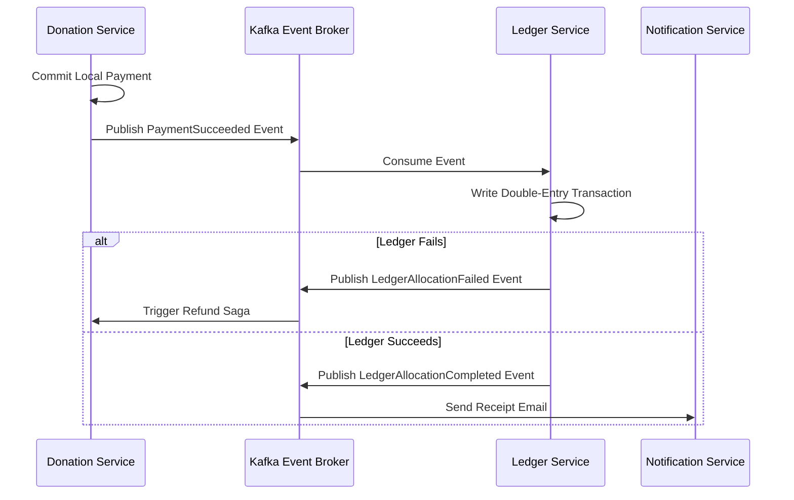

# Social Impact Platform - Service Architecture & Low-Level Design

This document details the microservice-ready low-level architecture for the 12 primary services of the Social Impact Platform. Every service is designed for horizontal scalability, asynchronous queue-first processing where appropriate, Redis caching, and resilient database interactions.

---

## 1. **Auth Service (Authentication & Identity)**

### Responsibilities
- User registration, login, and multi-factor authentication (MFA).
- OAuth2 integrations (Google, LinkedIn) and session lifecycle management.
- Issuing and validating JWT tokens (Access and Refresh tokens).
- Session tracking and device fingerprinting.

### Classes & Repositories
- `AuthController`: Handles HTTP request routing, cookie management, and MFA checks.
- `AuthService`: Core domain logic for credentials verification, JWT generation, and provider callbacks.
- `SessionRepository`: Manages active session entries in PostgreSQL, with caching in Redis.
- `UserRepository`: Interface for user record reads and password hash validations.

### DTOs & Interfaces
```typescript
interface SignUpDTO {
  email: string;
  password_hash: string;
  full_name: string;
  device_fingerprint: string;
}

interface LoginDTO {
  email: string;
  password_hash: string;
  device_fingerprint: string;
}

interface SessionTokenPair {
  access_token: string;
  refresh_token: string;
  expires_at: number;
}
```

### Database & Cache Interactions
- **Write**: Inserts a record into the `users` and `sessions` tables.
- **Read**: Fetches users by email or sessions by hash.
- **Cache**: Stores session metadata in Redis with a TTL matching token expiry (`auth:sessions:{token_hash}`).
- **Invalidation**: On logout, deletes the session from Redis and marks `revoked_at` in the PostgreSQL database.

### Failures, Retries, & Concurrency
- **Failure**: OAuth callback timeout. Mitigation: Fallback to username/password; log error and alert.
- **Idempotency**: Password resets are linked to a single-use token UUID cached in Redis with a 15-minute TTL.
- **Concurrency**: User creation has a unique constraint on email. Concurrent registrations fail gracefully at the database level, throwing a `409 Conflict` exception.

---

## 2. **Organization Service (Hierarchy & Config)**

### Responsibilities
- Organization CRUD operations.
- Managing hierarchical operations (ancestors, descendants, moving parent nodes).
- Dynamically configuring capabilities (enabling modules like donations, grants) and metadata properties.

### Classes & Repositories
- `OrganizationController`: Exposes tree traversal and configuration APIs.
- `OrganizationService`: Executes tree validations (e.g. preventing self-referencing loops) and calculates trust/risk scores.
- `OrganizationRepository`: Integrates with PostgreSQL using `ltree` extensions.

### DTOs & Interfaces
```typescript
interface CreateOrgDTO {
  name: string;
  parent_id?: string;
  org_type: string;
  metadata: Record<string, any>;
}

interface MoveOrgDTO {
  organization_id: string;
  new_parent_id: string;
}
```

### Database & Cache Interactions
- **Write**: Appends new organizations. The PostgreSQL trigger automatically computes `hierarchy_path`.
- **Read**: Executes recursive queries using `<@` (descendants) and `@>` (ancestors) ltree operators.
- **Cache**: Caches compiled organization trees in Redis (`org:tree:{root_id}`) with a 24-hour TTL.
- **Invalidation**: Clears tree cache in Redis whenever an organization is updated or hierarchy path changes.

### Failures, Retries, & Concurrency
- **Failure**: Recursive hierarchy loop during parent updates. Mitigation: Service checks `new_parent_path` to ensure it does not contain the `organization_id` before committing.
- **Concurrency**: High concurrent profile updates are resolved using **Optimistic Concurrency Control (OCC)** using an `updated_at` check clause.

---

## 3. **Authorization & Permission Service (Access Control Engine)**

### Responsibilities
- Managing global roles (`ADMIN`, `USER`) and organization-scoped roles (`ORG_ADMIN`, `PROFESSOR`, `RESEARCHER`, etc.).
- Evaluating dynamic database-driven permissions (`Permission`, `RolePermission` tables).
- Checking ABAC policy rules using user attributes, organization memberships, and resource ownership.

### Classes & Repositories
- `PermissionController`: Endpoint for checking and managing permissions.
- `PermissionService`: Evaluates DB permissions, manages default seeds, and handles fallback matrix logic.
- `PolicyEvaluator`: Evaluates JSON and attribute-based ABAC conditions.
- `PermissionRepository`: Interface to read/write permissions and role mappings.

### Interfaces & DTOs
```typescript
interface PermissionCheckDTO {
  user_id: string;
  organization_id?: string;
  permission_key: string;
  resource_context?: Record<string, any>;
}

interface RolePermissionDTO {
  role: string;
  permission_key: string;
}
```

### Database & Cache Interactions
- **Write**: Inserts dynamic permission definitions and role mappings in `identity.permissions` and `identity.role_permissions`.
- **Read**: Fetches effective permissions for global and organization roles.
- **Cache**: Caches compiled permission keys (`perm:role:{role}`) in Redis with a 15-minute TTL.
- **Invalidation**: On updating role permission mappings, clears Redis permission cache keys.

### Failures, Retries, & Concurrency
- **Failure**: Database connectivity loss during permission checks. Mitigation: Service falls back to in-memory static permission matrix.
- **Concurrency**: Role-permission updates use unique constraints (`role`, `permissionKey`) to prevent duplicate entry collisions.

---

## 4. **Onboarding Service (Workflow Orchestrator)**

### Responsibilities
- Managing workflow templates and parsing JSON configurations.
- Driving the state machine for applications (Draft -> Submitted -> In Verification -> Approved).
- Rate-limiting incoming applications using Kafka buffering to handle 20K+ concurrent submissions.

### Classes & Repositories
- `OnboardingController`: API for submissions and status lookups.
- `OnboardingCommandProducer`: Serializes and pushes applications to Kafka.
- `OnboardingWorker`: Consumes applications, runs basic checks, and initiates verifications.
- `WorkflowInstanceRepository`: Interacts with `workflow_instances` database table.

### DTOs & Interfaces
```typescript
interface SubmitApplicationDTO {
  applicant_email: string;
  applicant_name: string;
  org_type: string;
  form_data: Record<string, any>;
  idempotency_key: string;
}
```

### Database & Cache Interactions
- **Write**: The controller bypasses direct DB inserts under high load. The worker reads from Kafka and writes to `workflow_instances`.
- **Read**: Read-model queries fetch status by ID.
- **Cache**: Caches workflow templates (`onboarding:template:{id}`).

### Failures, Retries, & Concurrency
- **Failure**: Worker node crashes mid-step. Mitigation: Kafka offset is not committed until the database transaction succeeds. On restart, the worker re-consumes and resumes.
- **Idempotency**: Checked against the `idempotency_key` using Redis with an atomic `SET NX` command.
- **Transactions**: Step state updates are wrapped in `SERIALIZABLE` PostgreSQL transactions.

---

## 5. **Verification Service (Validation Pipeline)**

### Responsibilities
- Coordinating third-party validations (Email tokens, government CIN/PAN registries).
- Triggering document AI classification and fraud metrics calculations.
- Orchestrating human review assignments.

### Classes & Repositories
- `VerificationManager`: Schedules parallel verification tasks.
- `RegistryClient`: Connects to external government registration APIs.
- `VerificationRepository`: Manages CRUD operations on the `verifications` table.

### Database & Cache Interactions
- **Write**: Worker updates statuses in `verifications` table.
- **Read**: Queries list of pending external verification checks.
- **Cache**: Dynamic rate-limits for external APIs are tracked in Redis.

### Failures, Retries, & Concurrency
- **Failure**: Third-party API is down. Mitigation: Task is rescheduled to a delayed Kafka retry queue using exponential backoff (e.g. 5m, 15m, 1h).
- **Concurrency**: Triggers are locked using row-level select locks (`SELECT ... FOR UPDATE`) during status updates.

---

## 6. **Ledger & Wallet Service (Double-Entry Engine)**

### Responsibilities
- Creating ledger accounts and tracking financial balances.
- Guaranteeing complete double-entry transaction compliance (debits match credits).
- Disbursing grants and processing internal wallet transfers.

### Classes & Repositories
- `LedgerController`: Exposes statements and balance lookups.
- `LedgerService`: Assembles transactions, executes balance checks, and logs double entries.
- `LedgerRepository`: Direct database actions for `ledger_accounts`, `ledger_transactions`, and `ledger_entries`.

### DTOs & Interfaces
```typescript
interface LedgerEntryInput {
  account_id: string;
  amount: number; // Debit is positive (+), Credit is negative (-)
  entry_type: 'DEBIT' | 'CREDIT';
}

interface CreateLedgerTransactionDTO {
  tenant_id: string;
  reference_type: string;
  reference_id: string;
  description: string;
  entries: LedgerEntryInput[];
}
```

### Database & Cache Interactions
- **Write**: Appends a header row to `ledger_transactions` and entry rows to `ledger_entries` in a single ACID transaction. The database deferred trigger validates that the entries balance to zero.
- **Read**: Balance calculated via SUM query: `SELECT SUM(amount) FROM ledger_entries WHERE account_id = ?`.
- **Cache**: Caches pre-calculated account balances in Redis (`ledger:balance:{account_id}`) using write-through cache logic.

### Failures, Retries, & Concurrency
- **Failure**: A transaction entry does not balance. Mitigation: The deferred database trigger fails the transaction and rolls back all writes.
- **Concurrency**: High-throughput balance checks are isolated from direct update locks. We use append-only entries, completely eliminating deadlocks associated with updating single balance columns.

---

## 7. **Donation Service (Payment Routing)**

### Responsibilities
- Creating payment intents and integrating with Stripe/Razorpay.
- Receiving and processing payment status webhooks.
- Recording successful transactions in the double-entry ledger.

### Classes & Repositories
- `DonationController`: Handles payment redirection, checkouts, and webhooks.
- `PaymentServiceGateway`: Coordinates with Stripe/Razorpay APIs.
- `DonationRepository`: Interfaces with `donations` table.

### Database & Cache Interactions
- **Write**: Inserts a pending donation record. On webhook success, updates state and calls Ledger Service.
- **Read**: Fetches donation history for reporting.
- **Cache**: Idempotency keys mapping gateway transactions to internal IDs are stored in Redis (`donation:idempotency:{key}`).

### Failures, Retries, & Concurrency
- **Failure**: Payment succeeds but webhook delivery fails. Mitigation: Re-query the gateway status using a scheduled cron job (Reconciliation Loop) for pending payments.
- **Idempotency**: Enforced at the gateway level and inside the DB via unique index on `idempotency_key`.

---

## 8. **Grant Service (Applications & Milestones)**

### Responsibilities
- Managing grant templates and configurations.
- Driving proposal submission reviews and score aggregation.
- Tracking milestones and coordinating fund disbursements.

### Classes & Repositories
- `GrantController`: Handles grant applications and reviews.
- `GrantService`: Processes reviewer score calculations and checks eligibility.
- `GrantRepository`: Interface for grants and proposals tables.

### Database & Cache Interactions
- **Write**: Records applications, proposal reviews, and milestone reports.
- **Read**: Retrieves eligibility criteria and details.
- **Cache**: Frequently read grant definitions are cached.

---

## 9. **Document Service (Blob Registry)**

### Responsibilities
- Generating S3 pre-signed upload URLs and recording document metadata.
- Coordinating async document scanning and OCR processes.
- Managing access control and enforcing retention policies.

### Classes & Repositories
- `DocumentController`: Handles uploads and metadata.
- `S3StorageProvider`: Coordinates file uploads and presigning.
- `DocumentRepository`: Integrates with `documents` database table.

### Database & Cache Interactions
- **Write**: Inserts document records.
- **Read**: Resolves parent document IDs for version histories.
- **Cache**: Presigned download URLs are cached for their duration.

---

## 10. **Notification Service (Delivery Dispatcher)**

### Responsibilities
- Parsing template variables and dispatching multi-channel communications.
- Managing user channel preferences and tracking delivery outcomes.

### Classes & Repositories
- `NotificationConsumer`: Listens to Kafka event streams.
- `NotificationDispatcher`: Sends payloads to AWS SES, Twilio, or Firebase.
- `NotificationQueueRepository`: Manages notifications database queue.

### Database & Cache Interactions
- **Write**: Records sent logs.
- **Read**: Polls high-priority messages.
- **Cache**: User channel preferences are cached in Redis.

---

## 11. **Search Service (Discovery & Analytics)**

### Responsibilities
- Indexing entities (organizations, campaigns, grants) into OpenSearch.
- Servicing full-text and faceted search queries.

### Classes & Repositories
- `SearchController`: Exposes autocomplete and search API.
- `SearchSyncWorker`: Consumes events from Kafka to update OpenSearch indices.
- `OpenSearchGateway`: Interacts with OpenSearch cluster.

### Database & Cache Interactions
- **Write**: Synchronizes changes directly to OpenSearch.
- **Read**: Reads are directed straight to OpenSearch, relieving PostgreSQL read load.
- **Cache**: Common search results are cached in Redis.

---

## 12. **Reporting Service (Aggregator)**

### Responsibilities
- Calculating dashboards metrics and compiling audit records.
- Synchronizing historical logs to data warehouses (ClickHouse).

### Classes & Repositories
- `ReportingController`: Outputs financial statements and dashboard summaries.
- `WarehouseSyncWorker`: Processes data extracts for ClickHouse.
- `DashboardMetricsRepository`: Manages `dashboard_metrics` table.

### Database & Cache Interactions
- **Write**: Stores daily summarized metrics.
- **Read**: Queries materialized tables.
- **Cache**: Dashboard metrics are heavily cached with cache-aside policies.

---

## **Core Architectural Cross-Cutting Concerns**

### 1. **Idempotency Architecture**
- Every API mutating state must accept an `Idempotency-Key` header.
- On request, the API Gateway checks Redis: `SET rquest:idempotency:{key} IN_PROGRESS NX EX 86400`.
- If it fails, return `409 Conflict`. If it succeeds, the request runs. Upon completion, the result is saved in Redis: `SET rquest:idempotency:{key} {status: 200, body: ...}`.

### 2. **Distributed Transaction Patterns (Sagas)**
- In multi-step transactions (e.g. Donation completed -> Mint tokens -> Notify user), we use **Orchestrated Sagas** via Kafka:


### 3. **Retry Strategy & Dead Letter Queues (DLQ)**
- **Immediate Retries**: Simple network failures retry 3 times with exponential backoff.
- **Delayed Retries (Kafka)**: Transient service failures push the message to `{topic}_retry_5m` or `{topic}_retry_15m` partitions.
- **DLQ**: After maximum retries, messages land in `{topic}_dlq` for manual investigation and replay scripts.

### 4. **Connection Pool Management (PgBouncer)**
- To handle 20K+ concurrent user operations, services must not open direct DB connections.
- We utilize **PgBouncer** in **Transaction Pooling Mode**.
- Active connections per service instance are capped at 50, supporting tens of thousands of active client transactions.
- Keep-Alives and idle timeouts are configured aggressively: `idle_transaction_timeout = 5000` ms.
