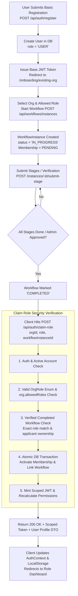

# Registration, Workflow Verification & Role Claiming Implementation Plan

This plan details the end-to-end architecture and fixes for the user onboarding lifecycle:
**Basic Registration (`USER` role) ➔ Role Workflow Execution ➔ Workflow Completion ➔ Role Claiming (`claimRole`) ➔ Database Role Activation & Scoped JWT Issuance**.

---

## Architecture Overview



---

## User Review Required

> [!IMPORTANT]
> **Key Security & Architectural Fixes Included in this Plan:**
> 1. **Removal of Premature Role Provisioning**: In `prisma-governance-repository.adapter.js`, starting a workflow previously granted immediate `status: ACTIVE` in `memberships`. This will be changed to `status: PENDING` so that unverified users cannot bypass workflows.
> 2. **Strict Role Matching**: Replaces loose substring searches (`.contains`) on template titles/slugs with strict equality checks on `instanceData.selectedRole` and validated `OrgRole` enums.
> 3. **Transactional Integrity**: Database membership activation and workflow applicant linking will execute inside a `prisma.$transaction`.
> 4. **Seamless Frontend Handoff**: `WorkflowRunner.tsx` will automatically invoke `claimRole` upon completion (or on button click), update `AuthContext` with the new scoped token, and redirect to the appropriate role dashboard.

---

## Proposed Changes

### 1. Server - Auth Validation & Constants

#### [MODIFY] [auth.validator.js](file:///home/dino/Documents/Coding/Freelance/dx-v2.0/server/src/modules/auth/auth.validator.js)
- Update `claimRoleSchema` to strictly validate `role` against allowed `OrgRole` enum values (`STUDENT`, `ORG_ADMIN`, `PROFESSOR`, `RESEARCHER`, `MENTOR`, `INCUBATOR_MANAGER`, `COMPLIANCE_OFFICER`, `GOV_OFFICIAL`, `STUDENT_PRESIDENT`, `CORPORATE_ADMIN`, `DONOR`).
- Validate `organizationId` format and `workflowInstanceId` as optional UUID.

---

### 2. Server - Auth Service & Role Claiming

#### [MODIFY] [auth.service.js](file:///home/dino/Documents/Coding/Freelance/dx-v2.0/server/src/modules/auth/auth.service.js)
- Enhance `claimRole(authenticatedUser, { organizationId, role, workflowInstanceId })`:
  1. **Strict Role & Org Permissions**:
     - Ensure `requestedRole` is in `OrgRole` enum.
     - Check if `org.allowedRoles` permits `requestedRole`.
  2. **Applicant Ownership & Email Verification Enforcement**:
     - If matching by `applicantEmail`, require `authenticatedUser.profileMetadata?.emailVerified === true` to prevent hijacking.
  3. **Strict Workflow Lookup**:
     - Query `WorkflowInstance` where `tenantId = org.id`, `status = 'COMPLETED'`, and exact `instanceData.selectedRole = requestedRole` (or `instanceData.role = requestedRole`).
     - Remove loose substring matching on template name/slug.
  4. **Atomic Transactional Database Updates**:
     - Wrap `prisma.membership.upsert` (`status = 'ACTIVE'`, `joinedAt = new Date()`) and `prisma.workflowInstance.update` in `prisma.$transaction`.
  5. **Scoped Profile Generation**:
     - Call `sessionService.switchProfile` to calculate permissions and generate a scoped JWT containing `activeTenantId` and the active `role`.
  6. **Audit Trail**:
     - Add non-blocking audit logging for claimed roles.

---

### 3. Server - Governance Workflow Adapter

#### [MODIFY] [prisma-governance-repository.adapter.js](file:///home/dino/Documents/Coding/Freelance/dx-v2.0/server/src/modules/governance/adapters/prisma-governance-repository.adapter.js)
- In `createWorkflowInstance`:
  - Change premature `status: 'ACTIVE'` membership provisioning to `status: 'PENDING'`.
- In `submitStageData`:
  - When the final stage completes, mark `status = 'COMPLETED'`, `completedAt = new Date()`, and ensure role data is consistently structured in `instanceData.selectedRole`.

---

### 4. Client - Frontend Workflow Completion & Role Claiming

#### [MODIFY] [WorkflowRunner.tsx](file:///home/dino/Documents/Coding/Freelance/dx-v2.0/client/src/components/workflow/engine/WorkflowRunner.tsx)
- Add state and handler to trigger `claimRole(organizationId, role, instance.id)` upon workflow completion.
- Render smooth loading feedback ("Activating role & issuing verified credentials...") and a success celebration card with active role badges.
- Provide a button to proceed to the activated dashboard (or automatically switch profile).

#### [MODIFY] [authService.ts](file:///home/dino/Documents/Coding/Freelance/dx-v2.0/client/src/services/authService.ts)
- Ensure `claimRole` properly saves the returned token via `setToken` and returns typed user information.

---

### 5. Server Test Suite Alignment

#### [MODIFY] [testApp.js](file:///home/dino/Documents/Coding/Freelance/dx-v2.0/server/tests/helpers/testApp.js)
- Fix legacy route require paths (`src/modules/auth/routes/auth.routes`).

#### [NEW] [claim-role.test.js](file:///home/dino/Documents/Coding/Freelance/dx-v2.0/server/tests/integration/claim-role.test.js)
- Add comprehensive integration tests verifying:
  - Valid claim role after completed workflow returns 200 + scoped token + active profile.
  - Incomplete/in-progress workflow is rejected with 403.
  - Mismatched role or unauthorized applicant is rejected with 403.
  - Disallowed organization role is rejected with 400.

---

## Verification Plan

### Automated Tests
1. Run backend integration tests:
   ```bash
   npx jest tests/integration/auth.test.js
   npx jest tests/integration/claim-role.test.js
   ```
2. Verify TypeScript compile in client:
   ```bash
   cd client && npm run build
   ```

### Manual Verification
1. Register a new user (`POST /api/auth/register`) -> verify `role = USER` and base session token.
2. Navigate to `/onboarding/existing-org` -> select organization (e.g. `National Institute of Technology Kurukshetra`) and select role (`STUDENT`).
3. Complete the workflow stages in the UI -> verify the instance transitions to `COMPLETED`.
4. Trigger Claim Role -> verify `POST /api/auth/claim-role` returns 200, sets new scoped JWT, activates `Membership` as `ACTIVE` in DB, and loads active dashboard profile.
