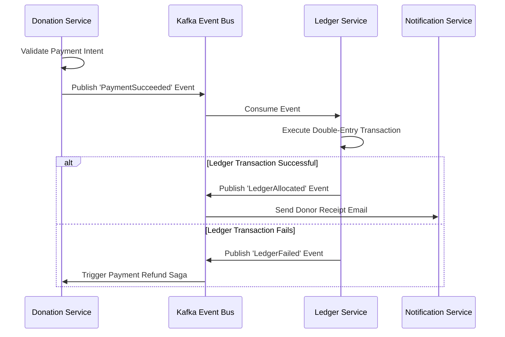

# System Architecture Overview: Social Impact Platform (dx-v2.0)

---

## 🏛️ Top-Level Architectural Blueprint

**dx-v2.0** is an enterprise-grade, event-driven microservice-ready platform engineered for extreme scale, auditability, and multi-tenant security.

```
                                  [ Client Web Application (Vite + React) ]
                                                     │
                                                     ▼
                                      [ Express API Gateway Subsystem ]
                                                     │
                         ┌───────────────────────────┼───────────────────────────┐
                         ▼                           ▼                           ▼
                 [ Redis Cache ]             [ Kafka Broker ]            [ PgBouncer Pool ]
            (Idempotency & Session)       (Command Event Bus)          (Transaction Mode)
                         │                           │                           │
                         ▼                           ▼                           ▼
                 [ OpenSearch ]             [ Background Workers ]       [ PostgreSQL DB ]
               (Faceted Discovery)          (Verification & Sagas)     (ltree, RLS, Ledgers)
```

---

## 🧩 The 12 Primary Core Services

1. **Auth Service**: User identity management, OAuth2 integration (Google, LinkedIn OIDC), MFA, and JWT session handling.
2. **Organization Service**: Hierarchical multi-tenancy management using PostgreSQL `ltree` extension for dynamic tree traversals.
3. **Authorization Service**: Dual-layered access control engine distinguishing global system roles (`User.role`) from local organization roles (`UserOrganization.role`).
4. **Onboarding Service**: Workflow template engine and ingestion API buffering high-concurrency application submissions.
5. **Verification Service**: Automated verification pipelines connecting third-party government registries (PAN, GST, CIN) and AI OCR processors.
6. **Ledger & Wallet Service**: Double-entry accounting compliance engine ensuring debits equal credits for every transaction.
7. **Donation Service**: Payment intent routing (Stripe/Razorpay), webhook reconciliation, and ledger event dispatch.
8. **Grant Service**: Milestone-tracked grant proposals, scoring matrices, and automated disbursement triggers.
9. **Document Service**: AWS S3 pre-signed upload/download URL management and malware scanning.
10. **Notification Service**: Asynchronous multi-channel dispatching (Email via AWS SES, SMS via Twilio, Push via Firebase).
11. **Search Service**: OpenSearch cluster management providing full-text and faceted search queries.
12. **Reporting Service**: ClickHouse data warehouse sync and real-time metric aggregation.

---

## 🔄 Distributed Sagas & Event Streaming

Multi-service operations (e.g. Donation Completed -> Double-Entry Ledger Created -> Grant Wallet Updated -> Receipt Email Dispatched) utilize **Orchestrated Sagas** over Apache Kafka.



---

## 🔒 Security & Data Isolation Strategy

* **PostgreSQL Row-Level Security (RLS)**: Enforces tenant isolation natively at the database layer (`SET LOCAL app.current_tenant_id = '...'`).
* **PgBouncer Pooling**: Solves connection exhaustion by maintaining transaction-level pooling across worker instances.
