# DreamXec (dx-v2.0) Campaign Frontend Specification & Design Architecture

> **Document Version**: 2.0.0  
> **Brand Style Target**: DreamXec v2.0 Brand & Social Design Language  
> **Status**: Official Engineering & UI/UX Standard  
> **Typography System**: Poppins (Primary) + Badlooking Brush (Secondary / Expressive)  
> **Color Identity**: Bold Energetic Quad-Primary + Dynamic High-Vibrancy Secondary Palette  
> **Companion Document**: [CAMPAIGN_MILESTONE_FUNDING_BRD.md](../docs/CAMPAIGN_MILESTONE_FUNDING_BRD.md)

---

## 1. Executive Summary & Design Vision

### 1.1 The Visual & Strategic Identity
The **DreamXec Campaign Frontend** merges **Neobrutalist Precision** (solid tactical outlines, zero-radius geometry, hard directional offset shadows) with **Vibrant Brand Energy** and **Handcrafted Creative Expression**.

The visual language directly reflects the spirit of research, imagination, and social impact:
* **Structured Rigor (Poppins Geometric Type + Bold Outlines)**: Communicates institutional transparency, fiscal discipline, dual-approval governance, and donor accountability.
* **Creative Spark (Badlooking Brush Typography + Energetic Palette)**: Highlights student curiosity, innovative breakthroughs, grassroots community action, and human stories.

```
┌──────────────────────────────────────────────────────────────────────────────────┐
│                             DreamXec Brand Identity                              │
│                                                                                  │
│   ┌────────────────────────────────┐         ┌───────────────────────────────┐   │
│   │    Structured Governance       │         │      Human Curiosity          │   │
│   │  • Poppins (Black / Med / Reg) │   ➕   │  • Badlooking Brush           │   │
│   │  • 3-5px Solid Borders         │         │  • Dynamic Doodles & Notes    │   │
│   │  • Hard Offset Box-Shadows     │         │  • Vibrant Multi-Color Accents│   │
│   └────────────────────────────────┘         └───────────────────────────────┘   │
└────────────────────────────────────────┬─────────────────────────────────────────┘
                                         │
                                         ▼
┌──────────────────────────────────────────────────────────────────────────────────┐
│                   Unified Campaign & Milestone Experience                        │
│   1. Multi-Step Campaign Builder (Escrow & Milestone Tranches)                   │
│   2. High-Impact Public Discovery & Rich Campaign Showcase                      │
│   3. Interactive Milestone Progress & Dual-Entry Escrow Transparency             │
│   4. Maker-Checker Verification & Post-Disbursement Evidence Portals            │
└──────────────────────────────────────────────────────────────────────────────────┘
```

---

## 2. Brand Design Tokens & System Reference

### 2.1 Primary Color Palette
The primary palette is bold, energetic, and expressive. It serves as the bedrock for structural hierarchy, state transitions, and primary calls-to-action.

| Color Name | Hex Code | RGB | Brand Meaning & Semantic Platform Role |
| :--- | :--- | :--- | :--- |
| **DreamX Orange** | `#FE4E1A` | `254, 78, 26` | **Creativity, Enthusiasm, Spark of Curiosity**: Primary CTA buttons (`.btn-dreamx-primary`), active tabs, donation progress bar fill, campaign hero highlights. |
| **Forest Green** | `#0F534A` | `15, 83, 74` | **Growth, Knowledge, Progress & Society**: Verified milestone badges, escrow release confirmations, institutional credibility tags, secondary header bars. |
| **Bright Red** | `#F4002C` | `244, 0, 44` | **Energy, Passion, Boundary-Pushing**: Urgent milestone deadlines, Maker-Checker rejection alerts, high-priority verification warnings, live countdown timers. |
| **Deep Purple** | `#4717AE` | `71, 23, 174` | **Wisdom, Intelligence, Intellectual Exploration**: Neobrutalist container frames/borders, headline contrast accents, governance dashboard panels, double-entry ledger cards. |

### 2.2 Secondary Supporting Palette
The secondary palette introduces flexibility, playfulness, and high-contrast accents across category pills, visual badges, charts, and interactive callouts.

| Color Name | Hex Code | RGB | Semantic Platform Role |
| :--- | :--- | :--- | :--- |
| **Bright Yellow** | `#FFDD33` | `255, 221, 51` | **Attention & Milestone In-Progress**: Pending review states, highlighted annotation banners, featured campaign ribbons, active step indicator fill. |
| **Bright Green** | `#9EFC5F` | `158, 252, 95` | **Success & Financial Reconciliation**: Reconciled invoice tags, instant settlement tags, donor leaderboard top badges. |
| **Pastel Pink** | `#FEB3FC` | `254, 179, 252` | **Community & Social Interaction**: Social share cards, backer comment bubbles, student club tags, impact quote callout containers. |
| **Vibrant Blue** | `#18D7E8` | `24, 215, 232` | **Telemetry, Analytics & Connectivity**: Live donor counters, real-time escrow analytics, telemetry graphs, university node tags. |

### 2.3 Structural Neutrals & Background Base

| Token | Hex / Value | Role |
| :--- | :--- | :--- |
| **Canvas Neutral** | `#FCFBF7` | Clean warm canvas base for light mode dashboards and landing views. |
| **Paper Tint** | `#FFF9F2` | Warm graph-paper card background with subtle dot-grid rules. |
| **Pure White** | `#FFFFFF` | Form input backgrounds, modal surfaces, and crisp card centers. |
| **Deep Obsidian** | `#121316` | Text headings, deep dark mode surfaces, and extreme contrast borders. |
| **Border Dark** | `#0F534A` or `#4717AE` | 3px to 5px solid neobrutalist structural borders. |

---

## 3. Typography Architecture & Hierarchy

### 3.1 Typeface Configuration

```
┌────────────────────────────────────────────────────────────────────────┐
│  PRIMARY: Poppins (Clean, Modern, Geometric Structured Clarity)         │
│  Weights: Black (900), ExtraBold (800), Bold (700), Medium (500), Reg (400)│
├────────────────────────────────────────────────────────────────────────┤
│  SECONDARY: Badlooking Brush (Handwritten Expression, Spark & Ideas)   │
│  Role: Annotations, Doodles, Editorial Quotes, Stylized Highlights     │
└────────────────────────────────────────────────────────────────────────┘
```

### 3.2 Hierarchy Rules

| Element Level | Typeface & Weight | CSS Font Size / Leading | Usage Context |
| :--- | :--- | :--- | :--- |
| **Hero Title** | `Poppins Black` (900) | `text-4xl md:text-6xl font-black leading-tight uppercase` | Main campaign headlines, hero titles, milestone target values. |
| **Section Header (H1/H2)** | `Poppins Black` / `Bold` | `text-2xl md:text-3xl font-black uppercase tracking-tight` | Module headers, wizard step titles, drawer headers. |
| **Subline / Subtitle** | `Poppins Medium` (500) | `text-base md:text-lg font-medium text-[#0F534A]` | Contextual descriptions, category subtitles, section leads. |
| **Card / Form Header (H3)** | `Poppins Bold` (700) | `text-lg md:text-xl font-bold tracking-normal` | Campaign card titles, milestone step titles, modal titles. |
| **Body Copy** | `Poppins Regular` (400) | `text-sm md:text-base font-normal leading-relaxed text-gray-800` | Campaign narrative, FAQ answers, evidence descriptions. |
| **Annotation / Doodles** | `Badlooking Brush` (400) | `font-brush text-lg md:text-2xl text-[#FE4E1A] -rotate-2` | Curated staff picks, "100% Verified!" notes, handwritten tags, impact doodles. |
| **Badges & Meta Caps** | `Poppins Bold` (700) | `text-[11px] font-black uppercase tracking-wider` | Category pills, KYC tags, Maker-Checker decision tags. |
| **Financial Monospace** | `Fira Code` / `Courier` | `font-mono text-sm font-bold` | Ledger transaction hashes, bank disbursement IDs, escrow smart balances. |

---

## 4. Frontend Component Catalog ("What Will Be Created")

```mermaid
graph TD
    A[DreamXec Campaign UI System] --> B[1. Discovery & Public Marketplace]
    A --> C[2. Multi-Step Campaign Wizard]
    A --> D[3. Dynamic Campaign Details & Engagement]
    A --> E[4. Donor Checkout & Escrow Ledger]
    A --> F[5. Maker-Checker Governance & Evidence Verification]
    A --> G[6. Expressive UI Primitives & Doodles]

    B --> B1[CampaignCard.tsx]
    B --> B2[CategoryFilterPills.tsx]
    B --> B3[ScrollStackFeatured.tsx]

    C --> C1[BasicPitchStep.tsx]
    C --> C2[MilestoneTrancheBuilder.tsx]
    C --> C3[BeneficiaryEscrowConfig.tsx]
    C --> C4[MediaDocumentUpload.tsx]

    D --> D1[InteractiveTrancheTimeline.tsx]
    D --> D2[PublicMilestoneEcosystem.tsx]
    D --> D3[StickyDonateCTA.tsx]
    D --> D4[SocialShareKit.tsx]

    E --> E1[DonateModal.tsx]
    E --> E2[DualEntryReceiptModal.tsx]

    F --> F1[MilestoneProofModal.tsx]
    F --> F2[MakerCheckerReviewPanel.tsx]
    F --> F3[PostDisbursementReconciliation.tsx]

    G --> G1[BrushAnnotation.tsx]
    G --> G2[TactileNeobrutalistButton.tsx]
    G --> G3[DreamxProgressBar.tsx]
```



---

### Component 1: `CampaignCard.tsx` (Public Discovery & Browse)
* **Visual Style**:
  * Neobrutalist container with `4px solid #4717AE` (Deep Purple) or `#0F534A` (Forest Green).
  * Hard offset shadow: `6px 6px 0px #FE4E1A` (DreamX Orange).
  * Subtle hover transform: `translate(-3px, -3px)` with expanded shadow `9px 9px 0px #FE4E1A`.
* **Sub-elements**:
  * **Category Pill**: High-contrast top-left tag using secondary colors (`bg-[#FFDD33]` Yellow or `bg-[#18D7E8]` Blue).
  * **Verified Stamp**: Top-right tactile badge in `bg-[#0F534A]` with white Poppins Bold text.
  * **Image Canvas**: 16:9 banner with solid bottom border divider.
  * **Title**: `Poppins Black` 2-line clamped headline.
  * **Handwritten Annotation**: `Badlooking Brush` callout (e.g., *"Milestone 2 in progress!"* or *"Grant Matched 2x"*).
  * **Milestone Mini-Meter**: Segmented 3-5 bar progress strip showing completed vs pending tranches.
  * **Funding Progress Bar**: `bg-[#FE4E1A]` fill on `#FFF9F2` track with numeric percentage in `Poppins Black`.
  * **CTA Footer**: Quick Donate & View Story buttons with Neobrutalist tactile press styling.

---

### Component 2: `CreateCampaign.tsx` (Milestone-First Campaign Wizard)
A 5-step guided creation flow adhering to the strict business requirements from `CAMPAIGN_MILESTONE_FUNDING_BRD.md`:

```
┌───────────────────────────────────────────────────────────────────────────┐
│                          CAMPAIGN CREATION STEPPER                        │
│  [1. Basic Story] ➔ [2. Milestone Tranches] ➔ [3. Beneficiary & Bank] ➔   │
│  [4. Media & Proof Plan] ➔ [5. Review & Submit for Review]                │
└───────────────────────────────────────────────────────────────────────────┘
```

* **Step 1: Pitch & Categorization**:
  * Campaign title, slug, category selection (`RESEARCH_GRANT`, `STARTUP_INNOVATION`, `TUITION_FEE`, `COMMUNITY_PROJECT`, `EMERGENCY_AID`).
  * Short summary & rich Markdown story editor.
  * Target amount input with instant currency conversion (`USD` / `INR`).
* **Step 2: Milestone Tranche Builder (Core Business Engine)**:
  * Dynamic list builder where creators define 2 to 6 specific delivery milestones.
  * For each milestone: Title, Target Date, Tranche Amount (or Percentage), Acceptance Criteria, Expected Deliverables (e.g., Prototype Video, Lab Test Report, Vendor Bill).
  * **Validation Rule**: Sum of all milestone budgets must strictly equal the campaign total funding goal (real-time validation indicator).
* **Step 3: Beneficiary & Bank Escrow Configuration**:
  * Individual student vs Institution/Club/NGO recipient selection.
  * KYC / KYB document upload slots with real-time status tracker.
  * Bank Account / UPI / Stripe Connect payout gateway linkage.
* **Step 4: Media & Proof Architecture**:
  * Cloudinary direct-to-cloud signed upload dropzones for 16:9 cover image, gallery photos, and explainer video.
  * Supporting PDF research proposals, university endorsement letters.
* **Step 5: Social Share & Launch Preview**:
  * Live mockup card showing how the campaign will unfurl on WhatsApp, Twitter/X, and LinkedIn.
  * Terms & Maker-Checker accountability declaration checkbox.

---

### Component 3: `CampaignDetails.tsx` & `PublicMilestoneEcosystem.tsx`
The primary public destination for donors and stakeholders.

* **Hero Section**:
  * Full-width display container with `5px solid #0F534A` outline.
  * Big `Poppins Black` title, author/club credentials with university badge.
  * Floating `Badlooking Brush` editorial sticky notes (*"Student Led · Verified by Faculty"*).
* **Tranche & Milestone Governance Ecosystem**:
  * Visual interactive milestone progression tree (`InteractiveTrancheTimeline.tsx`).
  * States: `PLANNED` (Muted), `IN_PROGRESS` (Active `#FFDD33` Yellow outline), `SUBMITTED` (Pending Verification), `VERIFIED` (Success `#0F534A` Green with checkmark), `DISBURSED` (`#FE4E1A` Orange celebration badge).
  * Expanding milestone card: Reveals detailed acceptance criteria, submitted proof files, reviewer verification timestamps, and disbursed payout ledger receipts.
* **Double-Entry Escrow Transparency Panel**:
  * Donor contributions collected $\rightarrow$ Held in Platform Escrow $\rightarrow$ Disbursed to Beneficiary $\rightarrow$ Remaining Locked.
  * Visual donut chart or tiered stack bar in `#FE4E1A`, `#0F534A`, `#18D7E8`, `#4717AE`.
* **Sticky Funding Action Sidebar (`VerticalStickyCTA.tsx` / `MobileDonateCTA.tsx`)**:
  * Pinned funding summary card with live backer count and countdown clock (`ResearchFlipClock.tsx`).
  * Fast amount selector buttons ($25, $50, $100, $250, Custom).
  * Primary Action: "Fund This Campaign" (`.btn-dreamx-primary`).

---

### Component 4: `MilestoneProofModal.tsx` & Maker-Checker Verification Queue
* **Role**: Used by Campaign Owners to submit proof of work, and by Reviewers/Finance Officers to inspect and dual-authorize tranche releases.
* **UI Features**:
  * Multi-file drag-and-drop supporting PDF invoices, MP4 prototype demo videos, laboratory data sheets.
  * Split-screen document viewer: Evidence file on the left, Acceptance Checklist on the right.
  * **Maker Action Panel (Verification Officer)**: Check off criteria $\rightarrow$ Add verification notes $\rightarrow$ Sign proof endorsement.
  * **Checker Action Panel (Finance Officer)**: Review verification endorsement $\rightarrow$ Verify double-entry escrow balance $\rightarrow$ 2FA authorization $\rightarrow$ Trigger payout release.

---

### Component 5: `DonateModal.tsx` & Double-Entry Donor Receipt
* **Payment Flow**:
  * Step 1: Contribution Amount & Tip slider.
  * Step 2: Milestone Allocation Preference (Fund General Pool vs Specific Milestone Tranche).
  * Step 3: Payment Gateway Checkout (Stripe / Razorpay).
  * Step 4: Instant Neobrutalist Receipt Card with immutable ledger hash, tax-exemption certificate download, and one-click social share buttons.

---

### Component 6: Expressive Visual Primitives
* **`BrushAnnotation.tsx`**: Lightweight component rendering curved handwritten brush highlights, underlines, circles, and speech callouts using SVG strokes with the `Badlooking Brush` typeface.
* **`TactileNeobrutalistButton.tsx`**: Reusable button primitive supporting 4 brand color variants (`orange`, `forest-green`, `deep-purple`, `bright-red`) with physical translation on active press.
* **`DreamxProgressBar.tsx`**: Segmented or striped progress bar with animated striped fills and milestone pin markers.

---

## 5. How It Will Be Used (Role-Based User Workflows)

### 5.1 The Donor Experience
```
1. Browse Feed ➔ Filter by Category/University (Poppins Bold Cards + Brush Highlights)
2. View Campaign ➔ Inspect Milestone 1 & 2 deliverables and verified evidence
3. Click "Fund Campaign" ➔ Select amount in DonateModal ➔ Complete 1-Click checkout
4. Receive Neobrutalist Double-Entry Receipt ➔ Track real-time tranche release notifications
```

### 5.2 The Campaign Creator (Student / Researcher / NGO)
```
1. Launch Wizard (CreateCampaign.tsx) ➔ Set Title, Target Amount & Story
2. Configure 3 Milestone Tranches with measurable Acceptance Criteria
3. Submit for Verification ➔ Undergoes Maker review
4. Campaign goes live ➔ Collects donations into Escrow
5. Complete Milestone 1 ➔ Open MilestoneProofModal.tsx ➔ Upload receipts & demo video
6. Receive payout upon dual-authorization ➔ Post post-disbursement evidence
```

### 5.3 The Reviewer / Verification Officer (Maker)
```
1. Access Verification Portal ➔ Open pending milestone case
2. Review uploaded documents side-by-side against original Acceptance Criteria
3. Approve Milestone Deliverable ➔ Creates immutable verification claim
```

### 5.4 The Finance & Treasury Officer (Checker)
```
1. Access Disbursement Authorization Queue
2. Inspect Maker's verification report & escrow ledger balance
3. Authorize Tranche Release via 2FA ➔ Ledger executes double-entry transfer ➔ Funds disbursed
```

---

## 6. Business Use Case Resolution Matrix

| Business Requirement (from BRD) | Frontend Component / Feature Solution | Brand & UI Styling Implementation |
| :--- | :--- | :--- |
| **Milestone-Linked Tranche Releases (§1.1)** | `MilestoneTrancheBuilder.tsx` & `InteractiveTrancheTimeline.tsx` | Segments funding into distinct milestones styled with `#FE4E1A` active bars and `#0F534A` checkmarks. |
| **Maker-Checker Four-Eyes Governance (§2.2)** | `MakerCheckerReviewPanel.tsx` & `MilestoneProofModal.tsx` | Visual two-step approval badge (Step 1: Verification Officer `#18D7E8`, Step 2: Finance Officer `#4717AE`). |
| **Double-Entry Financial Transparency (§1.2)** | `LiveEscrowTracker.tsx` & `DonationHistoryModal.tsx` | High-contrast balance card showing Total Raised = Escrow Locked + Disbursed with `#9EFC5F` verified stamps. |
| **Cloudinary Media Ingestion & Evidence (§2.4)** | `MediaDocumentUpload.tsx` with thumbnail preview | 4px solid bordered drag-drop box with `.btn-dreamx-secondary` upload triggers. |
| **Social Unfurls & Viral Sharing (§3.1)** | `SocialShareKit.tsx` & dynamic OpenGraph card generator | Pre-formatted share cards utilizing `Poppins Black` titles + `Badlooking Brush` quotes on `#FEB3FC` Pink backgrounds. |
| **Donor Confidence & Real-Time Tracking (§1.3)** | `PublicMilestoneEcosystem.tsx` & `ResearchFlipClock.tsx` | Animated flip counter and public ledger timeline displaying proof files and audit logs. |

---

## 7. Technical Implementation Reference

### 7.1 Tailwind Configuration Extension (`tailwind.config.js`)

```javascript
/** @type {import('tailwindcss').Config} */
module.exports = {
  theme: {
    extend: {
      colors: {
        dreamx: {
          // Primary Palette
          orange: '#FE4E1A',
          'orange-hover': '#e03d0d',
          forest: '#0F534A',
          'forest-light': '#18776b',
          red: '#F4002C',
          purple: '#4717AE',
          'purple-deep': '#350f87',

          // Secondary Palette
          yellow: '#FFDD33',
          'bright-green': '#9EFC5F',
          pink: '#FEB3FC',
          blue: '#18D7E8',

          // Functional Neutrals
          canvas: '#FCFBF7',
          paper: '#FFF9F2',
          obsidian: '#121316',
        }
      },
      fontFamily: {
        sans: ['Poppins', 'system-ui', 'sans-serif'],
        display: ['Poppins', 'sans-serif'],
        headline: ['Poppins', 'sans-serif'],
        brush: ['"Badlooking Brush"', 'cursive', 'sans-serif'],
        mono: ['"Fira Code"', 'monospace'],
      },
      boxShadow: {
        'neo-sm': '2px 2px 0px #0F534A',
        'neo-orange': '4px 4px 0px #FE4E1A',
        'neo-purple': '5px 5px 0px #4717AE',
        'neo-forest': '5px 5px 0px #0F534A',
        'neo-card': '6px 6px 0px #FE4E1A, 10px 10px 0px #4717AE',
        'neo-hover': '8px 8px 0px #FE4E1A',
      },
      borderWidth: {
        3: '3px',
        4: '4px',
        5: '5px',
      }
    }
  }
};
```

### 7.2 Core CSS & Font Face Definitions (`client/src/index.css`)

```css
@import url('https://fonts.googleapis.com/css2?family=Poppins:ital,wght@0,300;0,400;0,500;0,600;0,700;0,800;0,900;1,700&display=swap');

@font-face {
  font-family: 'Badlooking Brush';
  src: url('/fonts/BadlookingBrush.woff2') format('woff2'),
       url('/fonts/BadlookingBrush.ttf') format('truetype');
  font-weight: normal;
  font-style: normal;
  font-display: swap;
}

/* ─────────────────────────────────────────────
   TACTILE NEOBRUTALIST BUTTONS
───────────────────────────────────────────── */
.btn-dreamx-primary {
  background-color: #FE4E1A;
  color: #FFFFFF;
  font-family: 'Poppins', sans-serif;
  font-weight: 800;
  text-transform: uppercase;
  letter-spacing: 0.05em;
  border: 3px solid #0F534A;
  box-shadow: 4px 4px 0px #0F534A;
  transition: all 0.15s ease-in-out;
}

.btn-dreamx-primary:hover {
  transform: translate(-2px, -2px);
  box-shadow: 6px 6px 0px #0F534A;
}

.btn-dreamx-primary:active {
  transform: translate(2px, 2px);
  box-shadow: 2px 2px 0px #0F534A;
}

.btn-dreamx-secondary {
  background-color: #0F534A;
  color: #FFFFFF;
  font-family: 'Poppins', sans-serif;
  font-weight: 700;
  border: 3px solid #4717AE;
  box-shadow: 4px 4px 0px #4717AE;
  transition: all 0.15s ease-in-out;
}

.btn-dreamx-secondary:hover {
  transform: translate(-2px, -2px);
  box-shadow: 6px 6px 0px #4717AE;
}

/* ─────────────────────────────────────────────
   EXPRESSIVE BRUSH ANNOTATIONS
───────────────────────────────────────────── */
.font-brush {
  font-family: 'Badlooking Brush', cursive, sans-serif;
}

.brush-annotation-orange {
  font-family: 'Badlooking Brush', cursive;
  color: #FE4E1A;
  transform: rotate(-2deg);
  display: inline-block;
}

.brush-highlight-yellow {
  background: linear-gradient(180deg, transparent 60%, #FFDD33 60%);
  padding: 0 4px;
}

/* ─────────────────────────────────────────────
   NEOBRUTALIST CONTAINERS
───────────────────────────────────────────── */
.card-dreamx {
  background-color: #FFFFFF;
  border: 4px solid #0F534A;
  box-shadow: 6px 6px 0px #4717AE;
  border-radius: 0px;
}

.card-dreamx-featured {
  background-color: #FFF9F2;
  border: 4px solid #4717AE;
  box-shadow: 8px 8px 0px #FE4E1A;
}
```

### 7.3 Sample React Implementation: `InteractiveTrancheTimeline.tsx`

```tsx
import React from 'react';
import { CheckCircle2, Clock, ShieldCheck, AlertCircle } from 'lucide-react';

export interface MilestoneTranche {
  id: string;
  order: number;
  title: string;
  targetDate: string;
  budgetAmount: number;
  currency: string;
  status: 'PLANNED' | 'IN_PROGRESS' | 'SUBMITTED' | 'VERIFIED' | 'DISBURSED';
  acceptanceCriteria: string[];
  proofUrls?: string[];
  disbursedTxHash?: string;
}

export const InteractiveTrancheTimeline: React.FC<{ tranches: MilestoneTranche[] }> = ({ tranches }) => {
  return (
    <div className="w-full bg-[#FFF9F2] p-6 border-4 border-[#0F534A] shadow-[6px_6px_0px_#4717AE]">
      {/* Header */}
      <div className="flex flex-wrap items-center justify-between gap-4 mb-8 pb-4 border-b-3 border-[#0F534A]">
        <div>
          <span className="font-brush text-2xl text-[#FE4E1A] -rotate-1 inline-block">Milestone Roadmap</span>
          <h2 className="text-2xl font-black font-headline text-[#0F534A] uppercase tracking-tight">
            Governance & Tranche Releases
          </h2>
        </div>
        <div className="flex items-center gap-2 bg-[#FFDD33] px-3 py-1.5 border-2 border-[#0F534A] shadow-[2px_2px_0px_#0F534A]">
          <ShieldCheck className="w-4 h-4 text-[#0F534A]" />
          <span className="text-xs font-black uppercase text-[#0F534A]">Maker-Checker Protected</span>
        </div>
      </div>

      {/* Timeline Steps */}
      <div className="space-y-6">
        {tranches.map((m, idx) => {
          const isVerified = m.status === 'VERIFIED' || m.status === 'DISBURSED';
          const isActive = m.status === 'IN_PROGRESS' || m.status === 'SUBMITTED';

          return (
            <div
              key={m.id}
              className={`p-5 border-3 transition-all ${
                isVerified
                  ? 'border-[#0F534A] bg-[#FFFFFF] shadow-[4px_4px_0px_#0F534A]'
                  : isActive
                  ? 'border-[#4717AE] bg-[#FFFFFF] shadow-[5px_5px_0px_#FE4E1A]'
                  : 'border-gray-300 bg-gray-50 opacity-80'
              }`}
            >
              <div className="flex flex-col sm:flex-row items-start sm:items-center justify-between gap-3 mb-3">
                <div className="flex items-center gap-3">
                  <div
                    className={`w-9 h-9 flex items-center justify-center font-black text-sm border-2 ${
                      isVerified
                        ? 'bg-[#0F534A] text-white border-[#0F534A]'
                        : isActive
                        ? 'bg-[#FE4E1A] text-white border-[#4717AE]'
                        : 'bg-gray-200 text-gray-700 border-gray-400'
                    }`}
                  >
                    #{m.order}
                  </div>
                  <div>
                    <h3 className="text-lg font-bold font-headline text-[#121316]">{m.title}</h3>
                    <p className="text-xs font-medium text-gray-600">Target Date: {m.targetDate}</p>
                  </div>
                </div>

                <div className="flex items-center gap-3">
                  <span className="text-base font-black font-headline text-[#4717AE]">
                    {m.currency} {m.budgetAmount.toLocaleString()}
                  </span>
                  <span
                    className={`px-2.5 py-1 text-[10px] font-black uppercase tracking-wider border ${
                      isVerified
                        ? 'bg-[#9EFC5F] text-[#0F534A] border-[#0F534A]'
                        : isActive
                        ? 'bg-[#FFDD33] text-[#121316] border-[#4717AE]'
                        : 'bg-gray-200 text-gray-600 border-gray-400'
                    }`}
                  >
                    {m.status}
                  </span>
                </div>
              </div>

              {/* Criteria Checklist */}
              <div className="mt-3 pt-3 border-t border-dashed border-gray-300">
                <p className="text-xs font-bold text-gray-500 uppercase tracking-wider mb-2">
                  Acceptance Deliverables:
                </p>
                <ul className="grid grid-cols-1 sm:grid-cols-2 gap-2">
                  {m.acceptanceCriteria.map((c, cIdx) => (
                    <li key={cIdx} className="flex items-start gap-2 text-xs text-gray-700">
                      <span className="text-[#FE4E1A] font-bold">✓</span>
                      <span>{c}</span>
                    </li>
                  ))}
                </ul>
              </div>

              {/* Ledger Hash footer if disbursed */}
              {m.disbursedTxHash && (
                <div className="mt-3 p-2 bg-[#FCFBF7] border border-[#0F534A] text-[11px] font-mono text-gray-600 flex items-center justify-between">
                  <span>Ledger TX: {m.disbursedTxHash.slice(0, 16)}...</span>
                  <span className="text-[#0F534A] font-bold uppercase">Disbursed ✓</span>
                </div>
              )}
            </div>
          );
        })}
      </div>
    </div>
  );
};
```

---

## 8. Summary & Next Steps

This specification establishes the official frontend architecture for the DreamXec v2.0 campaign and governance platform. All new UI developments, component refactors, and styling enhancements must strictly comply with the **Quad-Primary Brand Palette (`#FE4E1A`, `#0F534A`, `#F4002C`, `#4717AE`)**, the **High-Vibrancy Secondary Palette (`#FFDD33`, `#9EFC5F`, `#FEB3FC`, `#18D7E8`)**, and the **Poppins + Badlooking Brush Typography Hierarchy**.
