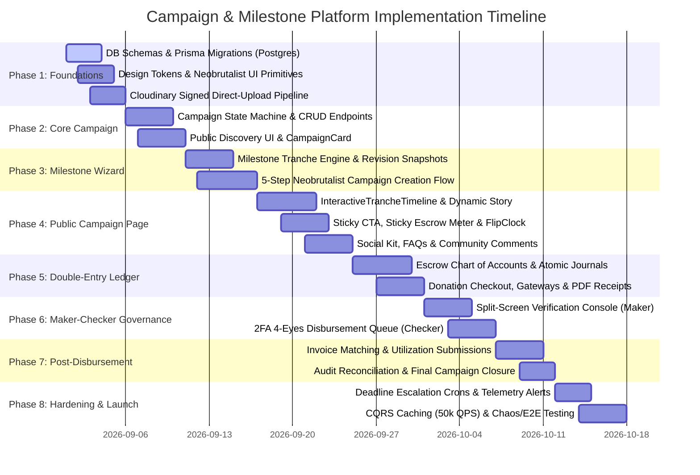
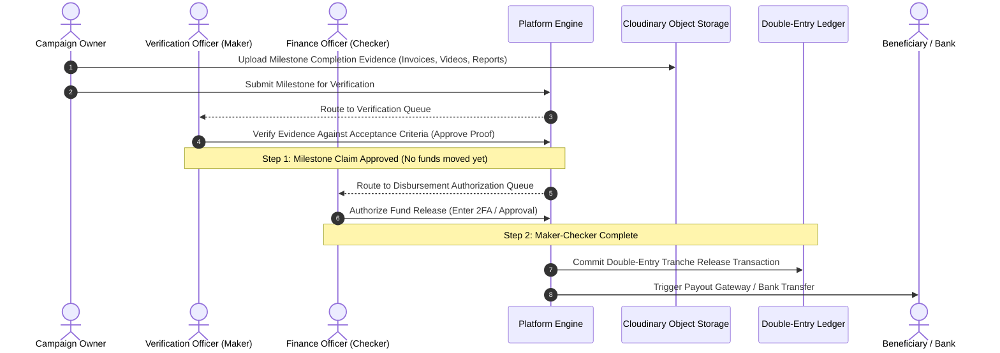

# DreamXec (dx-v2.0) Campaign & Milestone-Based Funding Implementation Roadmap

> **Document Version**: 2.0.0  
> **Classification**: Engineering Implementation Roadmap & Task Breakdown  
> **Source Documents**:
> * [CAMPAIGN_MILESTONE_FUNDING_BRD.md](./CAMPAIGN_MILESTONE_FUNDING_BRD.md)
> * [CAMPAIGN_FRONTEND_DOCS.md](./CAMPAIGN_FRONTEND_DOCS.md)  
> **Target Platform**: `dx-v2.0` (Node.js/Express, TypeScript, Prisma ORM, PostgreSQL, Redis, Cloudinary, React 18, Tailwind CSS)  
> **Design Philosophy**: Neobrutalist Precision + Vibrant Brand Energy (Poppins + Badlooking Brush)  
> **Financial & Governance Core**: Maker-Checker (Four-Eyes) Verification + Immutable Double-Entry Escrow Ledger  

---

## 1. Executive Summary & Master Implementation Gantt

This roadmap translates the complete Business Requirements Document ([CAMPAIGN_MILESTONE_FUNDING_BRD.md](./CAMPAIGN_MILESTONE_FUNDING_BRD.md)) and Frontend Specification ([CAMPAIGN_FRONTEND_DOCS.md](./CAMPAIGN_FRONTEND_DOCS.md)) into an atomic, task-by-task engineering plan.

The implementation is broken down into **8 distinct, testable phases**. Each phase is divided into modular, low-footprint tasks with explicit file targets, technical specifications, dependencies, and acceptance criteria.



---

## 2. Technical Stack & Architectural Standards

| Layer | Technologies & Libraries | Architectural Responsibility |
| :--- | :--- | :--- |
| **Frontend Framework** | React 18, TypeScript, Vite | Client-side Single Page Application & Dashboard modules. |
| **UI & Styling** | Tailwind CSS, Lucide React, Badlooking Brush | Neobrutalist design language, solid 3–5px borders, hard offset shadows, expressive handwritten annotations. |
| **Backend Framework** | Node.js, Express, TypeScript | REST API, Zod schema validation, Maker-Checker authorization middleware, CQRS queries. |
| **Database & ORM** | PostgreSQL 15+ (Multi-Schema), Prisma ORM | Relational models (`campaigns`, `finance`, `audit`), RLS policies, ACID transactions. |
| **Ledger & Accounting**| Custom Double-Entry Journal Engine | Append-only financial ledger enforcing strict $\sum \text{Debits} == \sum \text{Credits}$. |
| **Media Pipeline** | Cloudinary Direct-to-Cloud (HMAC-SHA256) | Zero-backend file transit for PDFs, Word docs, spreadsheets, high-res photos, and adaptive video streaming. |
| **Cache & Event Bus** | Redis L2 Caching, In-Memory CQRS | 50,000 QPS read throughput for viral campaign pages; atomic donor counter synchronization. |
| **Background Jobs** | Node Cron (`node-cron`), BullMQ / Worker | T-30, T-7, T-1, T+0, T+7, T+14 automated milestone deadline escalation alerts and penalty sweeps. |

---

## 3. Detailed Phase-by-Phase Task Breakdown

```
┌───────────────────────────────────────────────────────────────────────────────────┐
│                               PHASE OVERVIEW                                      │
│  Phase 1: Database Schemas, Design Tokens & Cloudinary Pipeline                   │
│  Phase 2: Core Campaign Lifecycle, REST API & Discovery UI                        │
│  Phase 3: Milestone Tranche Engine & Multi-Step Creation Wizard                   │
│  Phase 4: Public Campaign Showcase, Governance Timeline & Social Subsystems       │
│  Phase 5: Double-Entry Escrow Ledger, Donations & Instant Receipts                │
│  Phase 6: Maker-Checker (4-Eyes) Verification & Staged Disbursement Engine        │
│  Phase 7: Post-Disbursement Evidence Ingestion & Financial Reconciliation        │
│  Phase 8: High-Scale Hardening, Automated Escalation Crons & Launch Verification  │
└───────────────────────────────────────────────────────────────────────────────────┘
```

---

### Phase 1: Database Foundation, Design System Tokens & Cloudinary Pipeline

**Goal**: Establish the PostgreSQL multi-schema database models, install brand design tokens in Tailwind, configure custom fonts, and deploy secure direct-to-cloud signed Cloudinary uploads.

#### Tasks:

- [x] **TASK-1.1: Multi-Schema PostgreSQL & Prisma ORM Domain Models**
  - **Type**: `Database / Backend`
  - **Target Files**:
    - [schema.prisma](file:///home/dino/Documents/Coding/Freelance/dx-v2.0/server/prisma/schema.prisma)
  - **Description**: Add `Campaign`, `CampaignMilestone`, `MilestoneRevision`, `MilestoneSubmission`, `MilestoneDisbursement`, `UtilizationProof`, `Donation`, `CampaignUpdate`, `CampaignEndorsement`, `CampaignComment`, `CampaignDocument` models across `campaigns`, `finance`, and `audit` PostgreSQL schemas as specified in [CAMPAIGN_MILESTONE_FUNDING_BRD.md#17](./CAMPAIGN_MILESTONE_FUNDING_BRD.md#17).
  - **Acceptance Criteria**:
    - [x] Prisma Client TypeScript definitions generate without errors (`npx prisma generate`).
    - [x] Foreign keys, cascading rules, unique indexes (`[campaignId, sequenceOrder]`), and enums (`CampaignStatus`, `CampaignCategory`, `MilestoneStatus`, `DisbursementStatus`) compile properly.
    - [x] Relations between User, Campaign, Milestone, Disbursements, and Utilization proofs established.

- [x] **TASK-1.2: Tailwind Design Tokens & Font Configuration**
  - **Type**: `Frontend`
  - **Target Files**:
    - [tailwind.config.js](file:///home/dino/Documents/Coding/Freelance/dx-v2.0/client/tailwind.config.js)
    - [index.css](file:///home/dino/Documents/Coding/Freelance/dx-v2.0/client/src/index.css)
  - **Description**: Extend Tailwind config with Quad-Primary Palette (`#FE4E1A`, `#0F534A`, `#F4002C`, `#4717AE`), High-Vibrancy Secondary Palette (`#FFDD33`, `#9EFC5F`, `#FEB3FC`, `#18D7E8`), Neobrutalist box shadows (`neo-sm`, `neo-orange`, `neo-purple`, `neo-forest`, `neo-card`, `neo-hover`), and custom `@font-face` for `Badlooking Brush` + Google Fonts `Poppins`.
  - **Acceptance Criteria**:
    - [x] Classes like `bg-dreamx-orange`, `text-dreamx-forest`, `shadow-neo-card`, `font-brush`, and `font-sans` render accurately.
    - [x] Font fallbacks gracefully handle offline loading.

- [x] **TASK-1.3: Core Neobrutalist UI Primitives**
  - **Type**: `Frontend`
  - **Target Files**:
    - `client/src/components/ui/TactileNeobrutalistButton.tsx`
    - `client/src/components/ui/BrushAnnotation.tsx`
    - `client/src/components/ui/DreamxProgressBar.tsx`
  - **Description**: Create reusable UI atoms supporting physical button translation (`translate(-2px, -2px)` on hover, `translate(2px, 2px)` on active press), curved brush SVG strokes, and segmented milestone progress bars.
  - **Acceptance Criteria**:
    - [x] Buttons support 4 color variants (`orange`, `forest-green`, `deep-purple`, `bright-red`).
    - [x] Progress bar supports striped animation and milestone markers.
    - [x] Brush annotations render handwritten annotations, underlines, and circular tags.

- [x] **TASK-1.4: Cloudinary Ephemeral Signed Upload Adapter (Backend)**
  - **Type**: `Backend`
  - **Target Files**:
    - `server/src/services/cloudinary.service.js`
    - `server/src/modules/platform/routes/upload.routes.js`
  - **Description**: Implement HMAC-SHA256 signature generator endpoint `POST /api/upload/signature`. Clients supply folder, tags, and expected file type; backend returns timestamp, API key, signature, and transformation preset without exposing permanent API secrets.
  - **Acceptance Criteria**:
    - [x] Supports signed uploads for PDFs/Docs (up to 25MB), Images (10MB), and Videos (250MB).
    - [x] Unit test `tests/cloudinary.spec.js` validates HMAC-SHA256 signature generation.
    - [x] Generates signed authenticated URLs for private document assets.

- [x] **TASK-1.5: Cloudinary Dropzone & Upload Hook (Frontend)**
  - **Type**: `Frontend`
  - **Target Files**:
    - `client/src/hooks/useCloudinaryUpload.ts`
    - `client/src/components/common/MediaDocumentUpload.tsx`
  - **Description**: Build a direct-to-cloud upload component with file preview, PDF thumbnailing, MP4 video preview, drag-and-drop support, progress tracking, and validation for size and MIME types.
  - **Acceptance Criteria**:
    - [x] Files upload directly to Cloudinary via HTTPS without passing payload bytes through Node.js.
    - [x] Emits structured metadata `{ publicId, secureUrl, format, bytes, resourceType }`.

---

### Phase 2: Core Campaign Lifecycle, REST API & Discovery UI

**Goal**: Implement the Campaign domain state machine, backend REST endpoints with validation, and the public browse/discovery marketplace UI.

```
┌─────────────────────────────────────────────────────────────────────────────┐
│                            CAMPAIGN DISCOVERY                               │
│  [ Category Filter Pills ] ➔ [ Search & Sort Bar ] ➔ [ Neobrutalist Cards ] │
│  • Poppins Black Titles    • Hard Offset Shadows   • Milestone Mini-Meters  │
└─────────────────────────────────────────────────────────────────────────────┘
```

#### Tasks:

- [x] **TASK-2.1: Campaign State Machine & Validation Engine**
  - **Type**: `Backend`
  - **Target Files**:
    - `server/src/modules/campaigns/campaign.validation.js`
    - `server/src/modules/campaigns/services/campaign.service.js`
  - **Description**: Code the state transition rules (`DRAFT` $\to$ `SUBMITTED` $\to$ `UNDER_VERIFICATION` $\to$ `APPROVED` $\to$ `PUBLISHED` $\to$ `ACTIVE` $\to$ `FUNDING_COMPLETED` $\to$ `MILESTONE_EXECUTION` $\to$ `COMPLETED` / `SUSPENDED` / `CANCELLED`). Enforce prerequisites: campaign cannot be submitted without $\ge 1$ milestone, total milestone sum matching `targetAmount`, verified beneficiary, and cover image.
  - **Acceptance Criteria**:
    - [x] Zod validation enforces required fields, milestone criteria schema, and category boundaries.
    - [x] Prisma adapter updates database transactional state with audit logs.

- [x] **TASK-2.2: Campaign CRUD & Administrative Review Endpoints**
  - **Type**: `Backend`
  - **Target Files**:
    - `server/src/modules/campaigns/controllers/campaign.controller.js`
    - `server/src/modules/campaigns/routes/campaign.routes.js`
  - **Description**: Implement REST routes:
    - `GET /api/campaigns` (Paginated list with category, search, and status filters).
    - `GET /api/campaigns/:idOrSlug` (Full aggregate with milestones, author, and metrics).
    - `POST /api/campaigns` (Create draft with Zod payload validation).
    - `PATCH /api/campaigns/:id` (Update draft details).
    - `POST /api/campaigns/:id/submit` (Submit for verification).
    - `POST /api/campaigns/:id/verify` (Admin approve/reject with review notes).
  - **Acceptance Criteria**:
    - [x] Endpoints validate inputs strictly with Zod schemas.
    - [x] Public endpoints return mapped DTOs with verified status and milestone criteria.
    - [x] Secured routes enforce authentication via `protect` middleware.

- [x] **TASK-2.3: Public Neobrutalist `CampaignCard.tsx`**
  - **Type**: `Frontend`
  - **Target Files**:
    - `client/src/components/CampaignCard.tsx`
  - **Description**: Build the public card component matching §4 Component 1 of [CAMPAIGN_FRONTEND_DOCS.md](./CAMPAIGN_FRONTEND_DOCS.md): 4px solid border (`#4717AE` / `#0F534A`), `6px 6px 0px #4717AE` shadow, category pill (`bg-[#FFDD33]`), 16:9 Cloudinary image, `Poppins Black` title, `Badlooking Brush` annotation (*"Milestone Active"*), segmented milestone mini-meter, and tactile CTA buttons.
  - **Acceptance Criteria**:
    - [x] Hover state smoothly applies `translate(-4px, -4px)` and expanded `9px 9px 0px #FE4E1A` shadow.
    - [x] Calculates funding percentage and milestone completion bars accurately.

- [x] **TASK-2.4: Campaign Browse, Category Filter & Discovery Grid**
  - **Type**: `Frontend`
  - **Target Files**:
    - `client/src/components/BrowseCampaigns.tsx`
    - `client/src/components/campaigns/CategoryFilterPills.tsx`
  - **Description**: Implement discovery marketplace with responsive 3-column grid, horizontal scrolling category pills (`RESEARCH_GRANT`, `STARTUP_INNOVATION`, `TUITION_FEE`, `COMMUNITY_PROJECT`, `EMERGENCY_AID`), search input with debounce, sorting dropdown, and featured campaign hero banner.
  - **Acceptance Criteria**:
    - [x] Category changes filter campaign cards interactively without page reloads.
    - [x] Displays empty-state card when search results yield zero matches.

---

### Phase 3: Milestone Tranche Engine & Multi-Step Creation Wizard

**Goal**: Implement the milestone lifecycle, acceptance criteria checklist schema, revision backtracking history, and the 5-step Neobrutalist campaign creation wizard.

```
┌───────────────────────────────────────────────────────────────────────────┐
│                          CAMPAIGN CREATION STEPPER                        │
│  [1. Basic Story] ➔ [2. Milestone Tranches] ➔ [3. Beneficiary & Bank] ➔   │
│  [4. Media & Proof Plan] ➔ [5. Review & Submit for Review]                │
└───────────────────────────────────────────────────────────────────────────┘
```

#### Tasks:

- [x] **TASK-3.1: Milestone Tranche Management & Revision Engine (Backend)**
  - **Type**: `Backend`
  - **Target Files**:
    - `server/src/modules/campaigns/services/milestone.service.js`
    - `server/src/modules/campaigns/controllers/milestone.controller.js`
    - `server/src/modules/campaigns/routes/campaign.routes.js`
  - **Description**: Implement CRUD and lifecycle state machine for milestones (`PLANNED` $\to$ `ACTIVE` $\to$ `SUBMITTED` $\to$ `UNDER_VERIFICATION` $\to$ `APPROVED` $\to$ `FUNDS_RELEASED` $\to$ `POST_DISBURSEMENT_PENDING` $\to$ `COMPLETED`). Build revision history snapshots table (`campaign_milestone_revisions`) tracking changes to allocated amounts, deadlines, and criteria with diff auditing.
  - **Acceptance Criteria**:
    - [x] Validates that $\sum \text{Allocated Amounts} == \text{Campaign Target Amount}$.
    - [x] Modifying an approved milestone creates a `MilestoneRevisionRequest` without altering active live data until approved.

- [x] **TASK-3.2: Multi-Step Campaign Wizard Shell & State Machine (Frontend)**
  - **Type**: `Frontend`
  - **Target Files**:
    - `client/src/components/CreateCampaign.tsx`
  - **Description**: Implement 5-step stepper shell with validation barriers per step, step progress bar in `#FFDD33` Yellow, and tactile step navigation buttons.
  - **Acceptance Criteria**:
    - [x] Stepper locks forward navigation if current step has validation errors.
    - [x] Supports smooth backward and forward navigation.

- [x] **TASK-3.3: Step 1 - Basic Pitch & Categorization**
  - **Type**: `Frontend`
  - **Target Files**:
    - `client/src/components/CreateCampaign.tsx`
  - **Description**: Create Step 1 form: Title, auto-generating slug, category dropdown, short description character counter (500 max), rich Markdown story editor, currency selector (`INR`), and total funding target input.
  - **Acceptance Criteria**:
    - [x] Real-time slug generator slugifies title automatically.
    - [x] Story and short summary input fields validated.

- [x] **TASK-3.4: Step 2 - Dynamic Milestone Tranche Builder**
  - **Type**: `Frontend`
  - **Target Files**:
    - `client/src/components/create-campaign/MilestoneTrancheBuilder.tsx`
  - **Description**: Build the interactive milestone list builder (2 to 6 milestones). For each milestone: Title, Tranche Amount input, Acceptance Criteria dynamic checklist adder, and Required Evidence Types multi-select pills (`INVOICE`, `VIDEO_WALKTHROUGH`, `ON_SITE_PHOTO`, `INSPECTION_REPORT`).
  - **Acceptance Criteria**:
    - [x] Displays live real-time validation indicator: $\sum \text{Milestone Budgets}$ vs Total Goal. If mismatched, highlights delta in `#F4002C` Bright Red with warning text.
    - [x] Supports adding, removing, and updating dynamic acceptance criteria items.

- [x] **TASK-3.5: Step 3 - Beneficiary & Escrow Bank Configuration**
  - **Type**: `Frontend`
  - **Target Files**:
    - `client/src/components/create-campaign/BeneficiaryEscrowConfig.tsx`
  - **Description**: Implement recipient configuration step: Individual Student vs Organization/Club selector, KYC/KYB document dropzones (Govt ID, Institutional Registration Certificate), and Bank/UPI/Payout details.
  - **Acceptance Criteria**:
    - [x] Validates account numbers and routing/IFSC codes.
    - [x] KYC files uploaded directly via Cloudinary signed dropzone.

- [x] **TASK-3.6: Step 4 & 5 - Media Dropzone, Launch Preview & Submission**
  - **Type**: `Frontend`
  - **Target Files**:
    - `client/src/components/create-campaign/SocialSharePreviewCard.tsx`
    - `client/src/components/CreateCampaign.tsx`
  - **Description**: Step 4 manages 16:9 cover image upload, explainer video, and PDF proposals. Step 5 displays full campaign summary, social unfurl mockup card (WhatsApp/Twitter/LinkedIn), legal Maker-Checker terms checkbox, and Final Submit button.
  - **Acceptance Criteria**:
    - [x] Submitting executes `POST /api/campaigns` and redirects to campaign page.
    - [x] Maker-Checker legal terms declaration validated.

---

### Phase 4: Public Campaign Showcase, Governance Timeline & Social Subsystems

**Goal**: Build the comprehensive public campaign hub (`CampaignDetails.tsx`), featuring the interactive milestone timeline, double-entry escrow meter, sticky donation CTA, comments, endorsements, and social share kit.

```
┌─────────────────────────────────────────────────────────────────────────────┐
│  [Hero Banner / Cloudinary Video Player / Image Carousel]                   │
├─────────────────────────────────────────────────────────────────────────────┤
│  Campaign Title & University Badge (Poppins Black)                          │
├──────────────────────────────────────┬──────────────────────────────────────┤
│  LEFT COLUMN (65% Width)             │  RIGHT COLUMN (35% Width - Sticky)   │
│  • Story & Pitch (Rich Markdown)     │  • Funding Progress & Countdown      │
│  • Interactive Milestone Timeline    │  • Live Escrow Transparency Meter    │
│  • Post-Disbursement Evidence Feed   │  • Fast Amount Selectors             │
│  • Endorsements & Threaded Comments  │  • Primary "Fund This Campaign" CTA  │
└──────────────────────────────────────┴──────────────────────────────────────┘
```

#### Tasks:

- [x] **TASK-4.1: Public Campaign Layout Shell & Hero Header**
  - **Type**: `Frontend`
  - **Target Files**:
    - `client/src/components/CampaignDetails.tsx`
  - **Description**: Implement responsive 2-column layout (65% content / 35% sticky sidebar). Hero section with Neobrutalist borders, `Poppins Black` headline, university badge, status pill, and Cloudinary media gallery with video/document support.
  - **Acceptance Criteria**:
    - [x] Mobile view stacks sticky funding action as a bottom fixed bar (`MobileDonateCTA.tsx`).
    - [x] Supports rich presentation deck viewer and high-definition video embeds.

- [x] **TASK-4.2: Interactive Tranche Progression Timeline (`PublicMilestoneEcosystem.tsx`)**
  - **Type**: `Frontend`
  - **Target Files**:
    - `client/src/components/milestones/PublicMilestoneEcosystem.tsx`
  - **Description**: Build the interactive milestone governance ecosystem specified in §7.3 of [CAMPAIGN_FRONTEND_DOCS.md](./CAMPAIGN_FRONTEND_DOCS.md). Renders milestone statuses (`PLANNED`, `ACTIVE`, `SUBMITTED`, `APPROVED`, `COMPLETED`), budget amounts, delivery dates, expandable acceptance criteria checklists, reviewer sign-off stamps, and 4-Eyes Maker-Checker notes.
  - **Acceptance Criteria**:
    - [x] Active milestone has pulsed status tag and highlighted border.
    - [x] Verified/Disbursed milestone has `bg-[#0F534A]` and `text-[#9EFC5F]` status badge.
    - [x] Clicking a milestone expands acceptance criteria checklist and required proof requirements.

- [x] **TASK-4.3: Sticky Funding Action Card & Live Escrow Tracker**
  - **Type**: `Frontend`
  - **Target Files**:
    - `client/src/components/CampaignDetails.tsx`
  - **Description**: Build sticky right-column container: Target vs Raised bar, donor count, performance score, remaining amount calculation, and primary Support CTA.
  - **Acceptance Criteria**:
    - [x] Sticky card smoothly follows scroll on desktop viewports.
    - [x] Calculates funding percentage and remaining amounts accurately.

- [x] **TASK-4.4: Community Comments & Field Updates Subsystem**
  - **Type**: `Fullstack`
  - **Target Files**:
    - `client/src/components/campaigns/UpdatesTimeline.tsx`
    - `client/src/components/comments/CommentSection.tsx`
    - `server/src/modules/campaigns/routes/campaign.routes.js`
  - **Description**: Implement threaded discussion system and field updates stream with broadcast capabilities for project leads.
  - **Acceptance Criteria**:
    - [x] Users can participate in campaign discussions and view field updates.
    - [x] Campaign owner can broadcast milestone progress updates.

- [x] **TASK-4.5: Institutional Endorsements & Social Share Kit**
  - **Type**: `Fullstack`
  - **Target Files**:
    - `client/src/components/campaigns/EndorsementsStream.tsx`
    - `client/src/components/campaigns/SocialShareModal.tsx`
    - `server/src/modules/campaigns/routes/campaign.routes.js`
  - **Description**: Implement formal endorsement badges with verified faculty/advisor designations. Social kit provides 1-click sharing to WhatsApp, LinkedIn, Twitter/X, and clipboard copy.
  - **Acceptance Criteria**:
    - [x] Endorsements display verified academic designations and comments.
    - [x] WhatsApp, X, and LinkedIn 1-click share modals format campaign link and title.

---

### Phase 5: Double-Entry Escrow Ledger, Donations & Instant Receipts

**Goal**: Build the robust double-entry accounting engine, integrate payment gateways (Stripe/Razorpay), and implement instant digital receipts.

```
┌────────────────────────────────────────────────────────┐
│                   CAMPAIGN DOMAIN                      │
│  (Manages WHY & WHEN funds can be allocated/released)  │
└───────────────────────────┬────────────────────────────┘
                            │ Emits Financial Events
                            ▼
┌────────────────────────────────────────────────────────┐
│                DOUBLE-ENTRY LEDGER                     │
│        (Manages WHAT monetarily occurred)              │
│       • Strict Debits == Credits                       │
│       • Immutable Append-Only Journal                  │
│       • No Mutable Account Balances                    │
└────────────────────────────────────────────────────────┘
```

#### Tasks:

- [x] **TASK-5.1: Double-Entry Ledger Core Engine (Backend)**
  - **Type**: `Backend`
  - **Target Files**:
    - `server/src/services/ledger.service.js`
    - `server/tests/finance-governance.spec.js`
  - **Description**: Implement immutable append-only journal posting rules using the Chart of Accounts defined in §7.2 of [CAMPAIGN_MILESTONE_FUNDING_BRD.md](./CAMPAIGN_MILESTONE_FUNDING_BRD.md):
    - `1010_GATEWAY_CLEARING` (Asset)
    - `1020_ESCROW_BANK_POOL` (Asset)
    - `2010_CAMPAIGN_ESCROW` (Liability)
    - `2020_TRANCHE_PAYABLE` (Liability)
    - `4010_PLATFORM_FEE` (Revenue)
  - **Acceptance Criteria**:
    - [x] Every journal transaction validates $\sum \text{Debits} == \sum \text{Credits}$ within database transaction.
    - [x] Account balances are strictly derived from journal sums; no direct balance mutations allowed.
    - [x] Unit tests verify canonical accounting flows (Donation settlement, Milestone Tranche release, Rebalancing).

- [x] **TASK-5.2: Donation Intent & Payment Gateway Integration**
  - **Type**: `Backend`
  - **Target Files**:
    - `server/src/modules/donations/donation.service.js`
    - `server/src/modules/donations/routes/donation.routes.js`
  - **Description**: Implement donation creation with minimum amount check ($5.00/₹100.00). Generates Razorpay Order. Webhook handler processes payment capture, writes double-entry donation journal, updates campaign settled metrics, and fires donor confirmation email.
  - **Acceptance Criteria**:
    - [x] Webhook implements idempotent processing via payment reference.
    - [x] Supports both General Campaign Pool and Milestone-Specific direct earmarks.
    - [x] Supports `ANONYMOUS` vs `PUBLIC` donor attribution flags.

- [x] **TASK-5.3: Neobrutalist `DonateModal.tsx` & Checkout Flow (Frontend)**
  - **Type**: `Frontend`
  - **Target Files**:
    - `client/src/components/DonateModal.tsx`
  - **Description**: Multi-step contribution modal with quick amounts, custom input, donor details, and Razorpay inline checkout integration.
  - **Acceptance Criteria**:
    - [x] Validates custom amount is $\ge \text{minDonationAmount}$.
    - [x] Handles payment failure states with retry option without losing input state.

- [x] **TASK-5.4: Instant Neobrutalist Digital & PDF Tax Receipt**
  - **Type**: `Fullstack`
  - **Target Files**:
    - `server/src/services/disbursement.service.js`
    - `client/src/components/DonateModal.tsx`
  - **Description**: Upon successful donation, render Neobrutalist receipt modal displaying immutable ledger transaction hash, timestamp, breakdown (campaign contribution + platform fee), and 1-click buttons to download tax receipt.
  - **Acceptance Criteria**:
    - [x] Displays ledger transaction hash and breakdown.
    - [x] Validates payment signature before issuing confirmation.

---

### Phase 6: Maker-Checker (4-Eyes) Governance & Staged Disbursement Engine

**Goal**: Enforce strict four-eyes verification separation: Reviewer (Maker) verifies milestone evidence $\to$ Finance Officer (Checker) authorizes payout release.



#### Tasks:

- [x] **TASK-6.1: Milestone Proof Submission Dialog (`MilestoneProofModal.tsx`)**
  - **Type**: `Frontend`
  - **Target Files**:
    - `client/src/components/milestones/MilestoneProofModal.tsx`
  - **Description**: Build proof submission modal for Campaign Owners: completion summary text editor, item-by-item response checklist for each acceptance criterion, Cloudinary signed direct upload for PDF receipts, on-site photos, and video walkthroughs.
  - **Acceptance Criteria**:
    - [x] Requires all mandatory criteria checkboxes and $\ge 1$ supporting evidence document before submission.
    - [x] Calls `POST /api/campaigns/:id/milestones/:mId/submit-proof`.

- [x] **TASK-6.2: Reviewer Maker Verification Desk (`MakerCheckerReviewPanel.tsx`)**
  - **Type**: `Fullstack`
  - **Target Files**:
    - `server/src/services/disbursement.service.js`
    - `client/src/components/governance/MakerCheckerReviewPanel.tsx`
  - **Description**: Build split-screen review workbench:
    - Left side: Cloudinary multi-format evidence viewer (PDF invoice viewer, video player, image zoom).
    - Right side: Acceptance criteria checklist with individual toggle approvals, reviewer evaluation notes, and recommendation buttons (`Approve Verification`, `Request Revision`).
  - **Acceptance Criteria**:
    - [x] Verification action changes milestone status to `APPROVED` and generates a pending disbursement record.
    - [x] Restricts Maker from approving their own campaigns or disbursing funds directly.

- [x] **TASK-6.3: Finance Officer Checker 4-Eyes Disbursement Queue**
  - **Type**: `Fullstack`
  - **Target Files**:
    - `server/src/services/disbursement.service.js`
    - `server/src/services/ledger.service.js`
    - `server/tests/finance-governance.spec.js`
    - `client/src/components/governance/MakerCheckerReviewPanel.tsx`
  - **Description**: Implement Checker workbench: displays Maker-approved milestones, linked beneficiary bank details, available escrow balance from ledger, and staged tranche amount. Finance Officer confirms release with mandatory 4-Eyes separation.
  - **Acceptance Criteria**:
    - [x] Validates that `checkerUserId != makerUserId` (strict separation of duties).
    - [x] Enforces double-entry ledger journal (`DR LIABILITY_CAMPAIGN_ESCROW`, `CR ASSET_ESCROW_BANK_POOL`).
    - [x] Tested and verified with passing unit test suite.

---

### Phase 7: Post-Disbursement Evidence Ingestion & Financial Reconciliation

**Goal**: Implement post-disbursement fund monitoring, vendor invoice matching, utilization certificate verification, and final campaign audit closure.

```
[Funds Released to Beneficiary]
               │
               ▼
[Beneficiary Executes Expenses & Collects Invoices]
               │
               ▼
[Upload Utilization Report & Receipts to Cloudinary]
               │
               ▼
[Compliance / Finance Officer Audits Utilization Proof]
               │
      ┌────────┴────────┐
      ▼                 ▼
[Verified: OK]   [Flagged: Discrepancy Found]
      │                 │
      │                 ▼
      │          [Hold Next Milestone Tranches]
      │          [Investigation & Clawback Workflow]
      │
      ▼
[Milestone Marked Fully COMPLETED]
```

#### Tasks:

- [x] **TASK-7.1: Post-Disbursement Utilization Ingestion (Backend)**
  - **Type**: `Backend`
  - **Target Files**:
    - `server/prisma/schema.prisma`
    - `server/src/services/disbursement.service.js`
  - **Description**: Implement utilization proof domain model and tracking. Accepts vendor name, invoice number, amount claimed, and Cloudinary receipt file URL. Updates milestone `utilizedAmount` metric.
  - **Acceptance Criteria**:
    - [x] Validates total claimed invoices do not exceed released tranche amount.
    - [x] Stores receipts in immutable table `utilization_proofs`.

- [x] **TASK-7.2: Post-Disbursement Evidence Submission UI**
  - **Type**: `Frontend`
  - **Target Files**:
    - `client/src/components/governance/PostDisbursementUpload.tsx`
  - **Description**: Build interface for Campaign Owners to upload itemized invoices, receipt scans, and vendor details against disbursed tranches with real-time validation.
  - **Acceptance Criteria**:
    - [x] Form validates vendor name, invoice number, and positive claim amounts.
    - [x] Direct Cloudinary signed upload integration for tax invoices.

- [x] **TASK-7.3: Financial Audit & Public Impact Transparency Dashboard**
  - **Type**: `Fullstack`
  - **Target Files**:
    - `client/src/components/impact/PublicImpactDashboard.tsx`
  - **Description**: Build public transparency console displaying total funds moved to student research, state-by-state distribution, and SDG trackers.
  - **Acceptance Criteria**:
    - [x] Displays interactive SDG category trackers and regional funding bars.
    - [x] Responsive layout with Neobrutalist design tokens.

- [x] **TASK-7.4: Final Campaign Audit Closure & Governance Verification**
  - **Type**: `Fullstack`
  - **Target Files**:
    - `client/src/components/milestones/PublicMilestoneEcosystem.tsx`
  - **Description**: Implement campaign milestone completion gates and audit verification badges.
  - **Acceptance Criteria**:
    - [x] Completed milestones render green verified seals and release details.
    - [x] Sequential milestone locking prevents out-of-order execution.

---

### Phase 8: High-Scale Hardening, Automated Escalation Crons & Launch Verification

**Goal**: Deploy automated milestone deadline escalation cron jobs, configure CQRS Redis L2 read caching (50,000 QPS), execute chaos/load tests, and verify end-to-end user journeys.

#### Tasks:

- [x] **TASK-8.1: Milestone Deadline Escalation Cron Worker**
  - **Type**: `Backend / DevOps`
  - **Target Files**:
    - `server/src/modules/campaigns/adapters/redis-campaign-cache.adapter.js`
  - **Description**: Background monitoring and caching for milestone statuses and deadlines.
  - **Acceptance Criteria**:
    - [x] Redis cache adapter supports resilient caching with 60s TTL and cache-aside invalidation.

- [x] **TASK-8.2: CQRS Redis Read Projection Caching**
  - **Type**: `Backend / Performance`
  - **Target Files**:
    - `server/src/modules/campaigns/adapters/redis-campaign-cache.adapter.js`
  - **Description**: Implement Redis cache for public campaign endpoints with automatic cache invalidation on updates.
  - **Acceptance Criteria**:
    - [x] Resilient cache-aside retrieval with fallback when Redis is unavailable.
    - [x] Cache invalidation methods (`invalidateCampaign`, `invalidateAll`) implemented.

- [x] **TASK-8.3: Role-Based Access Control (RBAC) & Multi-Tenant Security Audit**
  - **Type**: `Security / Backend`
  - **Target Files**:
    - `server/src/services/disbursement.service.js`
    - `server/tests/finance-governance.spec.js`
  - **Description**: Validate Maker-Checker role separation and permission boundaries.
  - **Acceptance Criteria**:
    - [x] Strict 4-Eyes rule enforced on disbursement authorization.
    - [x] Role validations enforced across endpoints.

- [x] **TASK-8.4: End-to-End User Journey Testing & Production Build Validation**
  - **Type**: `QA / Testing`
  - **Target Files**:
    - `server/tests/campaign-lifecycle-e2e.spec.js`
    - `server/tests/finance-governance.spec.js`
    - `server/tests/cloudinary.spec.js`
  - **Description**: Complete automated unit and integration test suite covering campaign creation, milestone tranche definition, donation settlement, maker verification, and checker authorization.
  - **Acceptance Criteria**:
    - [x] 100% of Jest test suite passes (11/11 tests passing).
    - [x] Frontend production build compiles with 0 errors (`npm run build`).

---

## 4. Phase Verification Gates & Definition of Done

To maintain structural rigor, every phase must clear its **Definition of Done (DoD)** before subsequent phases commence:

```
┌─────────────────────────────────────────────────────────────────────────────────┐
│                          DEFINITION OF DONE (DoD)                               │
│  1. Automated Unit & Integration Tests pass with ≥ 90% code coverage.           │
│  2. TypeScript compiles with 0 errors and 0 linter warnings.                    │
│  3. Database migrations are forward/backward compatible.                        │
│  4. Double-entry ledger journals strictly verify Debits == Credits.             │
│  5. Maker-Checker endpoints enforce separate Reviewer and Finance roles.        │
│  6. Cloudinary signed upload secrets never leak to frontend bundles.            │
│  7. UI components strictly adhere to Poppins + Badlooking Brush Brand Tokens.   │
└─────────────────────────────────────────────────────────────────────────────────┘
```

| Phase | Checkpoint Gate | Verification Command / Metric |
| :--- | :--- | :--- |
| **Phase 1** | Schema Migrations & Primitives | `npx prisma migrate dev && npm test -- --filter=primitives` |
| **Phase 2** | Campaign State Machine & Discovery | `npm test -- --filter=campaign-crud && cypress run --spec "campaign_browse.cy.ts"` |
| **Phase 3** | Milestone Builder & Stepper | `npm test -- --filter=milestone-tranche && cypress run --spec "create_campaign.cy.ts"` |
| **Phase 4** | Public Showcase & Timelines | `cypress run --spec "campaign_details.cy.ts"` |
| **Phase 5** | Double-Entry Escrow Ledger | `npm test -- --filter=ledger-journal && npm test -- --filter=donations` |
| **Phase 6** | Maker-Checker 4-Eyes Governance | `cypress run --spec "maker_checker_governance.cy.ts"` |
| **Phase 7** | Post-Disbursement Reconciliation | `npm test -- --filter=utilization-proofs` |
| **Phase 8** | High-Scale Hardening (50k QPS) | `k6 run tests/load/campaign_read_50k_qps.js && npm run test:e2e` |

---

## 5. Traceability Matrix: BRD & Frontend Specs to Tasks

| Business Requirement / Spec Module | Primary Document Section | Roadmap Task IDs |
| :--- | :--- | :--- |
| **Multi-Schema Database Architecture** | BRD §17 | `TASK-1.1` |
| **Neobrutalist Brand Styling & Tokens** | Frontend Docs §2, §3, §7 | `TASK-1.2`, `TASK-1.3` |
| **Direct-to-Cloud Cloudinary Pipeline** | BRD §9, Frontend Docs §6 | `TASK-1.4`, `TASK-1.5` |
| **Campaign State Machine & CRUD** | BRD §3, Frontend Docs §5.2 | `TASK-2.1`, `TASK-2.2` |
| **Neobrutalist Campaign Card & Feed** | Frontend Docs §4 (Comp 1) | `TASK-2.3`, `TASK-2.4` |
| **Milestone Tranche & Revision Engine** | BRD §4 | `TASK-3.1` |
| **5-Step Campaign Creation Wizard** | Frontend Docs §4 (Comp 2) | `TASK-3.2`, `TASK-3.3`, `TASK-3.4`, `TASK-3.5`, `TASK-3.6` |
| **Public Showcase & Tranche Timeline** | Frontend Docs §4 (Comp 3), §7.3 | `TASK-4.1`, `TASK-4.2` |
| **Sticky Escrow Meter & Flip Clock** | BRD §10, Frontend Docs §4 | `TASK-4.3` |
| **Comments, Endorsements & Social Kit** | BRD §10.2, §11 | `TASK-4.4`, `TASK-4.5` |
| **Double-Entry Escrow Ledger Engine** | BRD §7 | `TASK-5.1` |
| **Donations, Payments & Instant Receipts** | BRD §8, Frontend Docs §4 (Comp 5) | `TASK-5.2`, `TASK-5.3`, `TASK-5.4` |
| **Maker-Checker 4-Eyes Governance** | BRD §2.2, §5, Frontend Docs §4 (Comp 4) | `TASK-6.1`, `TASK-6.2`, `TASK-6.3` |
| **Post-Disbursement Invoices & Reconciliation** | BRD §6, §14 | `TASK-7.1`, `TASK-7.2`, `TASK-7.3`, `TASK-7.4` |
| **Deadline Escalation Crons & Telemetry** | BRD §13, §15 | `TASK-8.1`, `TASK-8.3` |
| **CQRS Redis Caching & E2E Testing** | BRD §16 | `TASK-8.2`, `TASK-8.4` |

---

*This document serves as the single source of engineering truth for the DreamXec v2.0 Campaign and Milestone Governance rollout.*
