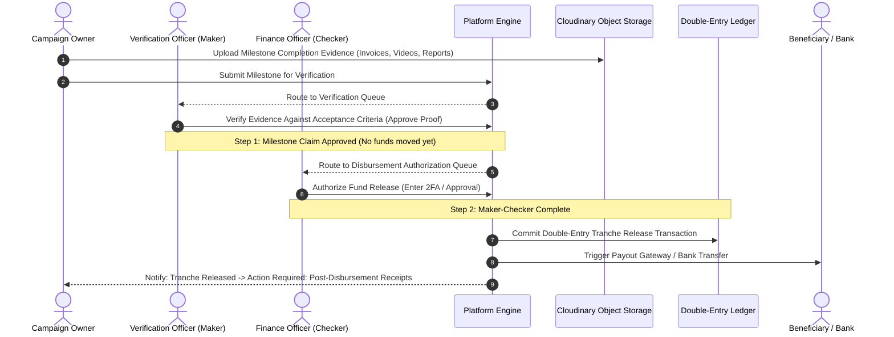
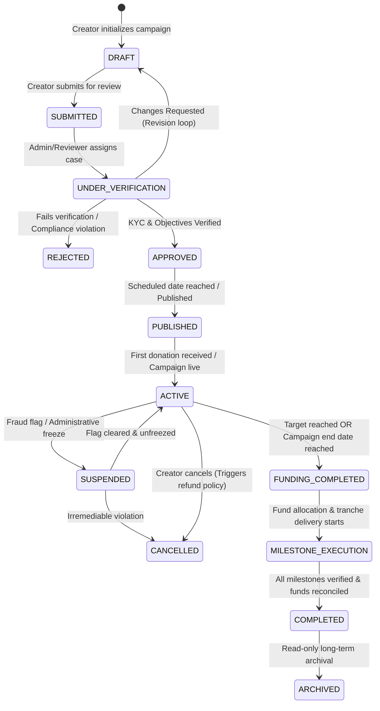
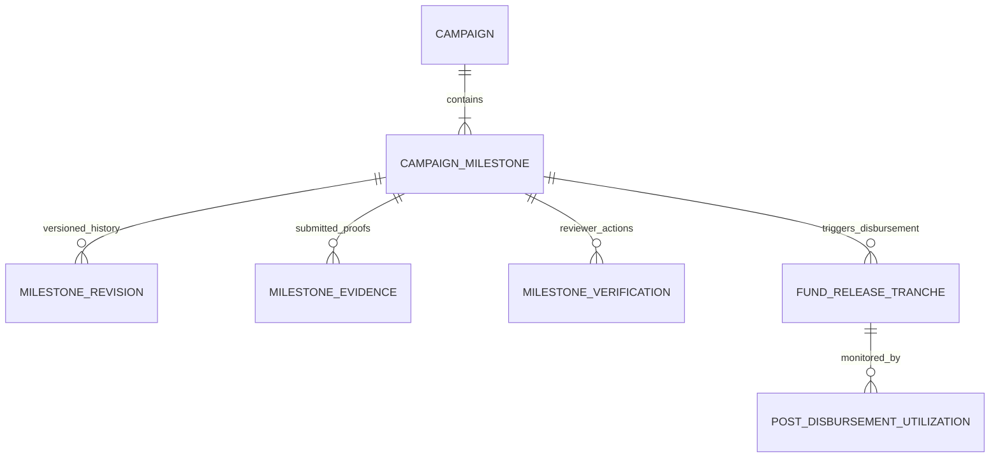
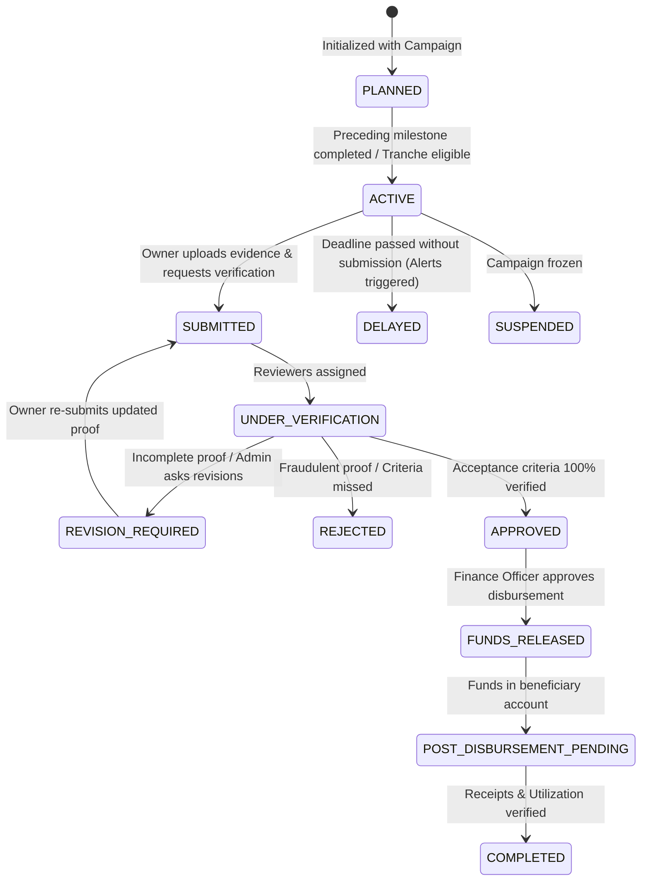

# Business Requirements Document (BRD) & Functional Specification
## Campaign & Milestone-Based Funding and Fund-Governance Platform

> **Document Version**: 2.0.0  
> **Target System**: `dx-v2.0` Enterprise Platform  
> **Status**: Approved for Engineering & Development  
> **Domain Classification**: Campaigns, Milestone Governance, Escrow Ledger & Compliance  
> **Last Updated**: August 2026  

---

## 1. Executive Summary & Product Vision

### 1.1 Overview
The **Campaign & Milestone-Based Funding Platform** is a transparent, governance-driven crowdfunding and tranche disbursement ecosystem. Unlike conventional crowdfunding platforms where funds are disbursed in bulk without delivery accountability, this platform mandates **milestone-linked tranche releases**, **strict four-eyes (Maker-Checker) administrative verification**, **double-entry financial ledger escrow accounting**, and **post-disbursement fund utilization monitoring**.

### 1.2 Core Business Rule (The Prime Directive)
> **"No fund release shall occur without a valid, verified, and dual-authorized milestone completion decision. Every release must generate an immutable double-entry financial record and mandate subsequent post-disbursement evidence reconciliation."**

### 1.3 Strategic Objectives
1. **Donor Trust & Transparency**: Provide donors with real-time visibility into milestone objectives, acceptance criteria, verified proof of work, and financial utilization graphs.
2. **Accountability for Campaign Owners**: Tie disbursements to tangible deliverables validated by administrators, compliance officers, and independent verifiers.
3. **Institutional Integrity**: Enforce double-entry accounting where campaign status transitions determine *eligibility* while the ledger manages *monetary truth*.
4. **Frictionless Media & Evidence**: Leverage Cloudinary for direct-to-cloud signed document (PDF, DOCX, XLSX) and video ingestion with thumbnailing, streaming, and version-controlled audit retention.

---

## 2. Role-Based Access Control (RBAC) & Governance Matrix

### 2.1 Actor Taxonomy

| Role Code | Role Name | Description | Key Responsibilities |
| :--- | :--- | :--- | :--- |
| `DONOR` | Donor / Backer | Registered or guest user supporting campaigns. | Browse public campaigns, make single/milestone donations, post comments, view receipts, track tranche progress. |
| `CAMPAIGN_OWNER` | Campaign Creator | Verified individual, organization, or student lead. | Draft campaigns, configure milestones, submit verification evidence, publish progress updates, upload invoices. |
| `BENEFICIARY` | Beneficiary | Designated recipient entity/student/vendor. | Receive approved disbursements, submit post-disbursement utilization reports and expense receipts. |
| `REVIEWER` | Verification Officer | Department admin, faculty, or institutional reviewer. | Review campaign drafts, inspect milestone deliverables and acceptance criteria, conduct physical/digital verifications. |
| `COMPLIANCE_OFFICER` | Compliance & Risk Officer | Platform compliance and fraud prevention specialist. | Perform KYC/KYB checks, review sanctions/AML flags, investigate suspicious donation velocity, approve high-risk campaigns. |
| `FINANCE_OFFICER` | Finance & Treasury Officer | Financial controller managing platform escrow. | Review verified milestone payout requests, execute dual-approval fund disbursements, reconcile ledger entries, manage refunds. |
| `SUPER_ADMIN` | Super Administrator | System-wide administrator. | Configure platform fee policies, manage tenant organizations, override system states with mandatory audit logging. |

### 2.2 Maker-Checker (Four-Eyes) Separation of Duties
Financial disbursements strictly separate the **Verification** authority from the **Disbursement** authority:



---

## 3. Campaign Lifecycle & Functional Requirements

### 3.1 Campaign Data Dictionary

| Field | Type | Mandatory | Description & Constraints |
| :--- | :--- | :--- | :--- |
| `title` | String (255) | Yes | Headline for the fundraising initiative. |
| `slug` | String (120) | Yes | URL-safe unique identifier (auto-generated with collision fallback). |
| `category` | Enum | Yes | `TUITION_FEE`, `RESEARCH_GRANT`, `STARTUP_INNOVATION`, `COMMUNITY_PROJECT`, `EMERGENCY_AID`, `COMPETITION_TRAVEL`, `EXTRACURRICULAR`. |
| `shortDescription` | String (500) | Yes | Executive summary used in social unfurls, SEO, and browse cards. |
| `detailedStory` | Text (Markdown) | Yes | Rich-text pitch, problem statement, execution plan, and budget breakdown. |
| `targetAmount` | Decimal (15,2) | Yes | Total funding target. Must equal the sum of all planned milestone allocations. |
| `currency` | String (3) | Yes | ISO-4217 code (Default: `USD` / `INR`). |
| `minDonationAmount` | Decimal (15,2) | Yes | Floor amount per donation transaction (e.g., $5.00 / ₹100.00). |
| `maxDonationAmount` | Decimal (15,2) | No | Optional single-transaction contribution ceiling. |
| `currentRaised` | Decimal (15,2) | Yes | Real-time settled donation sum (Derived from Ledger / CQRS Cache). |
| `donorCount` | Integer | Yes | Unique backer counter. |
| `fundingModel` | Enum | Yes | `FLEXIBLE` (Keep raised funds for completed milestones) vs `ALL_OR_NOTHING` (Refund if target unmet). |
| `disbursementType` | Enum | Yes | `MILESTONE_TRANCHE` (Default), `DIRECT_VENDOR_PAYOUT`, `REIMBURSEMENT`. |
| `location` | Object | Yes | Geo details: `{ city, state, country, postalCode, coordinates }`. |
| `authorDetails` | Object | Yes | `{ userId, name, avatarUrl, designation, organizationId, bio, contactEmail }`. |
| `beneficiaryDetails`| Object | Yes | `{ type: 'INDIVIDUAL'|'ORGANIZATION', name, kycStatus, bankAccountId }`. |
| `coverImageUrl` | URL | Yes | Cloudinary CDN URL for primary hero banner (16:9 ratio). |
| `galleryImageUrls` | Array<URL> | No | Supporting images stored in Cloudinary. |
| `videoUrls` | Array<URL> | No | Cloudinary-hosted explainer or progress videos. |
| `documents` | Array<DocRef> | No | Cloudinary-hosted registration certs, tax exemptions, project plans. |
| `faqs` | Array<FAQ> | No | Key-value array of `{ question: string, answer: string, order: number }`. |
| `socialShareMeta` | Object | Yes | `{ ogTitle, ogDescription, ogImage, twitterCard, shareCount }`. |
| `status` | Enum | Yes | Controlled lifecycle state (See §3.2). |

### 3.2 Campaign State Machine



### 3.3 State Transition Rules & Audit Trail
Every campaign state mutation MUST trigger an atomic entry in `audit.audit_logs`:
- **Actor**: `userId`, `userRole`, `ipAddress`, `userAgent`.
- **Payload**: `previousState`, `newState`, `reasonText`, `internalNotes`, `timestamp`.
- **Validation**:
  - A campaign cannot transition to `SUBMITTED` without:
    1. At least 1 milestone configured.
    2. Sum of milestone allocations == `targetAmount`.
    3. Primary cover image uploaded.
    4. Verified beneficiary linked.

---

## 4. Milestone Architecture & Tranche Management

### 4.1 Milestone Data Specification

A campaign is decomposed into sequential or parallel operational milestones.



#### Fields per Milestone:
- `milestoneId`: UUID (Primary Key).
- `campaignId`: UUID (Foreign Key $\to$ Campaign).
- `sequenceOrder`: Integer (1, 2, 3...).
- `title`: String (255) (e.g., "Foundation & Land Preparation").
- `objective`: Text (Clear description of what will be achieved).
- `startDate` & `deadline`: Timestamps (Enforces deadline tracking and automated alerts).
- `allocatedAmount`: Decimal (15,2) (Total target tranche for this milestone).
- `releasedAmount`: Decimal (15,2) (Cumulative funds disbursed to date).
- `utilizedAmount`: Decimal (15,2) (Cumulative funds proven utilized through post-disbursement receipts).
- `acceptanceCriteria`: JSON Array of `{ criterionId, description, mandatory: boolean, verified: boolean }`.
- `deliverables`: JSON Array of `{ deliverableId, title, formatRequired: string }`.
- `requiredEvidenceTypes`: Array of Enums: `[ 'INVOICE', 'ON_SITE_PHOTO', 'VIDEO_WALKTHROUGH', 'CONTRACT', 'INSPECTION_REPORT', 'UTILIZATION_CERTIFICATE' ]`.
- `verificationRule`: JSON Object specifying review policy (e.g., `{ minReviewers: 2, allowSelfVerification: false, requirePhysicalInspection: true }`).
- `status`: Lifecycle Enum (See §4.2).

### 4.2 Milestone State Machine



### 4.3 100+ Revision Backtracking & Audit History
If a milestone's scope, budget allocation, or deadline requires modification after campaign approval:
1. The Campaign Owner submits a `MilestoneRevisionRequest`.
2. The system stores a diff snapshot in `campaign_milestone_revisions` without modifying the active master record.
3. An assigned Reviewer examines the delta (e.g., "Deadline extended from Sept 30 to Oct 15 due to monsoon delay").
4. Upon dual-approval, the revision is merged into the active milestone master record, retaining the full immutable history for public transparency.

---

## 5. Milestone Verification & Tranche Fund Release

### 5.1 Verification Submission Protocol
When claiming milestone completion, the Campaign Owner must provide:
1. **Completion Summary**: Detailed narrative of executed tasks.
2. **Acceptance Criteria Verification Matrix**: Item-by-item response to configured criteria.
3. **Cloudinary Evidence Links**:
   - High-resolution photographs with EXIF geotag & timestamp validation.
   - High-definition video walkthroughs streamed via Cloudinary.
   - Financial receipts and contractor invoices (PDF/DOCX).
   - Independent inspection reports or institutional sign-offs.

### 5.2 Partial & Staged Tranche Disbursements
The platform supports split releases against a single milestone allocation:
- **Example**: Milestone 1 Allocation = ₹10,00,000 ($12,000)
  - **Tranche A (Advance Material Procurement)**: ₹4,00,000 upon contract upload & verification.
  - **Tranche B (Intermediate Progress)**: ₹3,00,000 upon 50% structural completion photo verification.
  - **Tranche C (Final Milestone Settlement)**: ₹3,00,000 upon final site inspection sign-off.

Every tranche disbursement records:
- `disbursementId`: UUID.
- `milestoneId`: UUID.
- `amount`: Decimal (15,2).
- `currency`: String (3).
- `beneficiaryAccountId`: UUID.
- `paymentGatewayRef`: String (e.g., Razorpay Payout / Stripe Transfer ID).
- `makerUserId`: UUID (Reviewer who verified deliverables).
- `checkerUserId`: UUID (Finance Officer who authorized payout).
- `ledgerTxId`: UUID (Double-entry journal reference).

---

## 6. Post-Disbursement Fund Monitoring & Utilization

### 6.1 The Post-Disbursement Lifecycle
Fund release is **not** the conclusion of governance. Once funds are transferred to the beneficiary:

```
[Funds Released to Beneficiary]
               │
               ▼
[Beneficiary Executes Expenses & Collects Invoices]
               │
               ▼
[Upload Utilization Report & Receipts to Cloudinary]
               │
               ▼
[Compliance / Finance Officer Audits Utilization Proof]
               │
      ┌────────┴────────┐
      ▼                 ▼
[Verified: OK]   [Flagged: Discrepancy Found]
      │                 │
      │                 ▼
      │          [Hold Next Milestone Tranches]
      │          [Investigation & Clawback Workflow]
      ▼
[Milestone Marked Fully COMPLETED]
```

### 6.2 Utilization Verification Criteria
1. **Invoice Matching**: Dollar/Rupee amount on uploaded vendor invoices must match or account for the released tranche.
2. **Vendor Authenticity**: Tax ID (GST/EIN) and vendor details verified.
3. **Bank Statement Proof**: Beneficiary bank debits corresponding to vendor payments.
4. **Utilization Certificate (UC)**: Official institutional sign-off for grant/non-profit initiatives.

---

## 7. Internal Double-Entry Campaign Ledger

### 7.1 Separation of Concerns: Campaign State vs Financial Ledger

```
┌────────────────────────────────────────────────────────┐
│                   CAMPAIGN DOMAIN                      │
│  (Manages WHY & WHEN funds can be allocated/released)  │
└───────────────────────────┬────────────────────────────┘
                            │ Emits Financial Events
                            ▼
┌────────────────────────────────────────────────────────┐
│                DOUBLE-ENTRY LEDGER                     │
│        (Manages WHAT monetarily occurred)              │
│       • Strict Debits == Credits                       │
│       • Immutable Append-Only Journal                  │
│       • No Mutable Account Balances                    │
└────────────────────────────────────────────────────────┘
```

### 7.2 Chart of Accounts (COA) per Campaign

| Account Code Pattern | Account Type | Account Name | Description |
| :--- | :--- | :--- | :--- |
| `1000-ESCROW-PLATFORM` | Asset | Platform Bank Escrow | Physical gateway bank account holding aggregate escrow cash. |
| `2000-CAMPAIGN-POOL:{campaignId}` | Liability | Campaign General Escrow Pool | Cumulative unsettled donations held on behalf of the campaign. |
| `2100-MILESTONE-ALLOC:{milestoneId}` | Liability | Milestone Tranche Allocation | Reserved funds locked for an active approved milestone. |
| `2200-DONOR-PAYABLE:{donorId}` | Liability | Donor Refund Liability | Pending refund balance owed to a donor. |
| `4000-PLATFORM-REVENUE` | Revenue | Platform Fee Account | Platform transaction commission and processing fees. |
| `5000-DISBURSEMENT-EXPENSE:{campaignId}` | Equity/Contra | Campaign Payout Clearing | Settled disbursements transferred to external beneficiary accounts. |

### 7.3 Canonical Ledger Journal Examples

#### A. Donor contributes $1,000 (with 3% platform fee):
- `DR` `1000-ESCROW-PLATFORM`: $1,000.00
- `CR` `2000-CAMPAIGN-POOL:{campaignId}`: $970.00
- `CR` `4000-PLATFORM-REVENUE`: $30.00

#### B. Milestone 1 ($400) reaches approved verification state:
- `DR` `2000-CAMPAIGN-POOL:{campaignId}`: $400.00
- `CR` `2100-MILESTONE-ALLOC:{milestone1Id}`: $400.00

#### C. Milestone 1 Tranche disbursed to Beneficiary bank:
- `DR` `2100-MILESTONE-ALLOC:{milestone1Id}`: $400.00
- `CR` `1000-ESCROW-PLATFORM`: $400.00

### 7.4 Real-Time Financial Metric Aggregations
The Campaign Financial Ledger guarantees real-time mathematical consistency:

$$\text{Total Raised} = \sum \text{Settled Donations}$$
$$\text{Available Escrow Balance} = \text{Total Raised} - \text{Platform Fees} - \text{Total Released} - \text{Refunds}$$
$$\text{Total Allocated} = \sum \text{Active Milestone Allocations}$$
$$\text{Total Released} = \sum \text{Settled Disbursements}$$
$$\text{Total Utilized} = \sum \text{Verified Post-Disbursement Invoices}$$

---

## 8. Donations & Allocation Engine

### 8.1 Donation Experience & Constraints
1. **Minimum Donation**: Configurable per campaign (e.g., $1.00 / ₹50.00). Transactions below the floor are rejected at validation.
2. **Suggested Presets**: 3 default preset chips + Custom amount entry box.
3. **Donor Attribution & Privacy**:
   - `PUBLIC`: Donor name, profile avatar, and optional cheering message shown on campaign backer feed.
   - `ANONYMOUS`: Backer name masked as "Generous Supporter" on public views, but stored securely in backend audit logs for tax and compliance.
4. **Instant Receipts**: Automatic generation of signed PDF tax receipts (with 80G / 501(c)(3) tax exemption credentials where applicable).

### 8.2 Donation Allocation Models
- **Model 1: Campaign-Level General Pool (Default)**:
  - Funds enter the campaign general escrow pool.
  - As milestones are verified, funds are drawn proportionally or sequentially.
- **Model 2: Milestone-Specific Direct Donation**:
  - Donors can directly tag their contribution to a specific milestone (e.g., "I am funding the Solar Panels for Milestone 3").
  - The ledger immediately earmarks the funds to `2100-MILESTONE-ALLOC:{milestoneId}`.
- **Model 3: Restricted vs. Unrestricted Contributions**:
  - Institutional/Grant donors can mandate restricted terms prohibiting cross-milestone reallocation.

---

## 9. Media & Document Management (Cloudinary Integration)

### 9.1 Supported File Types & Direct-to-Cloud Upload Pipeline

```
[Web / Mobile Client] 
        │ 1. Request Signed Upload Signature with Tags & Metadata
        ▼
[dx-v2.0 Backend Server] ── Returns Signed Cloudinary Payload (API Key, Timestamp, HMAC Signature)
        │
        ▼ 2. Direct HTTPS Upload (Bypasses Backend Node Server)
[Cloudinary CDN Storage]
        │
        ▼ 3. Cloudinary Webhook / Client Callback with Public ID & Secure URL
[dx-v2.0 Backend Server] ── Registers Asset Metadata in PostgreSQL (`documents`, `media`)
```

### 9.2 File Format Support Matrix

| Category | Allowed Extensions | Max Size | Storage Handling & Transformations |
| :--- | :--- | :--- | :--- |
| **Documents** | `.pdf`, `.docx`, `.doc`, `.xlsx`, `.xls`, `.pptx`, `.ppt`, `.csv`, `.zip` | 25 MB | Stored in secure private/authenticated Cloudinary folders. Served via signed expiration URLs. |
| **Images** | `.jpg`, `.jpeg`, `.png`, `.webp`, `.svg` | 10 MB | Auto-optimized format (`f_auto`), responsive quality (`q_auto`), thumbnail generations (`c_fill,w_400,h_300`). |
| **Videos** | `.mp4`, `.mov`, `.webm`, `.mkv` | 250 MB | Cloudinary video transcoding, adaptive HLS/DASH streaming, automated preview GIF generation, and frame thumbnail extraction. |

### 9.3 Document Versioning & Audit Retention
- Replacing a document (e.g., "Updated Tax Registration Certificate") **must not overwrite or delete** the original file.
- The system increments version counters (`v1` $\to$ `v2`) and marks the older version as `SUPERSEDED`, keeping it fully auditable for compliance investigations.

---

## 10. Public Campaign Page & User Experience Specification

### 10.1 UI/UX Architecture Layout

```
┌─────────────────────────────────────────────────────────────────────────────┐
│  [Hero Banner / Cloudinary Video Player / Image Carousel]                   │
├─────────────────────────────────────────────────────────────────────────────┤
│  Campaign Title: Build Clean Water Wells for Rural Schools                  │
│  Category: [COMMUNITY_PROJECT]  Location: [Kenya, East Africa]             │
│  Author: [John Doe, WaterAid Org] (Verified Badge) | Share: [X][LI][WA][🔗] │
├──────────────────────────────────────┬──────────────────────────────────────┤
│  LEFT COLUMN (65% Width)             │  RIGHT COLUMN (35% Width - Sticky)   │
│                                      │                                      │
│  [Tab 1: Story & Pitch]              │  [Funding Progress Card]             │
│  - Rich Markdown content             │  • $45,200 raised of $60,000 target  │
│  - Embedded progress photos & videos │  • 342 Donors • 14 Days Left         │
│  - Beneficiary background            │  • Min Donation: $10.00              │
│                                      │  ─────────────────────────────────── │
│  [Tab 2: Milestones & Governance]    │  [Live Financial Transparency Meter] │
│  - Stepper showing Milestones 1 to 4 │  • Escrow Held: $25,200              │
│  - Acceptance criteria checklists    │  • Released: $20,000                 │
│  - Verified proof badges & downloads │  • Utilized & Audited: $18,500       │
│                                      │  ─────────────────────────────────── │
│  [Tab 3: Evidence & Updates]         │  [Donation Action Box]               │
│  - Official progress announcements   │  • [$25] [$50] [$100] [Custom: $___] │
│  - Invoices & completion reports     │  • [x] Donate Anonymously            │
│                                      │  • [ BUTTON: DONATE NOW ]            │
│  [Tab 4: Community & Endorsements]   │  ─────────────────────────────────── │
│  - Endorsements from verified orgs   │  [Verified Beneficiary & Escrow Info]│
│  - Comment thread with nested replies│  • Identity Verified by University   │
│                                      │  • Escrow Protected by dx-v2.0       │
│  [Tab 5: FAQs & Contact]             │                                      │
│  - Accordion Q&A list                │                                      │
└──────────────────────────────────────┴──────────────────────────────────────┘
```

### 10.2 Social Sharing & Deep-Linking Kit
Every campaign page includes one-click social share actions with rich OpenGraph tags:
- **WhatsApp Share**: Deep link formatted with headline, target percentage, and URL.
- **LinkedIn / Twitter(X) / Facebook**: Automated unfurl with `cover_image_url`, campaign short description, and dynamic progress card.
- **Direct Link Copy**: One-click clipboard copy with tracking UTM parameters (`?utm_source=share_btn&utm_campaign={slug}`).
- **Embeddable Widget**: Iframe / JavaScript snippet allowing external blogs or university websites to embed a live funding card.

---

## 11. Comments, Endorsements & Social Subsystems

### 11.1 Comments & Community Interaction
- **Capabilities**:
  - Registered users can post comments and threaded replies (up to 3 nesting levels).
  - Comment authors can edit or soft-delete their own comments.
  - Donors receive a special "Backer" badge next to their comment.
- **Content Moderation & Safety**:
  - Users can report offensive or fraudulent comments with a reason code (`SPAM`, `HARASSMENT`, `FRAUD_CLAIM`, `MISINFORMATION`).
  - Automated keyword profanity filters mask restricted terms.
  - Reviewers and Administrators have a moderation panel to `HIDE`, `SOFT_DELETE`, or `FLAG_USER`.

### 11.2 Endorsements System
- **Purpose**: Allow reputable organizations, university faculty, corporate partners, or industry experts to stake their reputation in support of a campaign.
- **Endorsement Types**:
  1. `FACULTY_ENDORSEMENT`: Academic department head or professor confirming research/student legitimacy.
  2. `ORGANIZATION_ENDORSEMENT`: Partner NGO or university club backing the initiative.
  3. `EXPERT_ENDORSEMENT`: Verified professional vouching for technical feasibility.
- **Critical Business Disclaimer**:
  > Every public endorsement card must display the platform disclaimer:  
  > *"Endorsement signifies institutional or expert validation of project scope. It does not constitute a financial guarantee by the platform."*

---

## 12. Refunds, Cancellations & Escrow Settlement Policies

### 12.1 Handling Scenarios

| Scenario | Trigger Condition | Financial Settlement Policy |
| :--- | :--- | :--- |
| **All-or-Nothing Target Missed** | Campaign reaches end date without achieving 100% target funding. | 100% of escrow balance returned automatically to original donors' payment methods. No platform fee charged. |
| **Flexible Funding Target Missed** | Campaign ends below target under `FLEXIBLE` model. | Creator can execute reduced milestones if feasible, or initiate donor refunds for unallocated amounts. |
| **Milestone Claim Rejected** | Creator fails to satisfy acceptance criteria or submits fraudulent proof. | Tranche release is blocked. Funds remain safe in Escrow Account. Reviewers can trigger a 30-day cure period or cancel remaining milestones. |
| **Campaign Administrative Suspension** | Fraud detected or compliance violation flagged. | All disbursements instantly frozen. Incoming donations halted. Compliance investigation initiated. |
| **Campaign Cancellation with Unreleased Funds** | Creator or Admin cancels project before completion. | Unreleased escrow funds are refunded prorated to all active backers or transferred to an approved substitute cause upon donor consent. |

---

## 13. Milestone Deadlines, Alerts & Escalation Workflows

### 13.1 Automated Scheduled Monitoring
The platform runs background cron jobs (`cron/milestoneEscalation.cron.js`) to enforce delivery discipline:

```
T - 30 Days: Reminder email sent to Campaign Owner.
T - 7 Days:  Urgent notification sent to Owner & Beneficiary.
T - 1 Day:   Final deadline alert.
T + 0 Days:  Milestone marked DUE.
T + 7 Days:  Milestone marked DELAYED (Warning banner on public campaign page).
T + 14 Days: Case escalated to Compliance Officer for intervention.
```

---

## 14. Campaign Completion & Final Audit Closure

A campaign may transition to the final `COMPLETED` state **only** when all of the following conditions are met:
1. Every planned milestone is in either `COMPLETED` or `CANCELLED_BY_ADMIN` status.
2. 100% of released funds have matching, verified post-disbursement utilization receipts.
3. Total Ledger Escrow Account balance equals `0.00` (all raised funds either disbursed, refunded, or collected as fees).
4. The Campaign Owner has submitted an official Final Impact Report.
5. Compliance Officer signs off on final closure.

---

## 15. Administrative Workbenches & Back-Office Consoles

### 15.1 Campaign Verification Desk
- Filterable queue of `SUBMITTED` and `UNDER_VERIFICATION` campaigns.
- Side-by-side inspection: Campaign Story, Beneficiary KYC documents, Cloudinary proof images/videos, and Milestone Breakdown.
- Action Buttons: `Approve`, `Request Revisions` (with rich diff feedback), `Reject`, `Assign Inspector`.

### 15.2 Milestone Claims & 4-Eyes Payout Desk
- Reviewer Maker View: Inspect milestone acceptance criteria checklists, invoices, and on-site photos. Click `Recommend for Disbursement`.
- Finance Officer Checker View: Review recommended disbursements, bank account details, and available escrow liquidity. Click `Authorize Disbursement (2FA Required)`.

### 15.3 Compliance & Fraud Desk
- Live telemetry for duplicate campaign detection, high-velocity donation spikes, and mismatched beneficiary bank accounts.
- Action tools: `Freeze Campaign`, `Hold Disbursement`, `Trigger Enhanced KYC`, `Export Audit Trail`.

---

## 16. Non-Functional Requirements & Technical Guardrails

### 16.1 Security & Compliance
- **ReBAC & RLS**: Multi-tenant database row-level security ensuring strict institutional isolation.
- **Signed Cloudinary Uploads**: Clients never hold permanent Cloudinary API secrets; all uploads use ephemeral HMAC-SHA256 signatures generated on the backend.
- **Idempotent Financial Operations**: Every disbursement request mandates a unique `Idempotency-Key` header to prevent duplicate bank payouts.

### 16.2 High-Concurrency Read Performance (CQRS)
- High-traffic viral campaign pages are served via Redis L2 cache and CQRS read projections (`search.DonationDashboard`), sustaining up to **50,000 QPS** without hitting primary database write locks.
- Real-time donation counter updates are atomic in Redis and asynchronously flushed to PostgreSQL via Kafka/Outbox event workers.

---

## 17. Production Database Schema Blueprint (Prisma ORM)

```prisma
// ============================================================================
// CORE CAMPAIGN & MILESTONE GOVERNANCE DOMAIN MODEL
// ============================================================================

enum CampaignStatus {
  DRAFT
  SUBMITTED
  UNDER_VERIFICATION
  APPROVED
  PUBLISHED
  ACTIVE
  FUNDING_COMPLETED
  MILESTONE_EXECUTION
  COMPLETED
  SUSPENDED
  REJECTED
  CANCELLED
  ARCHIVED
  
  @@schema("campaigns")
}

enum CampaignCategory {
  TUITION_FEE
  RESEARCH_GRANT
  STARTUP_INNOVATION
  COMMUNITY_PROJECT
  EMERGENCY_AID
  COMPETITION_TRAVEL
  EXTRACURRICULAR
  
  @@schema("campaigns")
}

enum MilestoneStatus {
  PLANNED
  ACTIVE
  SUBMITTED
  UNDER_VERIFICATION
  REVISION_REQUIRED
  APPROVED
  FUNDS_RELEASED
  POST_DISBURSEMENT_PENDING
  COMPLETED
  DELAYED
  SUSPENDED
  REJECTED
  CANCELLED
  
  @@schema("campaigns")
}

enum DisbursementStatus {
  PENDING_CHECKER
  AUTHORIZED
  PROCESSING
  SETTLED
  FAILED
  REVERSED
  
  @@schema("finance")
}

model Campaign {
  id                  String           @id @default(dbgenerated("gen_random_uuid()")) @db.Uuid
  tenantId            String           @map("tenant_id") @db.Uuid
  organizationId      String?          @map("organization_id") @db.Uuid
  creatorUserId       String           @map("creator_user_id") @db.Uuid
  beneficiaryUserId   String?          @map("beneficiary_user_id") @db.Uuid
  
  title               String           @db.VarChar(255)
  slug                String           @unique @db.VarChar(120)
  category            CampaignCategory
  fundingModel        String           @default("FLEXIBLE") @map("funding_model") @db.VarChar(30)
  disbursementType    String           @default("MILESTONE_TRANCHE") @map("disbursement_type") @db.VarChar(30)
  
  shortDescription    String           @map("short_description") @db.VarChar(500)
  detailedStory       String           @map("detailed_story") @db.Text
  coverImageUrl       String           @map("cover_image_url") @db.VarChar(500)
  galleryImageUrls    String[]         @default([]) @map("gallery_image_urls")
  videoUrls           String[]         @default([]) @map("video_urls")
  
  targetAmount        Decimal          @map("target_amount") @db.Decimal(15, 2)
  minDonationAmount   Decimal          @default(5.00) @map("min_donation_amount") @db.Decimal(15, 2)
  maxDonationAmount   Decimal?         @map("max_donation_amount") @db.Decimal(15, 2)
  currentRaisedAmount Decimal          @default(0.00) @map("current_raised_amount") @db.Decimal(15, 2)
  donorCount          Int              @default(0) @map("donor_count")
  currency            String           @default("USD") @db.VarChar(3)
  
  status              CampaignStatus   @default(DRAFT)
  faqs                Json             @default("[]")
  locationData        Json?            @map("location_data")
  socialMeta          Json?            @map("social_meta")
  
  verifiedByUserId    String?          @map("verified_by_user_id") @db.Uuid
  verifiedAt          DateTime?        @map("verified_at") @db.Timestamptz
  rejectionReason     String?          @map("rejection_reason") @db.Text
  escrowAccountId     String?          @map("escrow_account_id") @db.Uuid
  
  startDate           DateTime?        @map("start_date") @db.Timestamptz
  endDate             DateTime?        @map("end_date") @db.Timestamptz
  createdAt           DateTime         @default(now()) @map("created_at") @db.Timestamptz
  updatedAt           DateTime         @updatedAt @map("updated_at") @db.Timestamptz
  deletedAt           DateTime?        @map("deleted_at") @db.Timestamptz

  milestones          CampaignMilestone[]
  donations           Donation[]
  updates             CampaignUpdate[]
  endorsements        CampaignEndorsement[]
  comments            CampaignComment[]
  documents           CampaignDocument[]

  @@index([tenantId, status])
  @@index([category, status])
  @@schema("campaigns")
  @@map("campaigns")
}

model CampaignMilestone {
  id                   String           @id @default(dbgenerated("gen_random_uuid()")) @db.Uuid
  campaignId           String           @map("campaign_id") @db.Uuid
  sequenceOrder        Int              @map("sequence_order")
  title                String           @db.VarChar(255)
  objective            String           @db.Text
  startDate            DateTime?        @map("start_date") @db.Timestamptz
  deadline             DateTime         @db.Timestamptz
  
  allocatedAmount      Decimal          @map("allocated_amount") @db.Decimal(15, 2)
  releasedAmount       Decimal          @default(0.00) @map("released_amount") @db.Decimal(15, 2)
  utilizedAmount       Decimal          @default(0.00) @map("utilized_amount") @db.Decimal(15, 2)
  
  acceptanceCriteria   Json             @default("[]") @map("acceptance_criteria")
  deliverables         Json             @default("[]")
  requiredEvidenceTypes String[]        @default([]) @map("required_evidence_types")
  verificationRules    Json             @default("{}") @map("verification_rules")
  status               MilestoneStatus  @default(PLANNED)
  
  createdAt            DateTime         @default(now()) @map("created_at") @db.Timestamptz
  updatedAt            DateTime         @updatedAt @map("updated_at") @db.Timestamptz

  campaign             Campaign         @relation(fields: [campaignId], references: [id], onDelete: Cascade)
  revisions            MilestoneRevision[]
  submissions          MilestoneSubmission[]
  disbursements        MilestoneDisbursement[]

  @@unique([campaignId, sequenceOrder])
  @@schema("campaigns")
  @@map("campaign_milestones")
}

model MilestoneSubmission {
  id                   String           @id @default(dbgenerated("gen_random_uuid()")) @db.Uuid
  milestoneId          String           @map("milestone_id") @db.Uuid
  submissionAttempt    Int              @default(1) @map("submission_attempt")
  narrative            String           @db.Text
  evidenceMediaUrls    String[]         @default([]) @map("evidence_media_urls")
  evidenceDocumentUrls String[]         @default([]) @map("evidence_document_urls")
  criteriaChecklist    Json             @default("[]") @map("criteria_checklist")
  
  status               String           @default("PENDING_REVIEW") @db.VarChar(30)
  reviewedByUserId     String?          @map("reviewed_by_user_id") @db.Uuid
  reviewedAt           DateTime?        @map("reviewed_at") @db.Timestamptz
  reviewerNotes        String?          @map("reviewer_notes") @db.Text
  
  createdAt            DateTime         @default(now()) @map("created_at") @db.Timestamptz
  milestone            CampaignMilestone @relation(fields: [milestoneId], references: [id], onDelete: Cascade)

  @@schema("campaigns")
  @@map("milestone_submissions")
}

model MilestoneDisbursement {
  id                   String              @id @default(dbgenerated("gen_random_uuid()")) @db.Uuid
  milestoneId          String              @map("milestone_id") @db.Uuid
  amount               Decimal             @db.Decimal(15, 2)
  currency             String              @default("USD") @db.VarChar(3)
  status               DisbursementStatus  @default(PENDING_CHECKER)
  
  makerUserId          String              @map("maker_user_id") @db.Uuid
  checkerUserId        String?             @map("checker_user_id") @db.Uuid
  payoutReference      String?             @map("payout_reference") @db.VarChar(255)
  ledgerTxId           String?             @map("ledger_tx_id") @db.Uuid
  
  authorizedAt         DateTime?           @map("authorized_at") @db.Timestamptz
  settledAt            DateTime?           @map("settled_at") @db.Timestamptz
  createdAt            DateTime            @default(now()) @map("created_at") @db.Timestamptz
  
  milestone            CampaignMilestone   @relation(fields: [milestoneId], references: [id], onDelete: Cascade)
  utilizationProofs    UtilizationProof[]

  @@schema("finance")
  @@map("milestone_disbursements")
}

model UtilizationProof {
  id                   String              @id @default(dbgenerated("gen_random_uuid()")) @db.Uuid
  disbursementId       String              @map("disbursement_id") @db.Uuid
  vendorName           String              @map("vendor_name") @db.VarChar(255)
  invoiceNumber        String              @map("invoice_number") @db.VarChar(100)
  amountClaimed        Decimal             @map("amount_claimed") @db.Decimal(15, 2)
  receiptFileUrl       String              @map("receipt_file_url") @db.VarChar(500)
  verified             Boolean             @default(false)
  verifiedByUserId     String?             @map("verified_by_user_id") @db.Uuid
  verifiedAt           DateTime?           @map("verified_at") @db.Timestamptz
  
  createdAt            DateTime            @default(now()) @map("created_at") @db.Timestamptz
  disbursement         MilestoneDisbursement @relation(fields: [disbursementId], references: [id], onDelete: Cascade)

  @@schema("finance")
  @@map("utilization_proofs")
}
```

---

## 18. API Specification & System Endpoints

### 18.1 Core Endpoints Table

| Method | Endpoint | Auth Scopes | Description |
| :--- | :--- | :--- | :--- |
| `GET` | `/api/v1/campaigns` | Public | Paginated search, category, location, and status filters. |
| `GET` | `/api/v1/campaigns/:idOrSlug` | Public | Full campaign aggregate with milestones, evidence, updates, FAQs. |
| `POST` | `/api/v1/campaigns` | `CAMPAIGN_OWNER` | Create draft campaign with initial milestones and media. |
| `PATCH` | `/api/v1/campaigns/:id` | `CAMPAIGN_OWNER` | Update draft metadata, story, FAQ, or milestones. |
| `POST` | `/api/v1/campaigns/:id/submit` | `CAMPAIGN_OWNER` | Submit campaign for administrative review. |
| `POST` | `/api/v1/campaigns/:id/verify` | `REVIEWER` / `ADMIN` | Approve or reject submitted campaign with audit reasons. |
| `POST` | `/api/v1/campaigns/:id/endorse` | `FACULTY` / `ORG_ADMIN`| Publish formal institutional endorsement. |
| `POST` | `/api/v1/campaigns/:id/media/signature` | Authenticated | Request signed Cloudinary direct-upload parameters. |
| `POST` | `/api/v1/campaigns/:id/milestones/:mId/submit-proof` | `CAMPAIGN_OWNER` | Submit completion evidence, video walkthroughs, and invoices. |
| `POST` | `/api/v1/campaigns/:id/milestones/:mId/verify` | `REVIEWER` (Maker) | Verify milestone acceptance criteria and recommend payout. |
| `POST` | `/api/v1/campaigns/:id/milestones/:mId/disburse` | `FINANCE_OFFICER` (Checker) | 4-Eyes authorization of tranche fund release. |
| `POST` | `/api/v1/campaigns/:id/milestones/:mId/utilization` | `CAMPAIGN_OWNER` | Submit post-disbursement vendor invoices and receipts. |
| `POST` | `/api/v1/campaigns/:id/donations` | Public / Donor | Initialize donation payment intent with min-amount guard. |
| `GET` | `/api/v1/campaigns/:id/ledger` | `ADMIN` / `FINANCE` | Retrieve immutable double-entry ledger journal and audit balance. |

---

## 19. Sign-off & Implementation Roadmap

### Phase Breakdown
1. **Sprint 1 - Foundations & Cloudinary**: Database migration for `campaigns.*` & `finance.*`, Cloudinary direct signed upload adapter, and Campaign CRUD + Verification state machine.
2. **Sprint 2 - Milestones & Maker-Checker**: Milestone submission loop, acceptance criteria checklist engine, Reviewer maker verification, and Finance checker tranche disbursement pipeline.
3. **Sprint 3 - Double-Entry Ledger & Post-Disbursement**: Double-entry journal posting rules, escrow account balance projections, and post-disbursement utilization proof verification console.
4. **Sprint 4 - Public Campaign Experience & Community**: React TSX public campaign page with video/photo gallery, live milestone stepper, donation payment checkout, comments, endorsements, FAQs, and social share kit.
5. **Sprint 5 - Compliance, Auditing & Hardening**: Deadline escalation crons, 4-Eyes compliance dashboard, load testing to 50,000 QPS with CQRS caching, and end-to-end security penetration testing.
