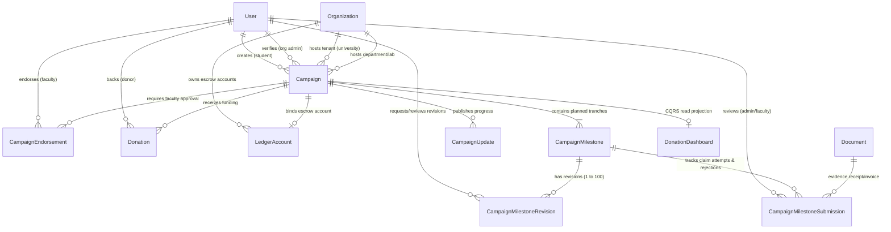
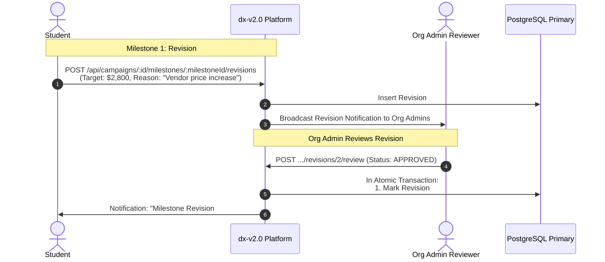
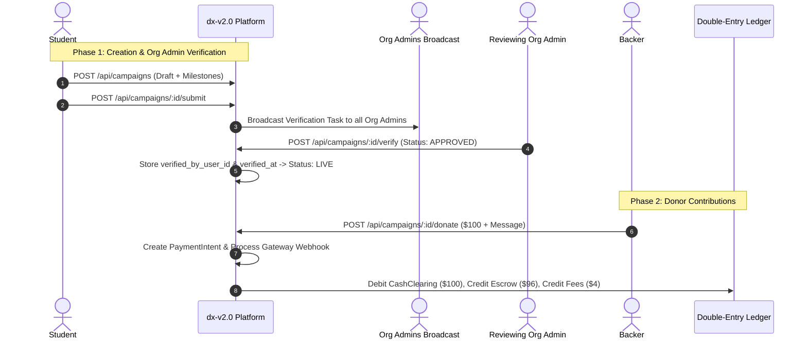

# Student Crowdfunding & Campaigns: Schema, Workflow & Risk Engineering Guide

> **Document Status**: Active Architecture & Operational Guide  
> **Target Version**: `dx-v2.0`  
> **Scope**: Database Models, End-to-End User Journeys, Milestone Multi-Rejection Loop & 100+ Revision Backtracking  

---

## 1. Domain Schema Architecture & Entity Relationships

The Campaign domain is encapsulated within the PostgreSQL multi-schema `campaigns.*` namespace. It connects bidirectionally to `identity`, `organization`, `finance`, `payments`, `documents`, and `search`.



---

## 2. Table-by-Table Schema Specification

### 2.1 `campaigns.campaigns` (Core Aggregate Root)
Stores campaign metadata, funding targets, live tallies, and Org Admin verification audit data.

| Column | Type | Nullable | Description |
| :--- | :--- | :--- | :--- |
| `id` | UUID | No | Primary Key (`gen_random_uuid()`). |
| `tenant_id` | UUID | No | University/Institution Organization ID (Enforces RLS multi-tenant boundary). |
| `student_user_id` | UUID | No | Foreign Key $\to$ `identity.users(id)`. Student beneficiary. Institutional ID resolved via `User.profileMetadata`. |
| `organization_id` | UUID | No | Specific College, Department, or Lab sub-unit under the tenant. |
| `title` | VARCHAR(255) | No | Campaign headline. |
| `slug` | VARCHAR(120) | No | URL-friendly unique identifier (e.g. `mit-solar-car-2026`). |
| `category` | Enum | No | `TUITION_FEE`, `RESEARCH_GRANT`, `STARTUP_INNOVATION`, `EMERGENCY_AID`, `COMPETITION_TRAVEL`, `EXTRACURRICULAR`. |
| `disbursement_type` | Enum | No | `MILESTONE_TRANCHE` (Default), `DIRECT_TUITION_PAYOUT`, `REIMBURSEMENT`. |
| `funding_model` | Enum | No | `FLEXIBLE` (Keep what is raised) or `ALL_OR_NOTHING` (Refund if target missed). |
| `short_description` | VARCHAR(500) | No | Summary snippet for search cards and social unfurls. |
| `story_markdown` | TEXT | No | Full pitch, rich media embeds, and detailed budget breakdown. |
| `cover_image_url` | VARCHAR(500) | No | Hero image hosted on secure CDN. |
| `video_url` | VARCHAR(500) | Yes | Optional YouTube/Vimeo explainer video. |
| `target_amount` | DECIMAL(15,2) | No | Goal funding in specified currency. |
| `min_donation_amount` | DECIMAL(15,2) | No | Minimum contribution allowed (Default: `$1.00`). |
| `current_raised_amount` | DECIMAL(15,2) | No | Cumulative settled donation amount (Default: `0.00`). |
| `donor_count` | INTEGER | No | Unique backer tally (Default: `0`). |
| `currency` | VARCHAR(3) | No | ISO-4217 Currency Code (Default: `USD`). |
| `status` | Enum | No | `DRAFT`, `SUBMITTED`, `PENDING_ENDORSEMENT`, `PENDING_VERIFICATION`, `APPROVED`, `LIVE`, `PAUSED`, `FULLY_FUNDED`, `CLOSED`, `CANCELLED`, `REJECTED`, `DISBURSING`, `COMPLETED`. |
| `verified_by_user_id` | UUID | Yes | Foreign Key $\to$ `identity.users(id)`. The Org Admin who approved the campaign. |
| `verified_at` | TIMESTAMPTZ | Yes | Timestamp when Org Admin approved. |
| `rejection_reason` | TEXT | Yes | Feedback provided if campaign draft was rejected. |
| `escrow_account_id` | UUID | Yes | Foreign Key $\to$ `finance.ledger_accounts(id)`. Escrow liability account. |
| `start_date` / `end_date` | TIMESTAMPTZ | Yes | Scheduled start and deadline timestamps. |
| `created_at` / `updated_at` | TIMESTAMPTZ | No | Audit timestamps. |
| `deleted_at` | TIMESTAMPTZ | Yes | Soft delete tombstone. |

---

### 2.2 Milestone Triad: Master, Revisions (Edits) & Submissions (Claims)

```
┌────────────────────────────────────────────────────────┐
│               campaign_milestones                      │
│        (Current Active Milestone State)                │
└──────────────────┬───────────────────┬─────────────────┘
                   │                   │
                   ▼                   ▼
┌─────────────────────────────┐ ┌─────────────────────────────┐
│ campaign_milestone_revisions│ │campaign_milestone_submissions│
│(Tracks all 100+ edits, diffs│ │ (Tracks all claim attempts, │
│     & admin approvals)      │ │   receipts & rejections)    │
└─────────────────────────────┘ └─────────────────────────────┘
```

#### 1. `campaigns.campaign_milestones` (Active Master State)
| Column | Type | Description |
| :--- | :--- | :--- |
| `id` | UUID | Primary Key. |
| `campaign_id` | UUID | Foreign Key $\to$ `campaigns.campaigns(id)` (Cascade on delete). |
| `sequence_order` | INTEGER | Step index (1, 2, 3...). Unique per campaign. |
| `current_version` | INTEGER | Current active revision number (Default: `1`). |
| `title` | VARCHAR(255) | Current milestone title. |
| `description` | TEXT | Deliverables expected before funds can be released. |
| `target_amount` | DECIMAL(15,2) | Current dollar amount allocated. |
| `status` | VARCHAR(50) | `PENDING`, `SUBMITTED`, `REJECTED`, `APPROVED`, `DISBURSED`. |
| `disbursed_at` | TIMESTAMPTZ | Timestamp when payout transaction was executed. |

#### 2. `campaigns.campaign_milestone_revisions` (Scope & Budget Changes History)
Tracks every modification (e.g. 1 to 100 revisions) with change reasons, author, and Org Admin review audit.

| Column | Type | Description |
| :--- | :--- | :--- |
| `id` | UUID | Primary Key. |
| `milestone_id` | UUID | Foreign Key $\to$ `campaigns.campaign_milestones(id)` (Cascade on delete). |
| `revision_number` | INTEGER | Incrementing revision counter (`1`, `2`, ... `100`). |
| `title` | VARCHAR(255) | Milestone title snapshot. |
| `description` | TEXT | Description snapshot. |
| `target_amount` | DECIMAL(15,2) | Target amount snapshot. |
| `change_reason` | TEXT | Explanation of why this revision was made. |
| `status` | VARCHAR(50) | `APPROVED` (Direct in draft or approved by admin), `PENDING_APPROVAL`, `REJECTED`. |
| `requested_by_user_id`| UUID | Foreign Key $\to$ `identity.users(id)`. Student who made/requested change. |
| `reviewed_by_user_id` | UUID | Foreign Key $\to$ `identity.users(id)`. Org Admin who reviewed. |
| `reviewed_at` | TIMESTAMPTZ | Approval/rejection timestamp. |
| `rejection_reason` | TEXT | Feedback if revision was rejected by Org Admin. |

#### 3. `campaigns.campaign_milestone_submissions` (Receipt Claim & Payout History)
| Column | Type | Description |
| :--- | :--- | :--- |
| `id` | UUID | Primary Key. |
| `milestone_id` | UUID | Foreign Key $\to$ `campaigns.campaign_milestones(id)` (Cascade on delete). |
| `submission_number` | INTEGER | Attempt counter (1, 2, 3...). |
| `evidence_doc_id` | UUID | Foreign Key $\to$ `documents.documents(id)`. Uploaded invoice/receipt. |
| `student_notes` | TEXT | Student explanation accompanying the receipt. |
| `status` | VARCHAR(50) | `PENDING_REVIEW`, `APPROVED`, `REJECTED`. |
| `reviewed_by_user_id` | UUID | Foreign Key $\to$ `identity.users(id)`. Admin/Faculty reviewer. |
| `reviewed_at` | TIMESTAMPTZ | Review timestamp. |
| `rejection_reason` | TEXT | Specific reason if this claim was rejected. |

---

## 3. Milestone Change & Backtracking Workflow



---

## 4. End-to-End Operational Workflows



---

## 5. Strategic Business Decisions Implemented

1. **Identity & Onboarding**: Student institutional details are resolved directly from `identity.User` (no duplicate fields on `Campaign`).
2. **100+ Revision Backtracking**: Fully typed and indexed via `CampaignMilestoneRevision`, allowing instant time-travel and chronological change inspection on the web.
3. **Milestone Rejection Loop**: Governed via `CampaignMilestoneSubmission` preserving an immutable log of every receipt upload and rejection reason.
4. **Funding Model**: **Hybrid** (Flexible funding for Tuition/Emergency aid; All-or-Nothing for Hardware Startups).
5. **Disbursement Routing**: **Hybrid** (Tuition & Research grants pay directly to University Bursar; Startups & Travel pay to student's verified bank account).
6. **Donor Experience**: **Direct Altruistic Contributions** with privacy controls (`isAnonymous`), custom display names, and public encouragement notes.
