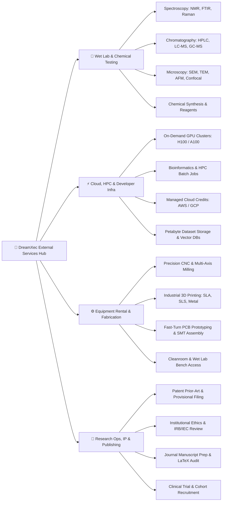
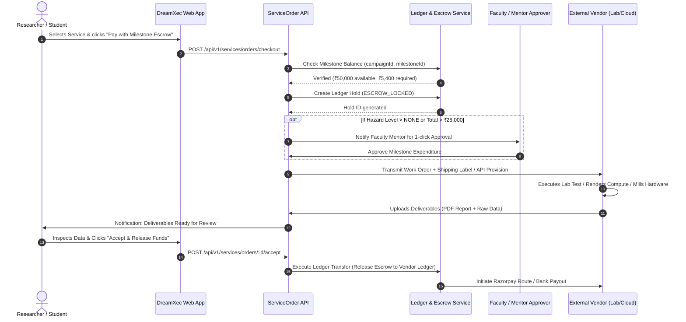
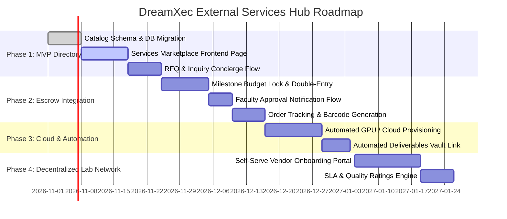

# DreamXec External Services & Researcher Enablement Hub
## System Architecture, Catalog Taxonomy, UI/UX Blueprint & Backend Implementation Specification

> **Document Status:** Architectural Proposal & Production Blueprint  
> **Target Version:** `dx-v2.0`  
> **Target Domain:** Researcher Marketplace & External Services (`services.*` / `marketplace.*`)  
> **Brand Guidelines:** Aligned with DreamXec Design Identity & Color Hierarchy  

---

## 1. Executive Summary & Vision

### 1.1 The Researcher Bottleneck
On DreamXec, student innovators, university researchers, and faculty launch funding campaigns to fuel breakthroughs. However, once funds are raised, researchers hit severe operational friction:
- **Fragmented Procurement:** Sourcing specialized chemical analysis (NMR, GC-MS, SEM), bio-reagents, or precision PCB fabrication requires navigating bureaucratic university purchase orders or dealing with unknown external vendors.
- **Out-of-Pocket Burden:** Students often lack corporate credit lines; paying for expensive GPU clusters or laboratory testing requires out-of-pocket cash followed by months-long reimbursement cycles.
- **Regulatory & Safety Hurdles:** Purchasing hazard-classified chemicals or clinical-grade biologicals requires institutional Environmental Health and Safety (EHS) and ethics compliance that single researchers struggle to navigate.
- **Opaque Pricing & No Academic Discounts:** Individual labs pay retail rates for cloud compute, lab consumables, and legal patent filings.

### 1.2 The Solution: DreamXec External Services Hub
The **External Services Hub** is an integrated marketplace within DreamXec that connects verified researchers directly to pre-vetted service providers across **wet lab testing, hardware fabrication, high-performance cloud compute, chemical reagents, and regulatory services**.

#### Key Value Differentiators:
1. **Direct Milestone Escrow Billing:** Researchers can pay vendors directly using their Campaign Milestone Grant Escrow (`finance.LedgerAccount`) with one-click faculty/mentor approval—**zero out-of-pocket spending**.
2. **Pre-Negotiated Academic & Grant Rates:** Consolidated purchasing power gives student researchers institutional-tier discounts (15% to 40% off).
3. **Built-in Compliance & Safety Guardrails:** Automated APAAR student identity checks, automated hazardous material classification, and university EHS sign-off workflows.
4. **Verified Vendor Network & Escrow Protection:** Funds are held in escrow and only disbursed to vendors upon confirmed delivery of lab test reports, physical prototypes, or compute telemetry.

---

## 2. Service Catalog Taxonomy: What We Provide

The marketplace categorizes services into **4 core pillars**, designed to cover the entire lifecycle from hypothesis to physical prototype and publication.



### Detailed Breakdown of Services:

| Category | Primary Services | Fulfillment Model | Turnaround SLA | Key Accreditations / Partners |
| :--- | :--- | :--- | :--- | :--- |
| **1. Wet Lab, Analytical & Chemical Testing** | • NMR (400/500/600 MHz) proton/carbon<br>• High-Resolution Mass Spec (HRMS, LC-MS/MS)<br>• Electron Microscopy (FESEM, HRTEM with EDX)<br>• Powder XRD & Single Crystal XRD<br>• Elemental Analysis (ICP-OES / ICP-MS)<br>• Certified Reagents & Hazard-regulated Solvents | Sample Mail-in / Courier Pickup with Cold-Chain Tracking | 48 hrs - 7 days | NABL, ISO/IEC 17025, GLP-compliant partner labs |
| **2. Cloud, GPU Clusters & Tech Infra** | • Dedicated NVIDIA H100 SXM5 / A100 80GB clusters<br>• On-demand vCPU / High-Memory compute nodes<br>• Pre-configured JupyterHub & Slurm clusters<br>• Hot/Cold S3-compatible research dataset storage<br>• Automated Vector DB & RAG inference endpoints | Instant Automated Provisioning / API Credential issuance | Real-time (< 2 mins) | AWS Cloud, RunPod, Lambda Labs, GCP Research, CoreWeave |
| **3. Prototyping, Fabrication & Lab Rental** | • Rapid PCB fabrication (2-16 layers, impedance controlled)<br>• Surface-Mount (SMT) component assembly<br>• Industrial 3D Printing (Metal DMLS, SLA Resin, PEEK)<br>• CNC 5-Axis Precision Machining<br>• Shared Cleanroom (Class 100/1000) & Lab Bench slots | CAD/Gerber file upload & physical fabrication | 3 - 10 business days | ISO 9001, IPC-A-610 Class 3 certified fab houses |
| **4. Research Operations, IP & Publishing** | • Patent prior-art search & provisional application drafting<br>• Ethics Board (IRB/IEC) fast-track compliance filing<br>• Academic English editing & journal manuscript styling<br>• Double-blind peer review readiness assessment<br>• Material Transfer Agreement (MTA) legal templates | Interactive Concierge & Portal Document Exchange | 5 - 14 business days | Registered Patent Attorneys, Top Academic Editors |

---

## 3. UI/UX Design & Frontend Specification

### 3.1 Design Language & Brand Rules
The Services Hub is designed using DreamXec's signature **Neo-Brutalist High-Contrast Tech** aesthetic, balancing vibrant energy with academic credibility.

- **Primary Brand Colors:**
  - **Creative Orange (`#FE4E1A`):** Action CTAs, primary accent buttons, highlight borders.
  - **Forest Green (`#0F534A`):** Verified Trust Badges, "Grant Escrow Approved" labels, academic growth tags.
  - **Bright Red (`#F4002C`):** Urgent alerts, hazard warnings (e.g. hazardous chemical storage notice), countdown timers for batch runs.
  - **Deep Purple (`#4717AE`):** Cloud & AI High-Performance Compute category cards, intelligence indicators.
- **Secondary Accents:**
  - **Bright Yellow (`#FFDD33`):** Promotional banners, "Student 30% Off" pill badges.
  - **Bright Green (`#9EFC5F`):** Status indicator pills ("Instant Provisioning", "Lab Available Now").
  - **Pastel Pink (`#FEB3FC`):** Micro-tag backdrops and quote tooltips.
  - **Vibrant Blue (`#18D7E8`):** Tech spec callouts, telemetry graphs, and turnaround chips.
- **Typography:**
  - **Headlines:** `Poppins Black` (uppercase, bold, authoritative).
  - **Sublines / Section Headers:** `Poppins Medium` (clean, geometric structure).
  - **Body / Specs:** `Poppins Regular` (crisp legibility).
  - **Annotations & Accents:** `Badlooking Brush` (handwritten notes, e.g., *"Backed by DreamXec Escrow!"*, *"Zero Out-of-Pocket"*).
- **Physical Styling:**
  - Solid `#121316` borders (2px to 3px width).
  - Hard drop shadows: `shadow-[4px_4px_0px_#121316]` and `hover:shadow-[6px_6px_0px_#121316]`.
  - Active button micro-interaction: `active:translate-x-[2px] active:translate-y-[2px] active:shadow-none`.

---

### 3.2 Visual Page Architecture & Wireframe Breakdown

```
+---------------------------------------------------------------------------------------------------+
|  [DreamXec Logo]   Browse Campaigns   [Researcher Services*]   Clubs   Vault   [Profile / Balance]  |
+---------------------------------------------------------------------------------------------------+
|                                                                                                   |
|   HERO SECTION                                                                                   |
|   +-------------------------------------------------------------------------------------------+   |
|   |  ACCELERATE YOUR DISCOVERY                                                                |   |
|   |  # WORLD-CLASS LAB TESTING, GPU CLOUD & FABRICATION                                       |   |
|   |  [Badlooking Brush: "Billed straight to your Grant Escrow! No reimbursement delays."]      |   |
|   |                                                                                           |   |
|   |  [ 🔍 Search tests, chemicals, H100 GPUs, PCB fab, patent filing... ] [Search Button]     |   |
|   |                                                                                           |   |
|   |  Filter Quick Pills: [All Services] [🧪 Wet Lab] [⚡ Cloud & GPUs] [⚙️ Fabrication] [📜 IP] |   |
|   +-------------------------------------------------------------------------------------------+   |
|                                                                                                   |
|   MAIN MARKETPLACE VIEW                                                                           |
|   +-----------------------------+  +----------------------------------------------------------+   |
|   | FILTERS SIDEBAR             |  | CATALOG HEADER: 142 Services Available   [Grid] [List]   |   |
|   |                             |  +----------------------------------------------------------+   |
|   | Category                    |  | SERVICE CARD 1 (Wet Lab)                                 |   |
|   | [x] Spectroscopy & Imaging  |  | [🧪 Chemical Testing] [NABL Certified]                   |   |
|   | [ ] Cloud & GPU Compute     |  | High-Resolution NMR Spectroscopy (500 MHz)              |   |
|   | [ ] Rapid PCB / Prototyping |  | Provider: National Center for Nano Analysis              |   |
|   |                             |  | • Turnaround: 48 Hours                                   |   |
|   | Payment Mode                |  | • Sample: 10mg Solid / Solution                          |   |
|   | [x] Direct Grant Escrow     |  | • Price: ₹1,800 / sample (Student Subsidized: -35%)     |   |
|   | [ ] Self-funded / Credit    |  | [View Details] [Book with Grant Escrow]                  |   |
|   |                             |  +----------------------------------------------------------+   |
|   | Turnaround Time             |  | SERVICE CARD 2 (Cloud Compute)                           |   |
|   | (o) Instant (< 5m)          |  | [⚡ Cloud Infra] [Instant Deploy]                         |   |
|   | ( ) Under 48 hours          |  | 8x NVIDIA H100 SXM5 GPU Cluster Node                     |   |
|   | ( ) Custom Lead Time        |  | Provider: DreamXec Cloud Grid (Tier-3 Datacenter)        |   |
|   |                             |  | • Specs: 640GB VRAM, NVLink 900 GB/s, 2TB RAM            |   |
|   | Safety & Hazmat             |  | • Price: ₹240 / GPU hour (Direct Milestone Debit)        |   |
|   | [ ] Non-Hazardous Only      |  | [Spin Up Instance] [Configure Specs]                     |   |
|   +-----------------------------+  +----------------------------------------------------------+   |
+---------------------------------------------------------------------------------------------------+
```

---

### 3.3 Key Interactive User Journeys

#### Journey A: Ordering Analytical Lab Testing (e.g. NMR / SEM)
1. **Search & Filter:** Student filters by "Spectroscopy" and flags "Grant Escrow Eligible".
2. **Configuration Modal:**
   - Selects frequency (e.g. 500 MHz vs 600 MHz), solvent (CDCl3, DMSO-d6), and number of samples.
   - Uploads Sample Safety Data Sheet (MSDS) or declares non-toxic nature.
3. **Checkout with Campaign Escrow:**
   - Instead of entering a credit card, researcher selects **"Pay via Campaign Escrow"**.
   - Dropdown displays active approved campaigns: *e.g., "Novel Bio-Polymer Hydrogel (Milestone 2: Synthesis & Testing - Remaining Budget: ₹75,000)"*.
   - System checks if the service cost (e.g. ₹5,400) is within the approved milestone budget.
4. **Order Confirmation & Sample Dispatch Kit:**
   - System auto-generates a printable **Chain-of-Custody Shipping Barcode** and sample packaging instructions.
   - Courier pickup is automatically scheduled.
   - Sample status transitions in real-time: `Awaiting Sample` → `In Transit` → `Lab Received` → `Testing` → `Report Uploaded`.
5. **Acceptance & Settlement:**
   - Lab uploads certified PDF report + raw data files (FID / CSV / TIFF).
   - Student reviews and clicks **"Approve & Release Payment"**.
   - Escrow funds are transferred to the vendor account, with zero reimbursement paperwork!

#### Journey B: Instant GPU Cluster Provisioning
1. **Selection:** Researcher chooses an 8x H100 cluster for 72 hours of deep learning model training.
2. **Quota & Security Check:** The backend validates campaign milestone allocation and generates an ephemeral SSH keypair and container JupyterLab URL.
3. **Live Telemetry & Burn Rate:** Real-time billing widget inside the DreamXec Dashboard tracks GPU utilization and milestone budget deductions.

---

## 4. Backend Implementation & Technical Architecture

### 4.1 Modular Architecture Overview
The backend implementation introduces a dedicated module under `server/src/modules/services/` following the existing clean architecture pattern:

```
server/src/modules/services/
├── controllers/
│   ├── service-catalog.controller.js      # Public discovery, filtering, search
│   ├── service-order.controller.js        # Checkout, quote request, escrow lock
│   ├── service-vendor.controller.js       # Vendor portal, sample intake, report upload
│   └── service-compliance.controller.js   # Hazmat, EHS, ethics sign-offs
├── services/
│   ├── catalog.service.js                 # Catalog logic, caching, pricing calculation
│   ├── order-workflow.service.js          # Order state machine & status progression
│   ├── escrow-integration.service.js      # Ledger allocation & milestone verification
│   └── cloud-provisioner.service.js       # AWS / RunPod / Slurm API automation
├── adapters/
│   ├── cloud-provider.adapter.js          # Integrations with GPU/Cloud APIs
│   ├── logistics-courier.adapter.js       # Shiprocket / Delhivery courier pickup
│   └── notification-alert.adapter.js      # WhatsApp, Email & Dashboard push alerts
├── routes/
│   └── services.routes.js                 # Express route definitions & guards
└── validators/
    └── service.validator.js               # Joi / Zod validation schemas
```

---

### 4.2 Database Schema (Prisma Multi-Schema Migration)

We introduce the new schema domain: `@@schema("marketplace")`.

```prisma
// ============================================================================
// MARKETPLACE & EXTERNAL RESEARCH SERVICES DOMAIN (marketplace.*)
// ============================================================================

enum ServiceCategoryType {
  WET_LAB_TESTING
  CLOUD_AND_HPC
  FABRICATION_AND_PROTOTYPING
  REAGENTS_AND_CHEMICALS
  EQUIPMENT_RENTAL
  IP_AND_PUBLISHING
  
  @@schema("marketplace")
}

enum PricingModel {
  FIXED_UNIT            // e.g. ₹1,500 per sample
  HOURLY_METERED        // e.g. ₹200 / GPU hour
  TIERED_VOLUME         // e.g. 1-10 samples ₹1,200, 11+ ₹900
  CUSTOM_RFQ            // Request For Quote based on custom parameters
  
  @@schema("marketplace")
}

enum ServiceOrderStatus {
  DRAFT
  RFQ_SUBMITTED
  QUOTE_OFFERED
  ESCROW_LOCKED         // Funds frozen from Campaign Milestone
  SAMPLE_DISPATCHED     // Courier in transit with physical sample
  SAMPLE_RECEIVED       // Vendor lab logged receipt
  IN_EXECUTION          // Testing / Manufacturing in progress
  DELIVERABLE_SUBMITTED // Report / CAD / Hardware delivered
  INSPECTION_ACCEPTED   // Researcher approved output
  ESCROW_RELEASED       // Vendor paid via double-entry ledger
  DISPUTE_RAISED
  CANCELLED
  
  @@schema("marketplace")
}

enum HazardClassification {
  NONE                  // General material
  BIOHAZARD_BSL1
  BIOHAZARD_BSL2
  FLAMMABLE_TOXIC       // Regulated chemical
  RADIOACTIVE_RESTRICTED
  
  @@schema("marketplace")
}

model ServiceVendor {
  id                    String              @id @default(uuid()) @db.Uuid
  organizationId        String?             @map("organization_id") @db.Uuid
  legalName             String              @map("legal_name") @db.VarChar(255)
  brandName             String              @map("brand_name") @db.VarChar(255)
  slug                  String              @unique @db.VarChar(120)
  contactEmail          String              @map("contact_email") @db.VarChar(255)
  contactPhone          String?             @map("contact_phone") @db.VarChar(50)
  taxIdGst              String?             @map("tax_id_gst") @db.VarChar(50)
  accreditations        Json                @default("[]") @map("accreditations") // ["NABL", "ISO 17025", "GLP"]
  isVerified            Boolean             @default(false) @map("is_verified")
  ratingAverage         Decimal             @default(5.0) @map("rating_average") @db.Decimal(3, 2)
  totalOrdersCompleted  Int                 @default(0) @map("total_orders_completed")
  payoutBankDetails     Json                @default("{}") @map("payout_bank_details")
  createdAt             DateTime            @default(now()) @map("created_at") @db.Timestamptz
  updatedAt             DateTime            @default(now()) @map("updated_at") @db.Timestamptz

  services              ServiceItem[]
  orders                ServiceOrder[]

  @@map("service_vendors")
  @@schema("marketplace")
}

model ServiceItem {
  id                    String              @id @default(uuid()) @db.Uuid
  vendorId              String              @map("vendor_id") @db.Uuid
  vendor                ServiceVendor       @relation(fields: [vendorId], references: [id], onDelete: Cascade)
  category              ServiceCategoryType
  title                 String              @db.VarChar(255)
  slug                  String              @unique @db.VarChar(200)
  shortDescription      String              @map("short_description") @db.Text
  fullDescription       String              @map("full_description") @db.Text
  pricingModel          PricingModel        @map("pricing_model")
  basePriceInCents      BigInt              @map("base_price_in_cents") // Currency in lowest denomination (e.g., paise)
  currency              String              @default("INR") @db.VarChar(10)
  academicDiscountPct   Int                 @default(0) @map("academic_discount_pct") // e.g. 25% off
  estimatedLeadTimeDays Int                 @default(3) @map("estimated_lead_time_days")
  hazardLevel           HazardClassification @default(NONE) @map("hazard_level")
  technicalSpecs        Json                @default("{}") @map("technical_specs") // Sample requirements, resolution, etc.
  orderFormSchema       Json                @default("{}") @map("order_form_schema") // Dynamic form fields for checkout
  isActive              Boolean             @default(true) @map("is_active")
  isGrantEscrowEligible Boolean             @default(true) @map("is_grant_escrow_eligible")
  createdAt             DateTime            @default(now()) @map("created_at") @db.Timestamptz
  updatedAt             DateTime            @default(now()) @map("updated_at") @db.Timestamptz

  orders                ServiceOrder[]
  quotes                ServiceQuote[]

  @@index([category, isActive])
  @@map("service_items")
  @@schema("marketplace")
}

model ServiceOrder {
  id                    String              @id @default(uuid()) @db.Uuid
  orderNumber           String              @unique @map("order_number") @db.VarChar(50) // e.g. "DX-SRV-2026-0841"
  serviceId             String              @map("service_id") @db.Uuid
  service               ServiceItem         @relation(fields: [serviceId], references: [id])
  vendorId              String              @map("vendor_id") @db.Uuid
  vendor                ServiceVendor       @relation(fields: [vendorId], references: [id])
  researcherId          String              @map("researcher_id") @db.Uuid
  researcher            User                @relation("ResearcherServiceOrders", fields: [researcherId], references: [id])
  
  // Direct Linkage to Campaign Milestone Funding
  campaignId            String?             @map("campaign_id") @db.Uuid
  campaign              Campaign?           @relation(fields: [campaignId], references: [id])
  milestoneId           String?             @map("milestone_id") @db.Uuid
  milestone             CampaignMilestone?  @relation(fields: [milestoneId], references: [id])
  
  status                ServiceOrderStatus  @default(DRAFT)
  totalAmountInCents    BigInt              @map("total_amount_in_cents")
  taxAmountInCents      BigInt              @default(0) @map("tax_amount_in_cents")
  escrowHoldId          String?             @map("escrow_hold_id") @db.Uuid
  
  orderParameters       Json                @default("{}") @map("order_parameters") // User input selections
  sampleTrackingNumber  String?             @map("sample_tracking_number") @db.VarChar(100)
  deliverableFiles      Json                @default("[]") @map("deliverable_files") // Test results, raw files, telemetry
  complianceApproval    Json                @default("{}") @map("compliance_approval") // EHS/faculty approval stamps
  
  createdAt             DateTime            @default(now()) @map("created_at") @db.Timestamptz
  updatedAt             DateTime            @default(now()) @map("updated_at") @db.Timestamptz

  timelineEvents        ServiceOrderEvent[]

  @@index([researcherId, status])
  @@index([campaignId, milestoneId])
  @@map("service_orders")
  @@schema("marketplace")
}

model ServiceOrderEvent {
  id                    String              @id @default(uuid()) @db.Uuid
  orderId               String              @map("order_id") @db.Uuid
  order                 ServiceOrder        @relation(fields: [orderId], references: [id], onDelete: Cascade)
  statusTransition      ServiceOrderStatus  @map("status_transition")
  actorId               String?             @map("actor_id") @db.Uuid
  comment               String?             @db.Text
  metadata              Json                @default("{}")
  createdAt             DateTime            @default(now()) @map("created_at") @db.Timestamptz

  @@map("service_order_events")
  @@schema("marketplace")
}

model ServiceQuote {
  id                    String              @id @default(uuid()) @db.Uuid
  serviceId             String              @map("service_id") @db.Uuid
  service               ServiceItem         @relation(fields: [serviceId], references: [id])
  researcherId          String              @map("researcher_id") @db.Uuid
  specifications        Json                @map("specifications")
  quotedPriceInCents    BigInt?             @map("quoted_price_in_cents")
  validUntil            DateTime?           @map("valid_until") @db.Timestamptz
  status                String              @default("PENDING") @db.VarChar(30)
  createdAt             DateTime            @default(now()) @map("created_at") @db.Timestamptz

  @@map("service_quotes")
  @@schema("marketplace")
}
```

---

### 4.3 Double-Entry Escrow Settlement Architecture

How milestone grant funds are safely utilized to pay vendors without cash ever leaving the controlled ecosystem:



---

### 4.4 RESTful API Endpoints Specification

| Method | Endpoint | Access Role | Description |
| :--- | :--- | :--- | :--- |
| `GET` | `/api/v1/services/catalog` | Public / All | List services with search, category filtering, turnaround and pricing filters. |
| `GET` | `/api/v1/services/catalog/:slug` | Public / All | Get complete service details, dynamic form schema, and vendor credentials. |
| `GET` | `/api/v1/services/eligible-milestones` | Authenticated Researcher | Returns active campaign milestones with remaining funds that can fund this service. |
| `POST` | `/api/v1/services/orders/checkout` | StudentGuard / Researcher | Creates service order and establishes Escrow Lock on selected Campaign Milestone. |
| `POST` | `/api/v1/services/quotes/request` | Authenticated Researcher | Submits custom parameter RFQ for bespoke testing or heavy manufacturing. |
| `GET` | `/api/v1/services/orders/my-orders` | Authenticated Researcher | Fetches current and past service orders, live status, tracking barcodes, and test reports. |
| `POST` | `/api/v1/services/orders/:id/deliverables` | VendorGuard | Vendor endpoint to upload raw data, calibrated instrument logs, and final reports. |
| `POST` | `/api/v1/services/orders/:id/accept` | StudentGuard / Researcher | Confirms satisfactory delivery and triggers automated escrow settlement. |
| `POST` | `/api/v1/services/orders/:id/dispute` | StudentGuard / Researcher | Holds escrow release and escalates to DreamXec Scientific Compliance Arbiter. |

---

## 5. Security, Regulatory & Hazardous Material Guardrails

1. **Dual-Factor Researcher Identity Verification:**
   - Orders involving restricted chemicals (e.g., toxic reagents, drug precursors) require APAAR ID verification and linked university lab credentials.
2. **University EHS Sign-off Hook:**
   - Any order tagged with `HazardClassification: FLAMMABLE_TOXIC` or `BIOHAZARD_BSL2` automatically requires the verified signature of the university Environmental Health & Safety (EHS) officer.
3. **Data Privacy & IP Protection:**
   - All sample reports and raw spectrometer logs are encrypted at rest with AES-256 in private S3 buckets.
   - Vendors sign legally binding Non-Disclosure Agreements (NDAs) ensuring full IP ownership stays with the researcher and university.
4. **Instrument Calibration Auditing:**
   - Vendor laboratories must submit quarterly NABL/ISO calibration logs to maintain their "DreamXec Certified Lab" badge.

---

## 6. Frontend Component Architecture (React/Vite)

To implement this page within `client/src/`, the following component tree will be established:

```
client/src/
├── pages/
│   └── ResearcherServicesPage.tsx           # Main Marketplace route (/services)
├── components/services/
│   ├── ServicesHero.tsx                     # Header, quick pills, Poppins/Badlooking Brush hero
│   ├── ServicesFilterSidebar.tsx            # Sticky filter sidebar (Category, Price, Turnaround)
│   ├── ServiceCard.tsx                      # Neo-brutalist card with badges and dual CTAs
│   ├── ServiceDetailModal.tsx               # Full spec drawer, sample protocol, SLA breakdown
│   ├── EscrowCheckoutModal.tsx              # Milestone selector, balance check & 1-click escrow lock
│   ├── ServiceOrderTracking.tsx             # Visual tracker (Dispatched → Testing → Deliverables)
│   └── DeliverablesViewer.tsx               # Interactive spectrum viewer, PDF preview & raw file download
```

---

## 7. Phased Implementation Roadmap



### Next Steps for Implementation:
1. **Approval of Specification:** Review catalog categories and milestone escrow settlement logic.
2. **Execute Database Migration:** Add `marketplace` schema and tables to `server/prisma/schema.prisma`.
3. **Build Core Services API Module:** Implement `server/src/modules/services/` with mock/seed data for the top 20 popular research services.
4. **Develop React UI Page:** Create `client/src/pages/ResearcherServicesPage.tsx` adhering to the Neo-Brutalist DreamXec design system.
