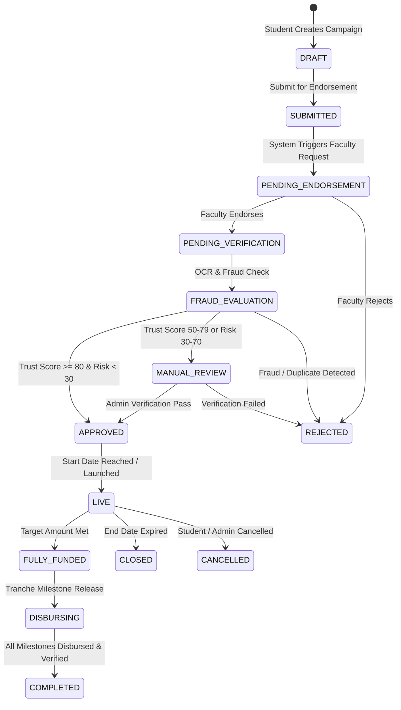

# Student Crowdfunding & Funding Campaigns - System Architecture & Production Design Specification

> **Document Status**: Production Design Draft  
> **Target Platform Version**: `dx-v2.0`  
> **Author**: Lead Software Architect & Engineering Team  
> **Last Updated**: August 2026  

---

## 1. Executive Summary & Product Vision

### 1.1 Overview
The **Student Crowdfunding & Funding Campaigns System** is an enterprise-grade platform feature embedded within the `dx-v2.0` multi-tenant architecture. It enables verified students (across colleges, universities, incubators, and research labs) to host funding campaigns for tuition assistance, academic research, innovation startups, emergency relief, and extracurricular competitions.

### 1.2 Core Pillars
1. **Verified Student Legitimacy**: Integrates directly with institutional identity (`identity.*`), university multi-tenant organizational hierarchies (`organization.*`), and document verification state machines (`verification.*`) to eliminate non-authentic or fraudulent student listings.
2. **Financial Integrity & Double-Entry Ledger**: All campaign funds flow through multi-tenant double-entry escrow ledger accounts (`finance.LedgerAccount`) with zero mutable balance columns. Payouts are released in tranche-based milestones requiring institutional endorsement.
3. **High-Concurrency Surge Resilience**: Architected to sustain viral traffic spikes (up to 50,000 QPS) via CQRS read projections (`search.DonationDashboard`), Single-Flight read coalescing, Redis L2 atomic counter buffers, and asynchronous database write flushing via Kafka.
4. **Institutional Governance & Faculty Endorsements**: Campaigns above threshold amounts mandate formal verification from university faculty, organization administrators, or department heads prior to public indexing.

---

## 2. High-Level System Architecture

The Student Campaign domain operates as an event-driven, decoupled system integrated with `dx-v2.0` core services.

```mermaid
graph TD
    Client[📱 Student / Backer Web & Mobile Client] --> Gateway[🌐 Kong API Gateway / Rate Limiter]
    Gateway --> AuthGuard[🔑 Zanzibar ReBAC & RLS Guard]
    AuthGuard --> CampaignService[⚡ Campaign Application Service]
    
    subgraph Read Path (CQRS - 50,000 QPS)
        CampaignService --> L1[L1: Container In-Memory Cache]
        L1 -- Miss --> L2[L2: Redis Campaign Cluster]
        L2 -- Miss --> ReadReplica[L3: PostgreSQL Read Replicas - search.CampaignDashboard]
    end

    subgraph Write & Processing Path (Transactional)
        CampaignService --> PostgresPrimary[(PostgreSQL Primary - campaigns.* / finance.*)]
        CampaignService --> Outbox[(Audit Outbox Log)]
        Outbox --> Kafka[📩 Apache Kafka Event Bus]
    end

    subgraph Asynchronous Event Consumers
        Kafka --> LedgerWorker[💰 Ledger & Payment Processing Worker]
        Kafka --> FraudWorker[🛡️ Fraud AI & Duplicate Engine Worker]
        Kafka --> NotificationWorker[🔔 Notification & Email Worker]
        Kafka --> SearchIndexer[🔍 Search & Projections Ingestion Engine]
    end

    LedgerWorker --> DoubleEntryLedger[(finance.ledger_accounts)]
    SearchIndexer --> OpenSearch[(L4: OpenSearch Cluster)]
    SearchIndexer --> CQRSProjections[(PostgreSQL search.donation_dashboards)]
```

### 2.1 Domain Mapping within Multi-Schema PostgreSQL
- **`campaigns.*`** *(New Domain)*: Stores campaign core metadata, updates, reward tiers, endorsements, and milestone release claims.
- **`identity.*` & `organization.*`**: Binds student user records (`User`) to institutional hierarchies (`Organization` LTREE node).
- **`verification.*`**: Handles student enrollment proof OCR parsing, duplicate campaign text/image detection, and trust scoring.
- **`finance.*` & `payments.*`**: Controls double-entry ledger entries (`LedgerAccount`, `LedgerTransaction`), payment intents, and escrow accounts.
- **`search.*`**: Houses CQRS read-optimized projections (`DonationDashboard`) for sub-millisecond public leaderboards and funding progress displays.
- **`audit.*` & `jobs.*`**: Manages immutable transactional outbox event streams (`OutboxEvent`) and background payout execution queues (`BackgroundJob`).

---

## 3. Production Database Schema Specification (Prisma PostgreSQL)

The following schema extensions represent the enterprise data model for the `campaigns` domain and related CQRS projections.

```prisma
// ============================================================================
// STUDENT CAMPAIGNS DOMAIN SCHEMA (campaigns.*)
// ============================================================================

enum CampaignStatus {
  DRAFT
  SUBMITTED
  PENDING_ENDORSEMENT
  PENDING_VERIFICATION
  APPROVED
  LIVE
  PAUSED
  FULLY_FUNDED
  CLOSED
  CANCELLED
  REJECTED
  DISBURSING
  COMPLETED

  @@schema("campaigns")
}

enum CampaignCategory {
  TUITION_FEE
  RESEARCH_GRANT
  STARTUP_INNOVATION
  EMERGENCY_AID
  COMPETITION_TRAVEL
  EXTRACURRICULAR

  @@schema("campaigns")
}

enum DisbursementType {
  MILESTONE_TRANCHE
  DIRECT_TUITION_PAYOUT
  REIMBURSEMENT

  @@schema("campaigns")
}

enum FundingModel {
  FLEXIBLE
  ALL_OR_NOTHING

  @@schema("campaigns")
}

enum EndorsementStatus {
  PENDING
  APPROVED
  REJECTED

  @@schema("campaigns")
}

model Campaign {
  id                  String           @id @default(uuid()) @db.Uuid
  tenantId            String           @map("tenant_id") @db.Uuid // University/College Org ID
  studentUserId       String           @map("student_user_id") @db.Uuid
  organizationId      String           @map("organization_id") @db.Uuid // College or Department ID
  title               String           @db.VarChar(255)
  slug                String           @unique @db.VarChar(120)
  category            CampaignCategory
  disbursementType    DisbursementType @default(MILESTONE_TRANCHE) @map("disbursement_type")
  fundingModel        FundingModel     @default(FLEXIBLE) @map("funding_model")
  shortDescription    String           @map("short_description") @db.VarChar(500)
  storyMarkdown       String           @map("story_markdown") @db.Text
  coverImageUrl       String           @map("cover_image_url") @db.VarChar(500)
  videoUrl            String?          @map("video_url") @db.VarChar(500)
  
  targetAmount        Decimal          @map("target_amount") @db.Decimal(15, 2)
  minDonationAmount   Decimal          @default(1.00) @map("min_donation_amount") @db.Decimal(15, 2)
  currentRaisedAmount Decimal          @default(0.00) @map("current_raised_amount") @db.Decimal(15, 2)
  donorCount          Int              @default(0) @map("donor_count")
  currency            String           @default("USD") @db.VarChar(3)
  
  status              CampaignStatus   @default(DRAFT)
  
  // Org Admin Institutional Governance Audit
  verifiedByUserId    String?          @map("verified_by_user_id") @db.Uuid
  verifiedAt          DateTime?        @map("verified_at") @db.Timestamptz
  rejectionReason     String?          @map("rejection_reason") @db.Text
  
  escrowAccountId     String?          @unique @map("escrow_account_id") @db.Uuid
  startDate           DateTime?        @map("start_date") @db.Timestamptz
  endDate             DateTime?        @map("end_date") @db.Timestamptz
  createdAt           DateTime         @default(now()) @map("created_at") @db.Timestamptz
  updatedAt           DateTime         @default(now()) @map("updated_at") @db.Timestamptz
  deletedAt           DateTime?        @map("deleted_at") @db.Timestamptz

  // Relations
  tenant              Organization     @relation("TenantCampaigns", fields: [tenantId], references: [id], onDelete: Restrict)
  department          Organization     @relation("DepartmentCampaigns", fields: [organizationId], references: [id], onDelete: Restrict)
  student             User             @relation("StudentCampaigns", fields: [studentUserId], references: [id], onDelete: Cascade)
  verifiedBy          User?            @relation("VerifiedCampaigns", fields: [verifiedByUserId], references: [id], onDelete: SetNull)
  escrowAccount       LedgerAccount?   @relation(fields: [escrowAccountId], references: [id], onDelete: SetNull)
  milestones          CampaignMilestone[]
  endorsements        CampaignEndorsement[]
  updates             CampaignUpdate[]
  donations           Donation[]

  @@index([tenantId, status])
  @@index([studentUserId])
  @@index([organizationId])
  @@index([verifiedByUserId])
  @@index([category, status])
  @@index([createdAt(sort: Desc)])
  @@map("campaigns")
  @@schema("campaigns")
}

model CampaignMilestone {
  id             String    @id @default(uuid()) @db.Uuid
  campaignId     String    @map("campaign_id") @db.Uuid
  sequenceOrder  Int       @map("sequence_order")
  currentVersion Int       @default(1) @map("current_version")
  title          String    @db.VarChar(255)
  description    String?   @db.Text
  targetAmount   Decimal   @map("target_amount") @db.Decimal(15, 2)
  status         String    @default("PENDING") @db.VarChar(50) // PENDING, SUBMITTED, REJECTED, APPROVED, DISBURSED
  disbursedAt    DateTime? @map("disbursed_at") @db.Timestamptz
  createdAt      DateTime  @default(now()) @map("created_at") @db.Timestamptz
  updatedAt      DateTime  @default(now()) @map("updated_at") @db.Timestamptz

  campaign       Campaign  @relation(fields: [campaignId], references: [id], onDelete: Cascade)
  submissions    CampaignMilestoneSubmission[]
  revisions      CampaignMilestoneRevision[]

  @@unique([campaignId, sequenceOrder])
  @@index([campaignId])
  @@map("campaign_milestones")
  @@schema("campaigns")
}

model CampaignMilestoneRevision {
  id                String    @id @default(uuid()) @db.Uuid
  milestoneId       String    @map("milestone_id") @db.Uuid
  revisionNumber    Int       @map("revision_number") // 1, 2, 3 ... 100
  title             String    @db.VarChar(255)
  description       String?   @db.Text
  targetAmount      Decimal   @map("target_amount") @db.Decimal(15, 2)
  changeReason      String    @map("change_reason") @db.Text
  status            String    @default("APPROVED") @db.VarChar(50) // PENDING_APPROVAL, APPROVED, REJECTED
  requestedByUserId String    @map("requested_by_user_id") @db.Uuid
  reviewedByUserId  String?   @map("reviewed_by_user_id") @db.Uuid
  reviewedAt        DateTime? @map("reviewed_at") @db.Timestamptz
  rejectionReason   String?   @map("rejection_reason") @db.Text
  createdAt         DateTime  @default(now()) @map("created_at") @db.Timestamptz

  milestone         CampaignMilestone @relation(fields: [milestoneId], references: [id], onDelete: Cascade)
  requestedBy       User              @relation("MilestoneRevisionRequestedBy", fields: [requestedByUserId], references: [id], onDelete: Restrict)
  reviewedBy        User?             @relation("MilestoneRevisionReviewedBy", fields: [reviewedByUserId], references: [id], onDelete: SetNull)

  @@unique([milestoneId, revisionNumber])
  @@index([milestoneId])
  @@index([reviewedByUserId])
  @@map("campaign_milestone_revisions")
  @@schema("campaigns")
}

model CampaignMilestoneSubmission {
  id               String    @id @default(uuid()) @db.Uuid
  milestoneId      String    @map("milestone_id") @db.Uuid
  submissionNumber Int       @default(1) @map("submission_number")
  evidenceDocId    String    @map("evidence_doc_id") @db.Uuid
  studentNotes     String?   @map("student_notes") @db.Text
  status           String    @default("PENDING_REVIEW") @db.VarChar(50) // PENDING_REVIEW, APPROVED, REJECTED
  
  // Reviewer Audit
  reviewedByUserId String?   @map("reviewed_by_user_id") @db.Uuid
  reviewedAt       DateTime? @map("reviewed_at") @db.Timestamptz
  rejectionReason  String?   @map("rejection_reason") @db.Text
  
  createdAt        DateTime  @default(now()) @map("created_at") @db.Timestamptz
  updatedAt        DateTime  @default(now()) @map("updated_at") @db.Timestamptz

  milestone        CampaignMilestone @relation(fields: [milestoneId], references: [id], onDelete: Cascade)
  evidenceDoc      Document          @relation(fields: [evidenceDocId], references: [id], onDelete: Restrict)
  reviewedBy       User?             @relation("ReviewedMilestoneSubmissions", fields: [reviewedByUserId], references: [id], onDelete: SetNull)

  @@index([milestoneId])
  @@index([evidenceDocId])
  @@index([reviewedByUserId])
  @@map("campaign_milestone_submissions")
  @@schema("campaigns")
}

model CampaignEndorsement {
  id               String            @id @default(uuid()) @db.Uuid
  campaignId       String            @map("campaign_id") @db.Uuid
  endorserUserId   String            @map("endorser_user_id") @db.Uuid
  designation      String            @db.VarChar(150) // e.g. "Head of Computer Science Dept", "Faculty Advisor"
  status           EndorsementStatus @default(PENDING)
  comments         String?           @db.Text
  endorsedAt       DateTime?         @map("endorsed_at") @db.Timestamptz
  createdAt        DateTime          @default(now()) @map("created_at") @db.Timestamptz

  campaign         Campaign          @relation(fields: [campaignId], references: [id], onDelete: Cascade)
  endorser         User              @relation("UserCampaignEndorsements", fields: [endorserUserId], references: [id], onDelete: Restrict)

  @@unique([campaignId, endorserUserId])
  @@index([campaignId])
  @@index([endorserUserId])
  @@map("campaign_endorsements")
  @@schema("campaigns")
}

model CampaignUpdate {
  id           String   @id @default(uuid()) @db.Uuid
  campaignId   String   @map("campaign_id") @db.Uuid
  title        String   @db.VarChar(255)
  content      String   @db.Text
  mediaUrls    Json     @default("[]") @map("media_urls")
  isPublic     Boolean  @default(true) @map("is_public")
  createdAt    DateTime @default(now()) @map("created_at") @db.Timestamptz

  campaign     Campaign @relation(fields: [campaignId], references: [id], onDelete: Cascade)

  @@index([campaignId, createdAt(sort: Desc)])
  @@map("campaign_updates")
  @@schema("campaigns")
}
```

---

## 4. Campaign Verification & Lifecycle State Machine

To protect donors and institution reputation, campaigns undergo rigorous verification prior to going `LIVE`.



### 4.1 Automated Validation Pipeline
1. **Active Student Identity Match**: The system cross-references `studentUserId` against `organization.memberships` to ensure `status == ACTIVE` and role is `STUDENT` or `RESEARCHER`.
2. **Document & Invoice OCR**: Proof of cost (e.g. university fee receipt, lab equipment invoice) is stored in `documents.Document` and analyzed via OCR for amount matching.
3. **Fuzzy Duplicate Campaign Check**: Uses Levenshtein text matching and perceptual image hashing (`duplicate_checks`) to catch copycat campaigns across tenants.
4. **Faculty Endorsement**: Required for campaigns exceeding **$500**. System dispatches notification to designated faculty members who sign off via cryptographic token.

---

## 5. Financial Architecture & Double-Entry Ledger Integration

All monetary movements strictly adhere to double-entry accounting to eliminate floating balance bugs or unauthorized money generation.

```
                  CAMPAIGN CONTRIBUTION FLOW (DEPOSIT TO ESCROW)
       DEBIT (+ Amount)                                  CREDIT (- Amount)
┌─────────────────────────────────────────┐    ┌─────────────────────────────────────────┐
│ payments.cash_clearing_account (Asset)  │    │ finance.campaign_escrow:{id} (Liability)│
│               + $1,000.00               │    │               - $1,000.00               │
└─────────────────────────────────────────┘    └─────────────────────────────────────────┘

                 TRANCHE MILESTONE DISBURSEMENT FLOW (BURSAR / STUDENT)
       DEBIT (+ Amount)                                  CREDIT (- Amount)
┌─────────────────────────────────────────┐    ┌─────────────────────────────────────────┐
│ finance.campaign_escrow:{id} (Liability)│    │ finance.student_payout_account (Liability)
│               + $500.00                 │    │                - $500.00                │
└─────────────────────────────────────────┘    └─────────────────────────────────────────┘
```

### 5.1 Journal Entry Breakdown
Upon a successful backer donation of **$100.00** (with a 2.5% Payment Gateway Fee and 1.5% Platform Governance Fee):
1. **Debit**: Payment Gateway Cash Clearing (`$100.00`)
2. **Credit**: Payment Gateway Fee Expense Account (`$2.50`)
3. **Credit**: Platform Governance Revenue Account (`$1.50`)
4. **Credit**: Student Campaign Escrow Account (`$96.00`)

*Total Debits ($100.00) == Total Credits ($100.00).* Transaction is committed inside a Postgres atomic block.

---

## 6. High-Concurrency Scalability & Surge Engineering

When a student campaign goes viral on social media or national news, read traffic can exceed **50,000 QPS** and write donation requests can hit **2,000 QPS**.

### 6.1 Mitigation of Traffic Bottlenecks

```mermaid
sequenceDiagram
    autonumber
    actor Donor
    participant Gateway as API Gateway
    participant Redis as Redis L2 Counter Cache
    participant App as Campaign Service
    participant SingleFlight as Single-Flight Deduplicator
    participant DB as PostgreSQL Read Replica

    Donor->>Gateway: GET /api/v1/campaigns/save-mit-lab/summary
    Gateway->>Redis: GET campaign:summary:save-mit-lab
    alt Cache Hit (Sub-millisecond)
        Redis-->>Gateway: Return JSON Cached Payload
        Gateway-->>Donor: 200 OK (0.8ms)
    else Cache Miss (Cold Start or Surge)
        Redis-->>App: Cache Miss
        App->>SingleFlight: Request coalescing for "save-mit-lab"
        Note over SingleFlight: 10,000 concurrent requests arrive.<br/>Only 1 executes query; 9,999 wait on promise.
        SingleFlight->>DB: Exec SELECT on search.donation_dashboards
        DB-->>SingleFlight: Return aggregated metrics
        SingleFlight->>Redis: SET campaign:summary:save-mit-lab (TTL 5s)
        SingleFlight-->>App: Return query result
        App-->>Gateway: Return response
        Gateway-->>Donor: 200 OK (15ms)
    end
```

### 6.2 Write Buffering for Donors (Atomic Redis Counter + Outbox)
1. **Instant Webhook Response**: Payment gateway webhooks hit `/api/v1/payments/webhook` and return `200 OK` within **10ms** after inserting the event payload into `webhook_events`.
2. **Atomic Counter Invalidation**: Redis executes `HINCRBYFLOAT campaign:{id}:stats raised_amount 50.00` and `HINCRBY campaign:{id}:stats donor_count 1` in `<1ms`.
3. **Kafka Batch Flusher**: An asynchronous worker consumes donation events from Kafka and executes batch SQL updates to `search.donation_dashboards` and `campaigns.campaigns` every 2 seconds, reducing database row-level locking contention by **99.5%**.

---

## 7. Security, Access Control & Anti-Fraud (Zanzibar ReBAC & RLS)

### 7.1 Multi-Tenancy Row-Level Security (RLS)
The `campaigns` table enforces strict university isolation:
```sql
CREATE POLICY tenant_campaign_isolation ON campaigns.campaigns
    FOR ALL USING (tenant_id = NULLIF(current_setting('app.current_tenant_id', true), '')::UUID);
```

### 7.2 Zanzibar Access Tuples
- `campaign:0928e4a9#owner@user:dino_student` (Can update story, post updates)
- `campaign:0928e4a9#endorser@user:prof_smith` (Can approve/reject endorsement)
- `campaign:0928e4a9#disburser@organization:mit#admin` (Can trigger milestone payout)

### 7.3 Fraud Mitigation Rules
- **Velocity Limit**: Max 5 contributions per IP / Card per hour to prevent credit card testing attacks.
- **Anonymous Contribution Limit**: Unauthenticated donations capped at **$500**. Contributions above require donor identity verification.
- **Destination Lock**: Milestone payouts can only be wired to verified University Bursar bank accounts or student accounts with completed KYC identity verification (`verification.verifications`).

---

## 8. Enterprise REST API Specifications

### 8.1 Create Draft Campaign
`POST /api/v1/campaigns`

```json
// Request Payload
{
  "title": "Autonomous Racing Drone for International Collegiate Challenge",
  "category": "STARTUP_INNOVATION",
  "disbursementType": "MILESTONE_TRANCHE",
  "shortDescription": "Funding specialized LiDAR sensors and carbon fiber frames for MIT Drone Team.",
  "storyMarkdown": "## Project Overview\nOur team qualified for...",
  "coverImageUrl": "https://cdn.platform.org/uploads/drone-cover.jpg",
  "targetAmount": 4500.00,
  "currency": "USD",
  "organizationId": "d748f3b2-1111-4d1a-be29-d52cd3798939",
  "milestones": [
    {
      "title": "Tranche 1: Sensor & Electronics Acquisition",
      "targetAmount": 2500.00,
      "sequenceOrder": 1
    },
    {
      "title": "Tranche 2: Chassis Fabrication & Flight Testing",
      "targetAmount": 2000.00,
      "sequenceOrder": 2
    }
  ]
}
```

```json
// Response Payload (201 Created)
{
  "success": true,
  "data": {
    "id": "e912f458-7f72-4d1a-be29-d52cd3799999",
    "slug": "autonomous-racing-drone-for-international-collegiate-challenge",
    "status": "DRAFT",
    "verificationScore": 0.00,
    "createdAt": "2026-08-20T23:14:44.000Z"
  }
}
```

### 8.2 Endorse Campaign (Faculty / Admin)
`POST /api/v1/campaigns/{id}/endorse`

```json
// Request Payload
{
  "status": "APPROVED",
  "comments": "Verified student enrollment and lab project safety compliance.",
  "designation": "Professor of Aerospace Engineering"
}
```

### 8.3 Idempotent Backer Contribution
`POST /api/v1/campaigns/{id}/donate`

```json
// Headers
// Idempotency-Key: 7b99c821-4f12-4211-9232-a128e4111222

// Request Payload
{
  "amount": 100.00,
  "currency": "USD",
  "isAnonymous": false,
  "backerNote": "Best of luck to the MIT Team!",
  "rewardId": "a1b2c3d4-1111-4d1a-be29-d52cd3798939"
}
```

```json
// Response Payload (200 OK)
{
  "success": true,
  "data": {
    "donationId": "f111e222-7f72-4d1a-be29-d52cd3798939",
    "clientSecret": "pi_3MtwB2LkdIwxyz_secret_abc123",
    "status": "PENDING_PAYMENT"
  }
}
```

---

## 9. Event-Driven Outbox Schemas

The following domain events are published to Kafka via the Transactional Outbox pattern (`audit.OutboxEvent`).

### 9.1 `campaign.created.v1`
```json
{
  "eventId": "11223344-5566-7788-9900-aabbccddeeff",
  "eventType": "campaign.created.v1",
  "tenantId": "0928e4a9-7f72-4d1a-be29-d52cd3798939",
  "aggregateId": "e912f458-7f72-4d1a-be29-d52cd3799999",
  "timestamp": "2026-08-20T23:14:44.000Z",
  "payload": {
    "campaignId": "e912f458-7f72-4d1a-be29-d52cd3799999",
    "studentUserId": "a1b2c3d4-0000-0000-0000-000000000001",
    "targetAmount": 4500.00,
    "category": "STARTUP_INNOVATION"
  }
}
```

### 9.2 `campaign.funded.v1`
```json
{
  "eventId": "22334455-6677-8899-0011-bbccddeeff00",
  "eventType": "campaign.funded.v1",
  "tenantId": "0928e4a9-7f72-4d1a-be29-d52cd3798939",
  "aggregateId": "e912f458-7f72-4d1a-be29-d52cd3799999",
  "timestamp": "2026-08-20T23:45:00.000Z",
  "payload": {
    "campaignId": "e912f458-7f72-4d1a-be29-d52cd3799999",
    "totalRaised": 4550.00,
    "targetAmount": 4500.00,
    "totalDonors": 42
  }
}
```

---

## 10. Comprehensive Edge Cases & Enterprise Mitigations

| Edge Case ID | Scenario | Root Cause | Engineering Mitigation |
| :--- | :--- | :--- | :--- |
| **EC-CAM-01** | Concurrent Backer Over-Funding | Multiple backers complete payments simultaneously at target threshold. | Campaigns support over-funding by default. Target percentage calculates dynamically; surplus funds held in escrow for milestone approval. |
| **EC-CAM-02** | Expired Campaign Under-Goal | Campaign end date reached with only 40% raised. | Supports `Flexible` (keep raised) vs `All-or-Nothing` config. For All-or-Nothing, Kafka worker initiates batch refund intent execution. |
| **EC-CAM-03** | Student Leaves University Mid-Campaign | Student account suspended or expelled in `identity.User`. | Database foreign key trigger checks `accountStatus`. If suspended, campaign automatically transitions to `PAUSED` and blocks payouts. |
| **EC-CAM-04** | Dual Milestone Claim Race Condition | Student double-clicks milestone disbursement claim button. | Redis distributed lock (`redlock`) placed on `milestone_id` during payout calculation. |
| **EC-CAM-05** | Fake Invoice Upload for Milestone Release | Student submits fabricated equipment receipt. | Requires Faculty Endorser sign-off on evidence documents stored in `documents.Document` with hash verification before release. |
| **EC-CAM-06** | Payment Gateway Webhook Out-of-Order | `payment_succeeded` webhook arrives before `campaign.created` event finishes indexing. | Asynchronous consumer uses UPSERT idempotency checks against `payments.payment_intents` and retry topics. |
| **EC-CAM-07** | Cache Stampede on Viral Campaign Launch | 100,000 users hit landing page at launch second. | Single-Flight promise coalescing limits database reads to 1 query; remaining 99,999 requests await Redis cache population. |
| **EC-CAM-08** | Chargeback / Payment Dispute | Backer disputes credit card transaction 30 days later. | Ledger executes reverse entry: Debits `campaign_escrow` account. If escrow balance is insufficient, platform registers negative balance claim on student account. |

---

## 11. Implementation Checklist for Development Teams
 
- [x] Add `campaigns` schema definition to `server/prisma/schema.prisma`.
- [x] Generate Prisma client bindings (`npx prisma generate`).
- [ ] Execute Prisma migration (`npx prisma migrate dev --name init_student_campaigns`).
- [ ] Create domain module `/server/src/modules/campaigns` (controllers, services, repositories, validators, routes).
- [ ] Implement Zanzibar relation tuple rules and permission matrix for `campaign` namespace.
- [ ] Build Double-Entry Ledger mapping hooks in `server/src/services/ledger.service.js`.
- [ ] Configure Redis L2 counter flushing worker in `server/src/jobs/donationFlusher.job.js`.
- [ ] Write integration test suite targeting state transitions and surge deduplication.
