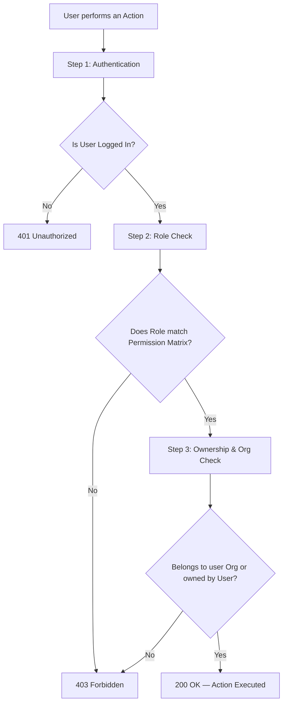
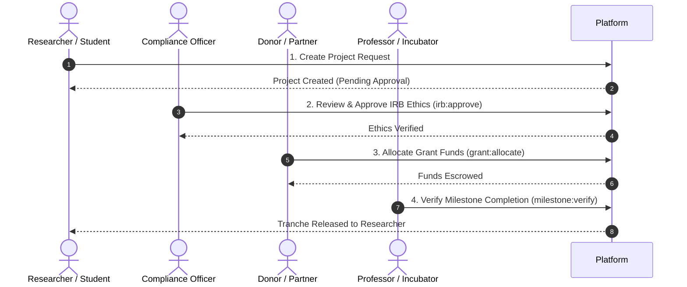

# Role-Based Access Control (RBAC) Architecture
> **Dreamxec Platform Security & Governance Overview**

---

## Executive Summary
Our platform uses an enterprise-grade, **3-Tier Access Control System**:
1. **RBAC (Role-Based)** — Restricts actions based on assigned user roles.
2. **ReBAC (Relationship-Based)** — Enforces multi-tenant organizational boundaries.
3. **ABAC (Attribute-Based)** — Validates resource ownership (e.g., project creator, assigned donor).

---

## Permission Matrix (Who Can Do What?)

| User Role | Create Project | Edit Project | Approve Ethics (IRB) | Verify Milestones | Allocate Grants | System Admin |
| :--- | :---: | :---: | :---: | :---: | :---: | :---: |
| **System Admin** | Yes | Yes | Yes | Yes | Yes | Yes |
| **Org Admin** | Yes | Yes | Yes | Yes | Yes | Yes |
| **Professor / Faculty** | Yes | Yes (Lead) | No | Yes | No | No |
| **Compliance Officer** | No | No | Yes | No | No | No |
| **Incubator Manager** | No | No | No | Yes | No | No |
| **Donor / Partner** | Yes | No | No | Yes | Yes | No |
| **Student President** | Yes | Yes (Owned) | No | No | No | No |
| **Researcher / User** | Yes | Yes (Owned) | No | No | No | No |

---

## How a Request Flows (Real-Time Security Check)

---

## End-to-End Workflow Example: Research Grant Lifecycle

---

## Key Client Benefits

* **Multi-Tenant Isolation:** Data and roles are strictly separated between different universities and companies.
* **Audit-Ready:** Every compliance approval and grant release is logged with explicit user roles.
* **Zero Hardcoding:** Roles and permissions are managed centrally, allowing rapid configuration of new roles without code rewrites.
