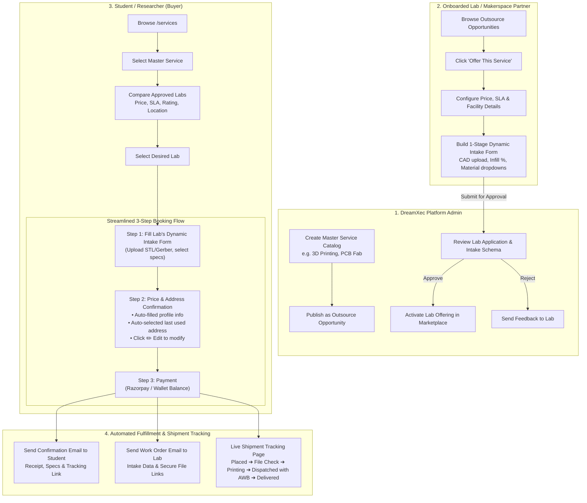

# DreamXec Distributed Fabrication & Lab Services Marketplace
## Architecture, Data Contracts & Complete Implementation Plan

---

## 1. Executive Summary & Vision (The Idea in Simple & Clear Form)

DreamXec connects students and academic researchers with accredited university and commercial labs for physical fabrication services (such as **3D Printing**, **PCB Fabrication & Assembly**, **CNC Machining**, and **Analytical Testing**).

Rather than binding a service to a single fixed provider, DreamXec operates as a **transparent, multi-lab marketplace**:

1. **Admin Master Service Catalog**:
   - DreamXec Admins create canonical master services (e.g., *3D Printing (FDM / SLA / SLS)*, *Multi-Layer PCB Prototyping*, *500 MHz NMR Testing*).
   - Each master service defines the domain, standard description, tags, default hero imagery, and flags whether physical shipping is required.

2. **Lab Discovery & 1-Stage Dynamic Intake Configuration**:
   - Onboarded Labs browse an **"Outsource Opportunities"** catalog of services DreamXec is seeking partners to fulfill.
   - A lab applies to offer a service by configuring:
     - **Pricing & SLA**: Base price, unit (per part, per board, per sample), and turnaround time.
     - **1-Stage Dynamic Intake Workflow**: The exact file formats (STL, Gerber) and custom technical inputs (materials, infill %, layer count, tolerances) that *this specific lab* needs from the student.
     - **Dispatch & Facility Details**: Facility address and support contact.

3. **Admin Review & Approval Gate**:
   - The lab's application enters a **Pending Approvals** queue in the DreamXec Admin Dashboard.
   - Admins inspect the lab credentials, pricing, and dynamic intake fields to guarantee student experience and safety.
   - Upon Admin approval, the lab is linked to the service and goes **live in the public marketplace**.

4. **Student / Researcher Experience (Multi-Lab Price & Quality Comparison)**:
   - Students visit the public `/services` marketplace and select a service.
   - They see a **side-by-side comparison of all approved labs** offering that service (comparing price, turnaround time, ratings, accreditation, and location).
   - They pick the lab that best fits their timeline and budget.

5. **Streamlined 3-Step Booking Flow**:
   - **Step 1: Dynamic Intake Form**: Dynamically renders the selected lab's specific intake questions and secure file upload dropzones (STL/Gerber).
   - **Step 2: Price Confirmation, Billing & Shipping Address**:
     - Transparent cost breakdown (unit price × quantity, grant subsidies, shipping).
     - Customer billing details (name, email, phone) are **auto-consumed from their logged-in profile**.
     - Delivery address is **automatically populated with their last-used address**, presented as a clean read-only summary card with an inline **"Edit" icon** to modify or select a new address.
   - **Step 3: Payment**: Direct checkout via Razorpay (UPI, Cards, NetBanking) or Student Grant/Wallet balance.

6. **Post-Order Fulfillment & Live Shipment Tracking**:
   - Automated confirmation emails sent immediately to the buyer (with receipt and specs) and the lab (with work order and CAD/Gerber file download links).
   - An intuitive **Shipment Tracking Page** with a visual progress stepper:
     *Order Placed &rarr; Pre-Flight File Check &rarr; In Production (Printing/Milling) &rarr; Dispatched (with Courier Name, AWB Tracking # and Link) &rarr; Delivered*.

---

## 2. System Architecture & Entity Flow



---

## 3. Current Codebase vs. Target Architecture (Gap Analysis)

| Area | Current Implementation | Target Marketplace Architecture | Changes Required |
| :--- | :--- | :--- | :--- |
| **Data Schema** | Single flat table `marketplace.service_items` (each row bundles title, fixed vendor, and price 1:1). | Relational hierarchy: `marketplace.master_services` (1) &rarr; `marketplace.lab_service_offerings` (N). | Create master services and lab offerings tables with foreign keys and approval lifecycle states. |
| **Lab Portal** | Generic lab modal (`AddLabModal.tsx`). | Dedicated **"Outsource Opportunities"** tab for onboarded labs. | Add lab view to browse master services and view application statuses (`APPROVED`, `PENDING_REVIEW`, `NOT_OFFERED`). |
| **Intake Builder** | 4-step modal in `ServiceWorkflowBuilderModal.tsx`. | Focused **1-Stage Dynamic Intake Builder** for labs applying to a specific master service. | Repurpose the existing field builder (`text`, `number`, `select`, `file`, `textarea`) into the lab application modal. |
| **Admin Moderation** | Admin panels for campaigns and orgs, but none for lab service offerings. | Dedicated **"Lab Service Applications"** review queue in Admin Dashboard. | Create admin endpoints and UI to inspect lab pricing, review intake schema previews, and approve/reject. |
| **Public Catalog** | Shows service cards; clicking opens fixed vendor modal. | Service card shows *"From ₹X • N Labs Available"*; detail modal displays a **Multi-Lab Comparison Matrix**. | Add lab comparison component with sorting by Lowest Price, Fastest Turnaround, and Highest Rating. |
| **Checkout Flow** | `ServiceCheckoutModal.tsx` has basic quantity and notes textarea. | **Dynamic 3-Step Wizard**: Step 1: Lab's dynamic intake form. Step 2: Auto-filled profile + auto-selected last used address (read-only with edit icon). Step 3: Payment. | Refactor checkout modal into a 3-step dynamic wizard. |
| **Address Memory** | No persistent shipping address memory for service orders. | Auto-save shipping addresses to `identity.users.profile_metadata` and order records. | Auto-load the last-used address; provide an inline edit drawer/modal. |
| **Email Service** | `server/src/modules/email/email.service.js` supports SendGrid, but has no service order templates. | Automated order confirmation emails for students and work order notifications for labs. | Add `sendServiceOrderConfirmationEmail` and `sendLabNewOrderAlertEmail`. |
| **Order Tracking** | `ResearcherOrdersPage.tsx` displays a basic table of orders. | Visual shipment tracker with milestone stepper and live courier tracking (AWB). | Build interactive shipment tracking view at `/services/orders/:orderNumber`. |

---

## 4. Comprehensive 6-Milestone Implementation Plan

### Milestone 1: Database Schema & Migration

#### 1.1 `marketplace.master_services` Table
Canonical services created and maintained by platform admins:
```sql
CREATE TABLE IF NOT EXISTS marketplace.master_services (
  id VARCHAR(60) PRIMARY KEY, -- e.g., 'srv-3d-printing', 'srv-pcb-fab'
  slug VARCHAR(80) UNIQUE NOT NULL,
  title VARCHAR(255) NOT NULL,
  category VARCHAR(50) NOT NULL, -- 'FABRICATION', 'TESTING', 'CLOUD', 'CHEMICALS', 'LEGAL'
  category_label VARCHAR(100),
  category_color VARCHAR(20),
  image_url TEXT NOT NULL,
  summary TEXT NOT NULL,
  full_description TEXT NOT NULL,
  is_physical_delivery BOOLEAN DEFAULT TRUE,
  default_unit VARCHAR(50) DEFAULT 'per part',
  tags JSONB DEFAULT '[]'::jsonb,
  created_at TIMESTAMPTZ DEFAULT NOW(),
  updated_at TIMESTAMPTZ DEFAULT NOW()
);
```

#### 1.2 `marketplace.lab_service_offerings` Table
Links an onboarded Lab to a Master Service with specific pricing and dynamic intake requirements:
```sql
CREATE TABLE IF NOT EXISTS marketplace.lab_service_offerings (
  id UUID PRIMARY KEY DEFAULT gen_random_uuid(),
  master_service_id VARCHAR(60) NOT NULL REFERENCES marketplace.master_services(id) ON DELETE CASCADE,
  organization_id UUID NOT NULL REFERENCES organization.organizations(id) ON DELETE CASCADE,
  vendor_name VARCHAR(255) NOT NULL,
  vendor_accreditation VARCHAR(255),
  vendor_location VARCHAR(255),
  vendor_rating NUMERIC(3, 2) DEFAULT 5.0,
  base_price NUMERIC(12, 2) NOT NULL,
  original_price NUMERIC(12, 2),
  unit VARCHAR(50) NOT NULL DEFAULT 'per part',
  turnaround VARCHAR(100) NOT NULL DEFAULT '3 - 5 Business Days',
  dynamic_intake_schema JSONB NOT NULL DEFAULT '[]'::jsonb,
  approval_status VARCHAR(30) NOT NULL DEFAULT 'PENDING', -- 'PENDING', 'APPROVED', 'REJECTED'
  admin_notes TEXT,
  is_active BOOLEAN DEFAULT TRUE,
  created_at TIMESTAMPTZ DEFAULT NOW(),
  updated_at TIMESTAMPTZ DEFAULT NOW(),
  UNIQUE(master_service_id, organization_id)
);
```

#### 1.3 `marketplace.service_orders` Table Enhancements
Enhanced to store shipping addresses, submitted intake data, and courier tracking:
```sql
ALTER TABLE marketplace.service_orders
  ADD COLUMN IF NOT EXISTS offering_id UUID REFERENCES marketplace.lab_service_offerings(id),
  ADD COLUMN IF NOT EXISTS shipping_address JSONB DEFAULT '{}'::jsonb,
  ADD COLUMN IF NOT EXISTS dynamic_intake_responses JSONB DEFAULT '{}'::jsonb,
  ADD COLUMN IF NOT EXISTS courier_details JSONB DEFAULT '{}'::jsonb,
  ADD COLUMN IF NOT EXISTS timeline_events JSONB DEFAULT '[]'::jsonb;
```

#### 1.4 User Address Memory
Stores saved addresses and references the last-used address inside `identity.users.profile_metadata`:
```json
{
  "shippingAddresses": [
    {
      "id": "addr-1",
      "recipientName": "Aarav Sharma",
      "phone": "+91 98765 43210",
      "addressLine1": "Room 304, Mega Boys Hostel 7",
      "addressLine2": "National Institute of Technology Kurukshetra",
      "city": "Kurukshetra",
      "state": "Haryana",
      "postalCode": "136119",
      "country": "India",
      "isDefault": true,
      "lastUsedAt": "2026-10-24T18:00:00.000Z"
    }
  ],
  "lastUsedAddressId": "addr-1"
}
```

---

### Milestone 2: Admin Master Service Management

1. **Admin Master Service UI**:
   - Integrated into the DxAdmin Dashboard (`/admin`).
   - Create, edit, and archive Master Services that DreamXec outsources.
   - Specify: Title, Category, Hero Image, Summary, Full Description, Default Unit, and `isPhysicalDelivery` toggle.
2. **Backend API Endpoints**:
   - `GET /api/services/admin/master-services` &mdash; List all master services.
   - `POST /api/services/admin/master-services` &mdash; Create a new master service.
   - `PUT /api/services/admin/master-services/:id` &mdash; Update master service details.
   - `DELETE /api/services/admin/master-services/:id` &mdash; Soft delete / archive service.

---

### Milestone 3: Lab Partner Portal & 1-Stage Dynamic Intake Builder

1. **Lab Partner Discovery View ("Outsource Opportunities")**:
   - Accessible by Lab Managers and Organization Admins.
   - Displays all active Master Services.
   - Status indicators per service:
     - `Offer This Service` (Not yet configured)
     - `Pending Admin Approval` (Submitted, under review)
     - `Active & Live` (Approved, visible to students)
     - `Action Required` (Changes requested by Admin)

2. **1-Stage Dynamic Intake Form Builder**:
   - When a lab clicks **"Offer This Service"**, an intuitive modal opens:
     - **Pricing & SLA**: Base price (₹), unit, estimated turnaround (days).
     - **1-Stage Dynamic Intake Form Builder**:
       - Lab configures the exact requirements needed from the student.
       - **1-Click Quick Templates**:
         - *3D Printing*: CAD model file upload (`.stl`, `.step`, `.obj`), Infill % dropdown (`20%`, `50%`, `100%`), Material dropdown (`PLA`, `ABS`, `PETG`, `Resin`), Color preference, Notes.
         - *PCB Fabrication*: Gerber archive upload (`.zip`), Layer count dropdown (`1`, `2`, `4`, `6`), Copper weight (`1oz`, `2oz`), Solder mask color, Surface finish (`HASL`, `ENIG`), Electrical testing required.
         - *Chemical/Analytical Testing*: Sample state (`Liquid`, `Powder`), Storage temperature, Concentration, Hazard declaration.
       - **Custom Field Builder**: Allows labs to add custom fields:
         - Types: `file`, `select`, `text`, `number`, `textarea`, `checkbox`.
         - Parameters: Field label, placeholder, helper text, required flag, and options (for dropdowns).
     - **Facility & Dispatch**: Confirm dispatch address and lab support contact email.
   - Submitting sets `approval_status = 'PENDING'` and alerts platform admins.

---

### Milestone 4: Admin Approval & Moderation Queue

1. **Admin Review Queue**:
   - A dedicated moderation view in the Admin Dashboard.
   - Displays pending lab applications with:
     - Lab profile, accreditation, and campus location.
     - Proposed price and turnaround time vs. marketplace averages.
     - **Interactive Live Preview** of the lab's dynamic intake form.
2. **Admin Actions**:
   - `Approve`: Sets `approval_status = 'APPROVED'`, activating the lab on the public catalog.
   - `Request Changes / Reject`: Enters feedback notes; sends notification to lab to adjust their intake form or pricing.
3. **Backend API Endpoints**:
   - `GET /api/services/admin/pending-offerings` &mdash; List all pending offerings.
   - `POST /api/services/admin/offerings/:id/approve` &mdash; Approve and publish.
   - `POST /api/services/admin/offerings/:id/reject` &mdash; Reject with feedback note.

---

### Milestone 5: Student / Researcher Marketplace & Lab Comparison Matrix

1. **Master Service Catalog (`/services`)**:
   - Clean, neobrutalist cards for each Master Service:
     - *3D Rapid Prototyping* &bull; Starts from ₹350 &bull; 3 Approved Labs Available
     - *Multi-Layer PCB Fabrication* &bull; Starts from ₹800 &bull; 2 Approved Labs Available
2. **Service Detail & Lab Comparison Matrix (`ServiceDetailModal.tsx`)**:
   - Clicking a service displays:
     - Technical service overview and general guidelines.
     - **"Available Certified Labs" Comparison Table**:
       - Side-by-side or stacked lab cards.
       - Key metrics: Lab Name, University/Facility Badge, Rating (★), Location, Base Price, and Turnaround Days.
       - Sorting controls: **Lowest Price**, **Fastest Turnaround**, **Highest Rated**, **Nearest Location**.
       - Action: **"Book with this Lab"** button opens the dynamic booking modal for the selected lab.

---

### Milestone 6: Streamlined 3-Step Dynamic Booking Modal

Refactored `ServiceCheckoutModal.tsx` into a guided 3-step wizard:

```
[ Step 1: Lab Intake ] ────► [ Step 2: Price & Address ] ────► [ Step 3: Payment ]
```

#### Step 1: Dynamic Intake Form
- Dynamically renders each field defined by the selected lab's `dynamic_intake_schema`:
  - **File Upload Fields**: Drag-and-drop CAD models (`.stl`, `.step`) or Gerber archives (`.zip`) with client-side extension validation and secure upload.
  - **Dropdowns & Selectors**: Material selection, layer count, infill density, color.
  - **Text & Number Inputs**: Special dimensional requirements or project notes.
- Validates all required fields before proceeding.

#### Step 2: Price Confirmation, Billing & Shipping Address
- **Transparent Price Breakdown**:
  - Unit Price × Quantity.
  - Grant Subsidy / Student Discount (if applicable).
  - Shipping fee (flat rate or calculated).
  - Net amount payable.
- **Billing Details**:
  - Full Name, Email, and Phone number are **automatically consumed and pre-filled from the user's logged-in profile**.
- **Delivery / Shipping Address (for Physical Services)**:
  - System automatically checks the user's profile for past delivery addresses.
  - **If a previous address exists**:
    - Automatically pre-selects the **last used address**.
    - Renders as a clean, read-only summary card:
      ```
      📍 Delivery Address (Last Used)
      Aarav Sharma — +91 98765 43210
      Hostel 7, Room 304, NIT Kurukshetra Campus
      Kurukshetra, Haryana — 136119
      [ ✏️ Edit Address ]
      ```
    - Clicking the **Edit** icon opens an inline address modal/drawer to edit details or select/add a new address.
  - **If no address exists**:
    - Displays an intuitive address form (Street, City, State, PIN, Phone).
    - Checking *"Save this address for future orders"* persists it to their profile.

#### Step 3: Payment
- Payment method selection:
  - **Pay with Wallet / Grant Balance** (deducts from active ledger account).
  - **Pay via Razorpay** (opens Razorpay standard modal for UPI, Cards, NetBanking).
- On payment confirmation:
  - Order status set to `CONFIRMED`.
  - Generates unique tracking code (e.g., `DX-3DP-94812`).

---

### Milestone 7: Automated Notifications & Live Shipment Tracking

#### 1. Automated Email Dispatch (via SendGrid)
- **To Student / Researcher**:
  - Subject: `🚀 Order Confirmed: 3D Printing with NIT KKR MakerSpace [DX-3DP-94812]`
  - Body: Itemized receipt, summary of submitted specs/files, lab facility contact, estimated completion date, and direct link to the **Live Order Tracking Page**.
- **To Fulfilling Lab**:
  - Subject: `📦 New Service Work Order: 3D Rapid Prototyping [#DX-3DP-94812]`
  - Body: Complete intake specifications, direct secure download links for CAD/Gerber files, student delivery address, and one-click action button to update order status.

#### 2. Visual Shipment & Order Tracking Page
- Accessible at `/services/orders/:orderNumber` or via the "My Orders" drawer.
- Interactive milestone stepper:
  1. **Order Received & Verified**: Payment confirmed and intake files delivered to the lab.
  2. **Engineering Review (Pre-Flight Check)**: Lab verifies file geometry and manufacturability (e.g., slicing check, DRC check).
  3. **In Production**: 3D printing or PCB etching actively running.
  4. **Quality Inspection & Packaging**: Finished item inspected, cleaned, and packed securely.
  5. **Dispatched / In Transit**:
     - Displays courier partner name and logo (e.g., **Blue Dart Express**, **DTDC**, **Delhivery**).
     - Live **AWB Tracking Number** with clickable direct link to courier tracking portal.
     - Estimated Delivery Date.
  6. **Delivered**: Final delivery confirmation.

---

## 5. Data Contracts & JSON Schemas

### 5.1 Dynamic Intake Field Schema (Stored in Lab Offering `dynamic_intake_schema`)
```json
[
  {
    "id": "cad_model_file",
    "label": "3D Model File (STL or STEP)",
    "type": "file",
    "required": true,
    "acceptedFormats": [".stl", ".step", ".obj"],
    "maxSizeMb": 50,
    "helperText": "Export your 3D CAD model in millimeters (mm) with manifold mesh geometry."
  },
  {
    "id": "material_type",
    "label": "Select Material",
    "type": "select",
    "required": true,
    "options": ["PLA Tough (White)", "PLA Tough (Black)", "PETG (Chemical Resistant)", "ABS (High Temp)", "Tough Resin"],
    "helperText": "PLA is best for prototypes; PETG and ABS for functional mechanical parts."
  },
  {
    "id": "infill_density",
    "label": "Infill Density",
    "type": "select",
    "required": true,
    "options": ["20% (Standard Prototype)", "50% (Semi-Structural)", "100% (Solid Functional Part)"]
  },
  {
    "id": "special_tolerances",
    "label": "Tolerances & Thread Requirements",
    "type": "textarea",
    "required": false,
    "placeholder": "e.g., M3 brass heat-set inserts required, critical fit on motor mount shaft."
  }
]
```

### 5.2 Shipping Address Contract (Stored in Order `shipping_address`)
```json
{
  "recipientName": "Aarav Sharma",
  "phone": "+91 98765 43210",
  "addressLine1": "Room 304, Mega Boys Hostel 7",
  "addressLine2": "National Institute of Technology Kurukshetra",
  "city": "Kurukshetra",
  "state": "Haryana",
  "postalCode": "136119",
  "country": "India",
  "isDefault": true
}
```

### 5.3 Courier & Shipment Tracking Contract (Stored in Order `courier_details`)
```json
{
  "currentStatus": "DISPATCHED",
  "statusLabel": "Shipped via Blue Dart Express",
  "courierName": "Blue Dart Express",
  "trackingNumber": "BLR-98472910-IN",
  "trackingUrl": "https://www.bluedart.com/tracking?awb=BLR-98472910-IN",
  "dispatchedAt": "2026-10-25T10:30:00.000Z",
  "estimatedDelivery": "2026-10-27T18:00:00.000Z",
  "milestones": [
    { "step": "ORDER_PLACED", "label": "Order Placed & Payment Verified", "completedAt": "2026-10-24T18:30:00Z" },
    { "step": "PRE_FLIGHT_CHECK", "label": "CAD Files Verified by Lab", "completedAt": "2026-10-24T20:15:00Z" },
    { "step": "IN_PRODUCTION", "label": "3D Printing & Post-Curing", "completedAt": "2026-10-25T08:00:00Z" },
    { "step": "DISPATCHED", "label": "Handed to Courier", "completedAt": "2026-10-25T10:30:00Z" },
    { "step": "DELIVERED", "label": "Delivered to Customer", "completedAt": null }
  ]
}
```

---

## 6. Design System & Brand Rules Compliance

All UI components for this marketplace will strictly adhere to DreamXec design rules:

- **Color Palette**:
  - Primary Orange: `#FE4E1A` (Action buttons, primary highlights)
  - Forest Green: `#0F534A` (Verified lab badges, successful order states)
  - Deep Purple: `#4717AE` (Tech/Cloud services, advanced workflows)
  - Bright Yellow: `#FFDD33` (Discount badges, attention banners)
  - Vibrant Blue: `#18D7E8` (Tracking milestones, information tags)
  - Dark Neutral: `#121316` (Borders, headlines, neobrutalist drop shadows)
  - Warm Canvas: `#FCFBF7` (Modal and card backgrounds)
- **Typography**:
  - Headlines & Titles: `Poppins Black` (uppercase, bold tracking)
  - Subheadings & Labels: `Poppins Medium`
  - Body Text & Specifications: `Poppins Regular`
  - Annotations & Notes: `Badlooking Brush` (stylized highlights, notes)
- **Styling**:
  - Neobrutalist design with crisp `border-2 border-[#121316]` and tactile `shadow-[3px_3px_0px_#121316]`.

---

## 7. Execution Checklist

- [ ] **Milestone 1**: Execute SQL migrations for `master_services` and `lab_service_offerings`.
- [ ] **Milestone 2**: Build Admin Master Service management API and dashboard UI.
- [ ] **Milestone 3**: Implement Lab Partner "Outsource Opportunities" portal with 1-stage dynamic intake form builder.
- [ ] **Milestone 4**: Build Admin Application Moderation Queue with live intake form preview.
- [ ] **Milestone 5**: Update Public Marketplace with Master Services and side-by-side Lab Comparison Table.
- [ ] **Milestone 6**: Refactor `ServiceCheckoutModal` into 3-step dynamic wizard with auto-filled profile and address memory.
- [ ] **Milestone 7**: Wire automated SendGrid confirmation emails and implement visual Shipment Tracking page.
